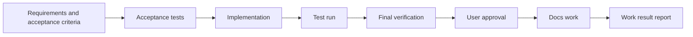
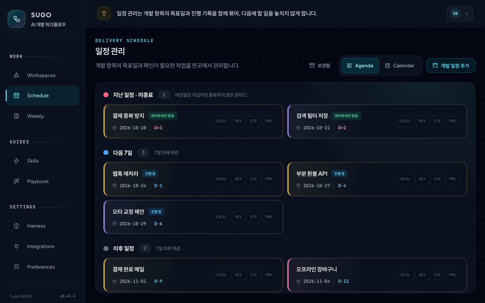

# Sugo

**A Claude Code plugin that verifies AI agent development work with execution evidence**

[한국어](README.md)

Sugo runs each feature in this order: requirements and acceptance criteria → implementation → tests → final verification → user approval → docs work → work result report. Each step moves on only after Sugo checks the real test run records and the changed files. A person gives the final approval after reading the diff.


## Problems it solves

| Problem | What Sugo does |
| --- | --- |
| The agent reports done without tests | No recorded test run, no next step |
| The agent edits files outside the request | Each step has a limited scope. The test agent edits only tests. The docs agent edits only docs |
| Approval from a summary only | You approve after you see requirement status, test results, open risks, and the diff on one screen |
| The reasoning disappears when the session ends | Specs, design decisions, work results, and later patches stay connected in one history |
| Claude and Codex follow different rules | Both agents read the same rule files |
| The same mistake comes back | Rules that you add as Console domain rules apply to all agents from the next session |

## When to use it

| Goal | Feature |
| --- | --- |
| Feature work with evidence | `/sugo:feat` |
| Team coding rules and prevention rules | Harness (project coding rule set), Console domain rules, `/sugo:checkpoint-sync` |
| Turn a planning draft into an implementable spec and schedule it | Console Schedule, `/sugo:spec-writer` |
| Connect a later fix to the original task | `/sugo:patch` |
| Connect changes from a normal chat to an existing task | `/sugo:patch-attach` |
| Review results and learnings | Console Home learning notes, Console Weekly reports |

Do not use it for one-line fixes or throwaway experiments. Use a normal chat, and connect only the changes you keep with `/sugo:patch-attach`.

## Getting started

### Requirements

- Claude Code or the Codex app
- Git
- Node.js 22.5 or later. The Console uses `node:sqlite`. With an older Node, only the Console does not start.

### Install

```bash
claude plugin marketplace add kim-svadoz/sugo
claude plugin install sugo@sugo-marketplace
```

In Claude Code, run `/reload-plugins`, then `/sugo:version`. No build or `npm install` is necessary.

- Update: `claude plugin update sugo@sugo-marketplace`, then `/reload-plugins`. If the Console is off, run `/sugo:console start`.
- Codex app: add `https://github.com/kim-svadoz/sugo.git` as a plugin marketplace and turn on `sugo`. Codex provides the `/sugo:...` commands as skills.

### First feature

Use absolute paths.

```text
/sugo:ws-add payments
/sugo:add /path/to/payment-api payments
/sugo:feat --project /path/to/payment-api Lock the account for 10 minutes after 5 failed logins
```

| Command | Action |
| --- | --- |
| `/sugo:ws-add` | Creates a workspace (domain). A domain is a group of projects in one business area. Example: the `payments` domain holds a payment API, a settlement batch, and an admin UI. Domain rules, schedules, and work history belong to the domain. |
| `/sugo:add` | Registers a project in a domain. It detects the language, framework, and build tool and installs the harness. |
| `/sugo:feat` | Runs one feature through the flow below. |



1. Requirements and acceptance criteria: Sugo writes the request as a PRD and sets acceptance criteria for each requirement. Out-of-scope work is removed here.
2. Acceptance tests: when needed, Sugo writes the acceptance criteria as contract tests first and confirms that they fail. A baseline locks existing behavior that must not change.
3. Implementation and test run: `code-agent` implements. `test-agent` runs the tests and records the results.
4. Final verification: `review-agent` (read-only) checks rule violations and security and prepares the verification material.
5. User approval: a person reads the verification material and the diff in the Console and approves each requirement.
6. Docs work: `docs-agent` updates the project docs for the change.
7. Work result report: Sugo saves the change summary, design decisions, open risks, and test evidence to `work-result.md`. The next patch and the Weekly report use this history. On `feature/*` branches, Sugo updates TODO-SPEC with done and remaining work and checks it before the commit.

If a step stops, Sugo returns the missing condition and how to fix it. Answer policy or scope questions in the Console, and the same session continues.

Done does not mean pushed. You run `git commit` and `git push`.

## How to use

Each feature produces a PRD, test records, verification material, and a work result report. Start with commands. Check and decide in the Console (`http://localhost:3001`).

| Task | Console | Command |
| --- | --- | --- |
| Prepare schedule and spec | Create a schedule in Schedule and attach planning links and screen captures | `/sugo:spec-writer` and `/sugo:feat --spec`, copied from the schedule card |
| Check progress | Home work flow: the step in progress now. Workspaces work floor: step and finished records per task | `/sugo:ws-status` |
| Human decisions | Policy and scope questions and approval requests appear in Home and Schedule | — |
| Approve | In the Agent Canvas, check requirement status, test results, open risks, and the diff | — |
| Prevent repeats | Add the rule to Workspaces domain rules | `/sugo:checkpoint-sync` writes it to `.claude/rules/` |
| Later fix | Check the history of the finished task | `/sugo:patch` |
| Weekly review | Read the weekly report and learning notes in Weekly. Set the generation schedule in Preferences | — |

Put one behavior change in each `/sugo:feat`. If a PRD is large, Sugo splits it into subtasks and integrates them.

**Check progress** · the step of the selected task, and the finished records of that task


**User approval** · read the verification result and the changed-file diff, then approve or request changes

<p>
  
  
</p>

**Prepare schedule and spec** · development schedule grouped by due date



## What installing Sugo changes

Hooks run in every Claude Code project, including projects that you did not register with Sugo.

| When | Hook | Action |
| --- | --- | --- |
| Session start | `dashboard-start` | Starts the local Console in the background |
| Session start | `agent-tools` | Applies `agents.extraTools` to Sugo agents |
| Before Bash | `aws-readonly-guard` | Blocks AWS CLI calls that write, read secrets, or exceed the budget |
| Before Write/Edit | `scope-guard` | Limits the scope of test-agent and docs-agent |
| After Edit | `lint-hint` | Sends lint failures in registered projects to Claude. Does not block edits |
| After MCP calls | `mcp-presentation` | Applies only to servers in `presentation.mcpServers`. Off by default |

- The local Console starts at `http://localhost:3001`. It accepts connections from `127.0.0.1` only. To turn it off, set `"dashboard": {"enabled": false}` in `~/.claude/sugo/settings.json`.
- Sugo writes `sugo/`, `.claude/rules/`, and a Sugo-managed block in `AGENTS.md` and `CLAUDE.md` to registered projects. Your own text stays.
- Network: Sugo sends no telemetry. The Console fetches public engineering-blog RSS feeds for Home, a web font from a CDN, and Open-Meteo only if you set a weather region.

## Commands

| Command | Purpose |
| --- | --- |
| `/sugo:feat` | Run one feature through the pipeline |
| `/sugo:patch` | Start a later fix from a finished task's `work-result.md` |
| `/sugo:patch-attach` | Verify changes from a normal chat and connect them to an existing task as a patch |
| `/sugo:add`, `/sugo:ws-add` | Register a project, create a workspace (domain) |
| `/sugo:status`, `/sugo:ws-list`, `/sugo:ws-status` | Show status and where to resume |
| `/sugo:overview` | Analyze project structure (AST) |
| `/sugo:spec-writer` | Write `spec.md` from a Schedule draft |
| `/sugo:validate` | Check the project against its rules |
| `/sugo:checkpoint-sync` | Copy Console domain rules to `.claude/rules/` |
| `/sugo:console` | Local Console `status`, `start`, `restart`, `stop` |
| `/sugo:version` | Show the installed version |
| `/sugo:uninstall`, `/sugo:restore`, `/sugo:purge`, `/sugo:fresh-start` | Remove, restore, delete |

Arguments are defined in [`sugo/commands/`](sugo/commands/).

## Console

`http://localhost:3001`. It starts with each new Claude Code session.

| Screen | Content |
| --- | --- |
| Home | Work flow, work to continue and approval requests, recent finished work and learning notes, engineering-blog feed |
| Workspaces | Projects, domain rules, and history per domain; step per task; Agent Canvas (task graph, patch history, approval evidence, diff) |
| Schedule | Spec schedule, planning links and memos, deployment state |
| Weekly | Weekly reports and learning notes |
| Skills, Playbook | Agents, commands, and skills; usage scenarios |
| Harness | Coding rules for your projects |
| Integrations | Git providers, AWS, Pinpoint, plugin API tokens |
| Preferences | Display name, weather region, Weekly generation schedule (day and time, Claude model, extra repositories, scheduled-run token) |

The Home work flow shows the steps from spec to commit in one row. When an activity event arrives, the current step is selected, and the right panel shows what that step does and what it hands on. The cards below open the Harness, domain, and Weekly screens.

The Workspaces work floor shows each task in progress in a domain as its own lane. When you select a lane, the recent work summary below changes to the finished records of that task.

Console data is in `~/.claude/sugo/dashboard/` and stays after updates. If the Console is off, the pipeline continues and sends sync data later.

## Configuration

Set personal settings as optional keys in `~/.claude/sugo/settings.json`. A missing key turns the feature off.

| Key | Action |
| --- | --- |
| `dashboard` | Console connection (`enabled`, `apiUrl`, `userId`, `apiToken`). Set automatically for the local Console |
| `agents.extraTools` | Extra MCP tools for Sugo agents. Example: `["mcp__team-knowledge__search"]` |
| `aws.environments` | Maps environment names (example: `dev`) to AWS account names registered in the Console |
| `presentation.mcpServers` | MCP servers whose results Claude explains in STE-based Korean |

Integrations are optional.

- Git providers (GitHub, GitLab, Bitbucket Server, CodeCommit): used for PR context.
- AWS: uses the local AWS CLI profile and stores resource metadata only. The default direct-read budget is 30 per session, 200 per day, and 10 per minute. If you turn off direct reads in Integrations, all AWS CLI calls from agents are blocked.

## Uninstall and data

Data stays until you ask to delete it.

| Command | Project | Sugo data |
| --- | --- | --- |
| `/sugo:uninstall` | Removes Sugo blocks, rules, hooks. Keeps your text | Archived in `~/.sugo/data`. Not restored on reinstall |
| `/sugo:restore` | Restores archived links | Used again |
| `/sugo:fresh-start` | — | Deletes the archive and registers again |
| `/sugo:purge` | Removes Sugo blocks, rules, hooks | Deletes everything |

If you deleted the plugin cache first, run `node ~/.sugo/bin/sugo-uninstall.mjs uninstall` (or `purge`).

| Location | Content |
| --- | --- |
| `<project>/sugo/` | Applied rules, config, per-feature PRDs and work result reports |
| `<project>/.claude/rules/` | Harness coding rules, Console domain rules |
| `~/.claude/sugo/` | Registry, sessions, workspaces, specs, settings, Console data |
| `~/.sugo/` | Archived data, standalone uninstaller |

## Supported stacks

Java, JavaScript, TypeScript, Python · Spring, Node, Express, React, Next.js · Gradle, Maven, npm, pnpm, Yarn, pip, Poetry. Other stacks use the default rules. Rule sources: [`sugo/harness-library/`](sugo/harness-library/).

## Troubleshooting

| Symptom | Fix |
| --- | --- |
| `localhost:3001` does not respond | `/sugo:console status`, then `/sugo:console start` |
| Behavior is old after an update | `/reload-plugins`, then check `/sugo:version` |
| Finished work is not in the Console | Ask the agent to call `sugo_status` with `health: true` and check connection and sync errors |
| Old work is missing after a reinstall | Expected. Run `/sugo:restore`, or `/sugo:fresh-start` to start over |

## More

- [Changelog](CHANGELOG.md) (Korean)
- [Contributing](CONTRIBUTING.md) (Korean)
- [MIT License](LICENSE)
