# Sugo

[](LICENSE)  

[한국어](README.md)

AI agents now take a lot of the legwork out of development. That also means each developer takes on more, and handing several tasks to AI at the same time has become normal. The more you hand off, the more you need to set and manage the standard that AI-written code has to meet.

Sugo (from 수고, Korean for the legwork a job takes) is a Claude Code plugin that manages that standard. It keeps a harness of coding rules for your stack and team, attaches contract tests to each requirement, and checks results against real build and test runs such as Gradle or npm, while security hooks block risky commands such as unchecked API calls, write commands, and secret reads before they run. The aim is an AI agent that you and your organization can trust with the work. With the Sugo Console that comes with it, you see every task running in parallel in one place and put more of your energy into the decisions that are yours.


## Contents

- [Why Sugo](#why-sugo)
- [How it works](#how-it-works)
- [Quick start](#quick-start)
- [Console guide](#console-guide)
- [Console tour](#console-tour)
- [Commands](#commands)
- [What installing Sugo changes](#what-installing-sugo-changes)
- [Reference](#reference)
- [Design philosophy](#design-philosophy)

## Why Sugo

| Common problem | What Sugo does |
| --- | --- |
| AI-written code is hard to keep to your team's standard | Agents read the coding rules for your stack (the harness) and the business rules your team set before they work, and review catches violations |
| It is hard to tell whether every requirement was built | Each requirement gets acceptance criteria and tests that check them, and you see which requirements are met |
| You end up re-running builds and tests yourself | Sugo records real build and test runs such as Gradle or npm and decides the next step from those records |
| Risky commands can run unchecked | Security hooks block commands that change AWS resources, secret reads, and edits outside an agent's scope before they run |
| Running many tasks at once makes progress easy to lose | The Console shows progress, blockers, and approval requests per business area on one screen |
| The reasoning disappears when the session ends | Specs, design decisions, work results, and later fixes stay in one history |
| Claude and Codex follow different rules | Both agents read the same rule files |
| The same mistake comes back | A mistake you record as a rule is followed by every agent from the next session |

## How it works

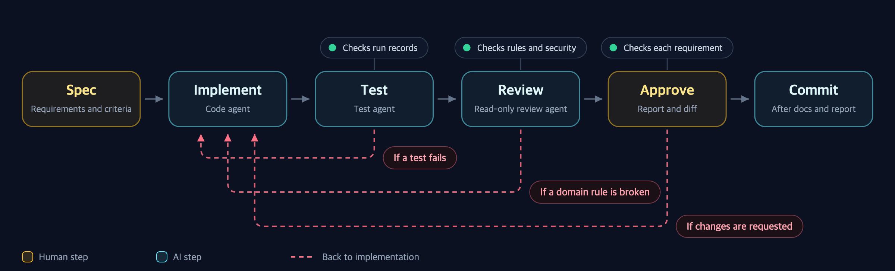

A person sets the spec. AI agents implement, test, and review. A person approves the result, and Sugo commits. If a test fails, review finds a rule violation, or the person requests changes, the work goes back to implementation.

Seen as roles, this flow is a loop of Planner, Executor, and Validator (PEV). The Claude session you are talking to splits the spec into steps that can be checked (Planner), code-agent and test-agent do the work (Executor), and whether it passes is decided not by the AI grading itself but by real build and test records, a read-only review, and human approval (Validator).

The reason stays as a sentence at the top of the **spec card** in the Console (the local screen Sugo runs). A spec card collects the status and history of one spec.

**A failing test sends the work back to implementation.** A task with 2 of 26 tests failing is not reported as done.

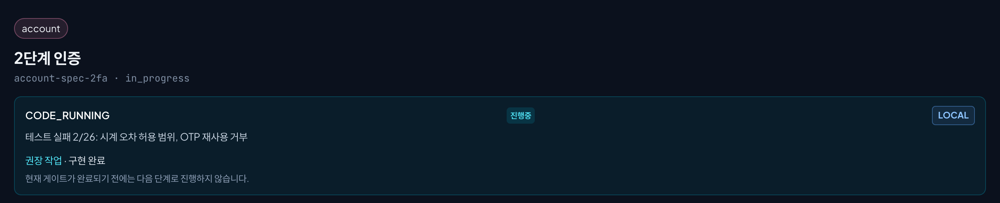

**Review catches a rule violation.** Even with every test passing, code that uses `double` against the rule "compute money only as a whole number (long)" goes back to implementation.

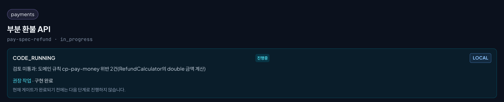

**A person approves at the end.** Open the review report and the changed-file diff, then approve or write what to change and request changes.

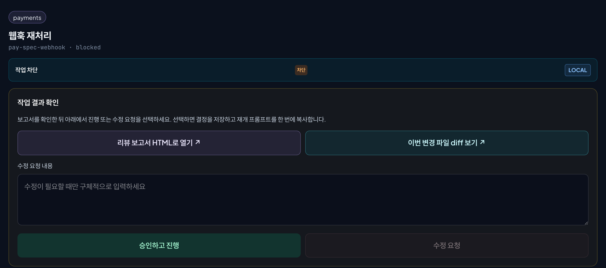

<details>
<summary>The seven steps one feature takes from spec to commit</summary>

When you hand over a feature, the work goes through the seven steps below in order. A step starts only after the one before it is done, and if a test fails, review finds a rule violation, or a person requests changes in steps 3 to 5, the work goes back to step 2.

| Step | Who | What happens |
| --- | --- | --- |
| 1. Spec | You and the Claude session | The request becomes a spec (`spec.md`). Each requirement gets acceptance criteria, unclear points are settled by asking you, and out-of-scope work is removed. A large spec is split into subtasks. For a big change such as a JDK upgrade, a baseline of passing existing tests and contract tests that still fail are recorded here first |
| 2. Implement | code-agent | Changes the code within the spec |
| 3. Test | test-agent | Writes and runs tests from the spec, not from the implementation, and records the command and exit code. It edits only test files |
| 4. Review | review-agent | Reads without editing and looks for harness and domain rule violations and security problems. When review ends, the change summary, design decisions, open risks, and test evidence are saved to `work-result.md` |
| 5. Approve | You | Read the review report and diff on the spec card in the Console, then approve each requirement or send it back with what to fix. Answer policy or scope questions here too, and the same session continues |
| 6. Docs | docs-agent | Updates the project docs to match the change |
| 7. Commit | Sugo | Makes the commit. The commit message has no AI co-author line |

</details>

## Quick start

### 1. Requirements

- Claude Code or the Codex app
- Git
- Node.js 22.5 or later: the Console uses `node:sqlite`. With an older Node, only the Console does not start.
- Python 3.12 or later: only Weekly report generation needs it.

### 2. Install

```bash
claude plugin marketplace add kim-svadoz/sugo
claude plugin install sugo@sugo-marketplace
```

In Claude Code, run `/reload-plugins`, then `/sugo:version`. No build or `npm install` is necessary.

- **Update:** `claude plugin update sugo@sugo-marketplace`, then `/reload-plugins`
- **Codex app:** add `https://github.com/kim-svadoz/sugo.git` as a plugin marketplace and turn on `sugo`. Codex provides the `/sugo:...` commands as skills.

### 3. First feature

```text
/sugo:ws-add payments
/sugo:add /path/to/payment-api payments
/sugo:feat --project /path/to/payment-api Lock the account for 10 minutes after 5 failed logins
```

| Command | Action |
| --- | --- |
| `/sugo:ws-add` | Creates a domain. A domain is a group of projects in one business area. Example: the `payments` domain holds a payment API, a settlement batch, and an admin UI |
| `/sugo:add` | Registers a project in a domain. It detects the language, framework, and build tool and installs the coding rules for that stack (the harness) |
| `/sugo:feat` | Runs one feature from spec to commit |

Use absolute paths. Put one behavior change in each `/sugo:feat`; if a spec is large, Sugo splits it into subtasks and integrates them.

## Console guide

The Console (`http://localhost:3001`) starts with each new Claude Code session. First register your projects and connect the external services you use, then start work from a schedule and a spec.

### 1. Register projects and domains

In **Integrations → 프로젝트**, choose a project folder, put it in an existing domain or create a new one, and select **프로젝트 등록**. Registration detects the stack and installs the matching harness automatically. It is the same registration as `/sugo:ws-add` and `/sugo:add` in the terminal.

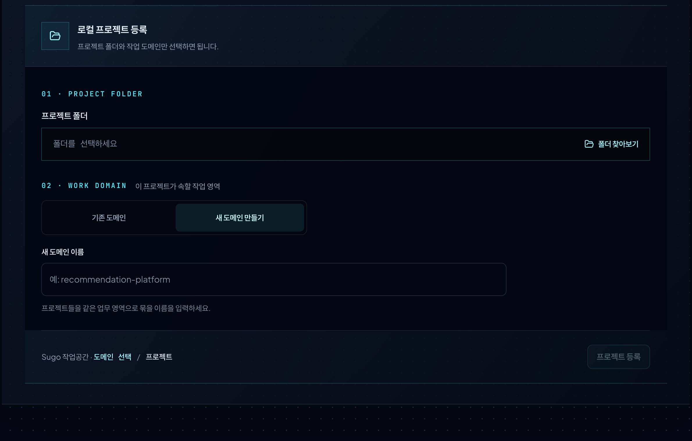

### 2. Connect external services

In **Integrations → 외부 서비스**, connect only what you need. Every integration is optional and read-only.

**AWS accounts.** Enter an environment name (example: DEV), choose a local AWS CLI profile and a region, then select **환경 연결**. Keys are not stored. Drag environments to reorder them; the order becomes the deployment state shown in Schedule (LOCAL → DEV → STG → PRD). **AWS 전체 동기화** fetches service lists such as ECS and pipelines.

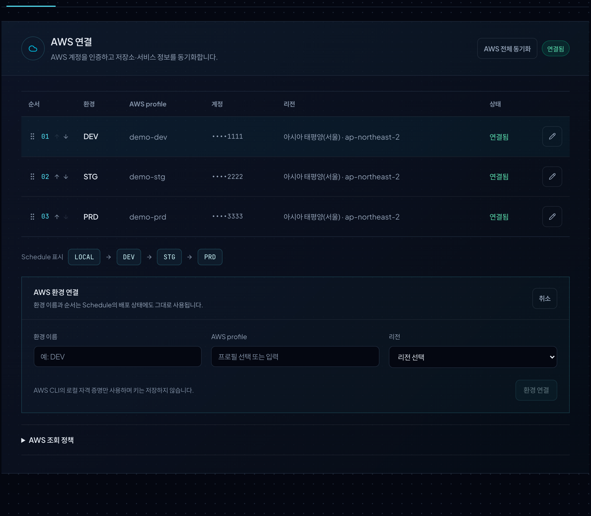

**PR integration.** GitHub uses an access token; AWS CodeCommit uses your AWS CLI or SSO login. The token is used only to check branches and read or create PRs. Commit and push use your local Git credentials.

**Service status.** Choose a project and add its running services per environment from the synced list. Connected services appear in the Inspector on the right of Workspaces and in Schedule deployment state.

**Monitoring.** Enter a Pinpoint address to read application status and performance from the last 5 minutes.

| PR integration | Service status | Monitoring |
| --- | --- | --- |
| 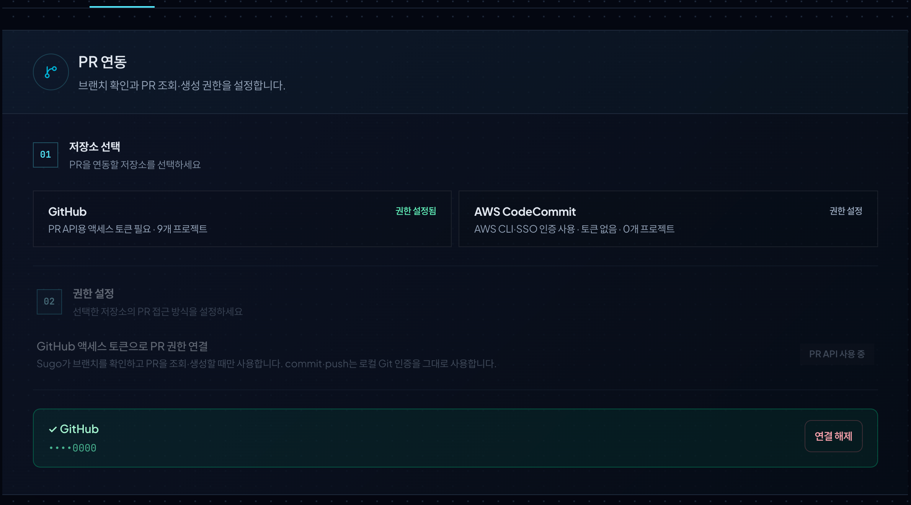 | 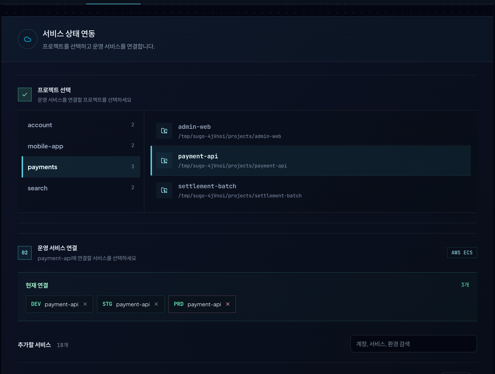 | 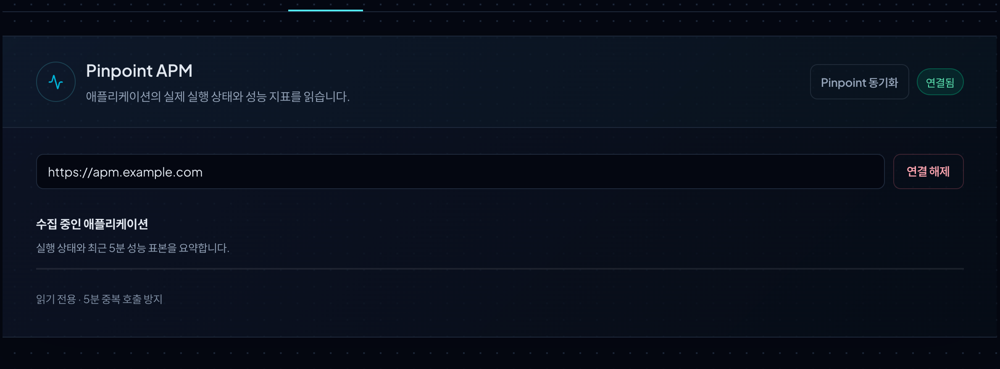 |

See the result per project in **Integrations → 연결 현황**.


### 3. Schedule and spec

In **Schedule → 개발 일정 추가**, set the title, domain, project, and due date, and write a SPEC draft. Describe the problem, goal, scope, and acceptance criteria freely, and paste screen captures from your planning.

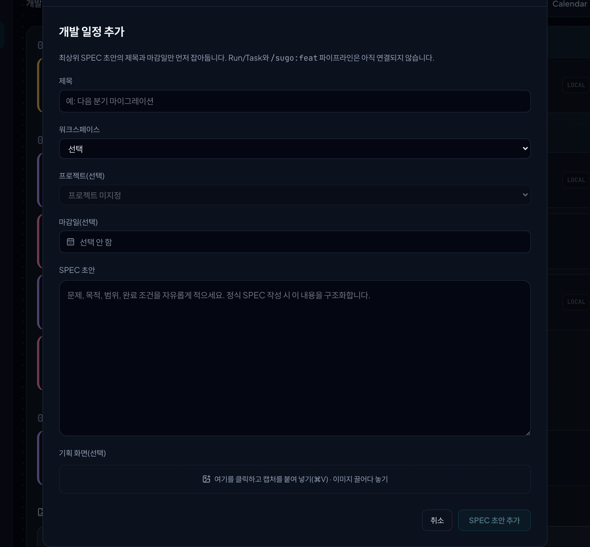

Open the schedule card to attach more planning links and captures. Choose the agent (Claude or Codex), select **SPEC 작성 명령 복사**, and paste it in the terminal to turn the draft into a buildable spec. When the spec is ready, copy the command with **feat 시작** to start development.

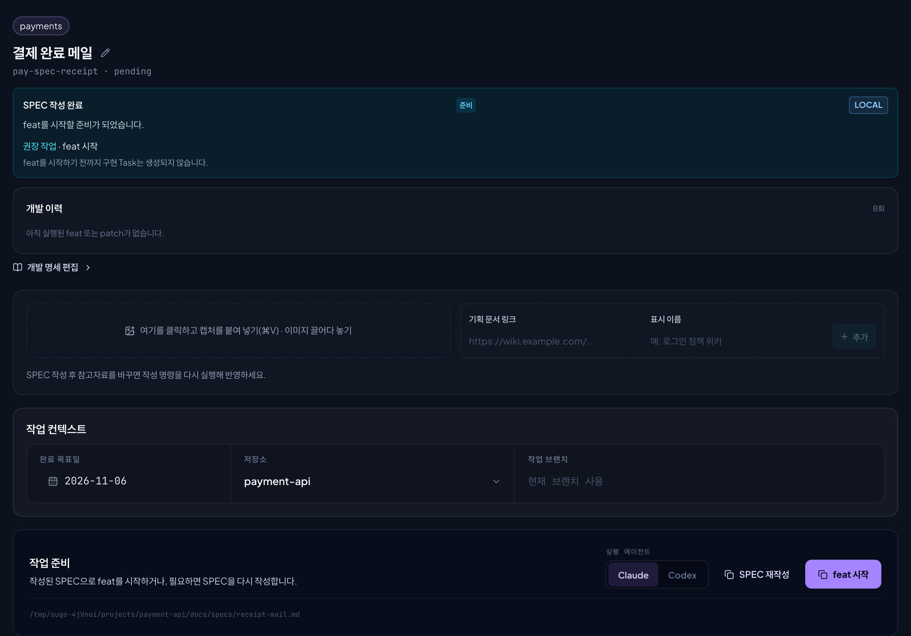

### 4. Follow progress and approve

Follow running work on the Workspaces work floor and the spec card. When a person needs to confirm something, an approval request appears in Home and Schedule; read the review report and diff on the spec card, then approve or request changes. To change a finished task later, select **새 Patch 시작** on the spec card and the work continues in the same history.

Small work such as a one-line fix or an experiment does not need a spec; handle it in a normal chat. For the changes you want to keep, `/sugo:patch-attach` verifies them and attaches them to an existing task as a patch, so the history stays in one piece.

### 5. Domain rules

In **도메인 규칙 관리** on a domain card, write a new rule with a folder, a name, and Markdown content. A rule applies to the whole domain or to one project, and `/sugo:checkpoint-sync` writes it to `.claude/rules/` in each project. Claude Code and Codex read these rules before they work.

| Rules | New rule |
| --- | --- |
| 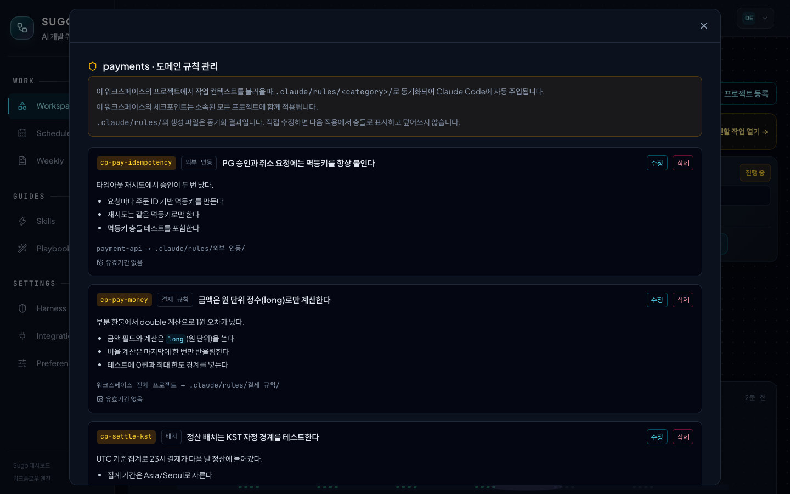 | 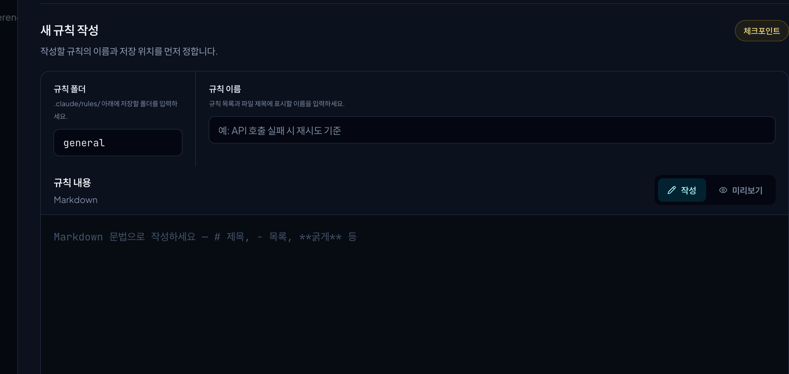 |

### 6. Harness

In **Harness**, choose a technology and version to see Sugo's default coding rules. Select **내 규칙으로 수정** to adapt them to your team and save; they become the project's verification standard from the next sync.

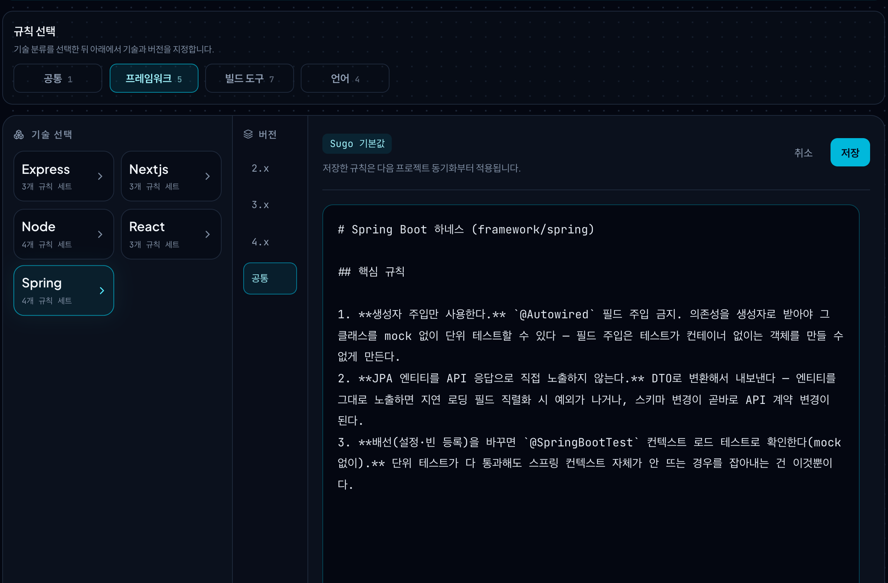

### 7. Weekly

In **Preferences → 주간 리포트**, set the day and time, the Claude model, extra repositories, and the Claude token for scheduled runs. The Console builds the weekly report and learning notes on that schedule; run `/sugo:weekly` to build one now.


## Console tour

### Home

Home shows the work to continue today and the work waiting for your decision first. The work flow separates human steps from AI steps, and below it collect review notes from recent finished work and new posts from engineering blogs.


### Workspaces

One screen shows what each domain is doing and how far it has gone.

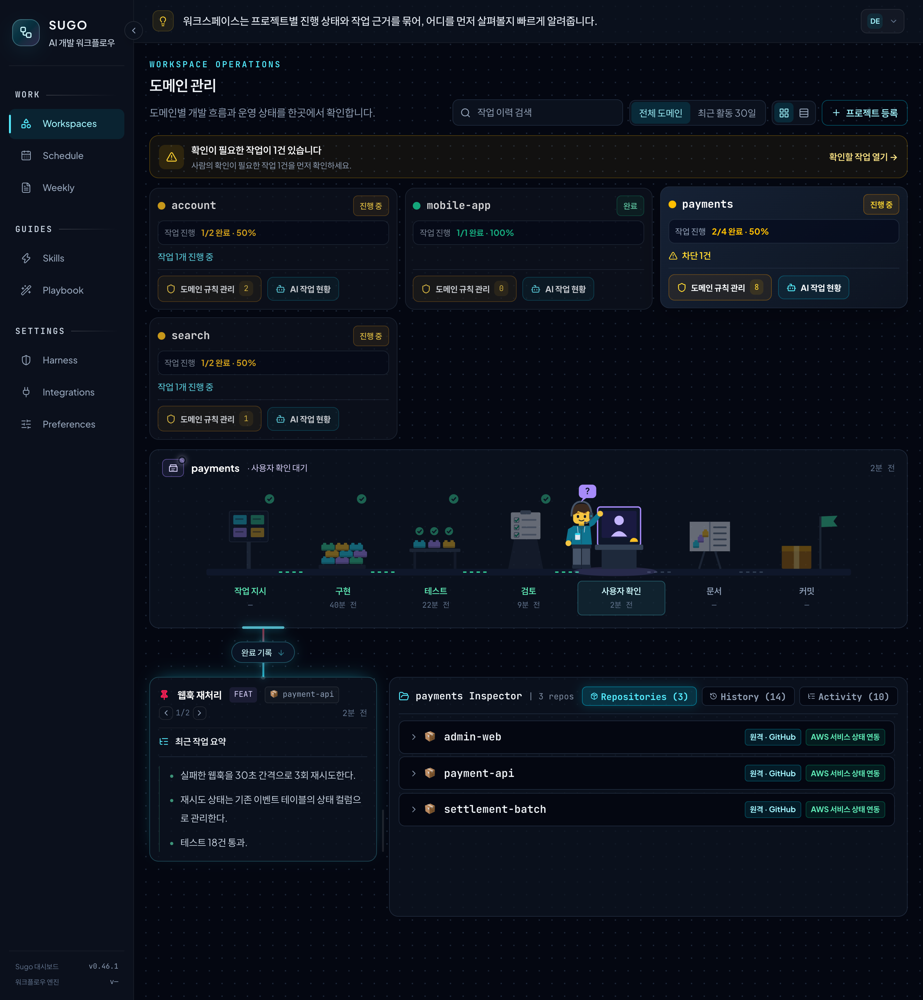

- **Domain cards:** progress, blocked tasks, and the number of rules per domain.
- **Work floor:** shows which step the worker is on now. When a person needs to confirm something, the worker raises a question mark and waits.
- **Recent work summary:** the title and finished result of the selected task.
- **Inspector:** the domain's repositories and integrations, finished history (History), and the step records of the task (Activity).

### Schedule and development history

The Schedule Agenda shows today, the next 7 days, and later work. A spec card shows its development history from the first implementation (FEAT) through every patch.

| Agenda | Development history and follow-up |
| --- | --- |
| 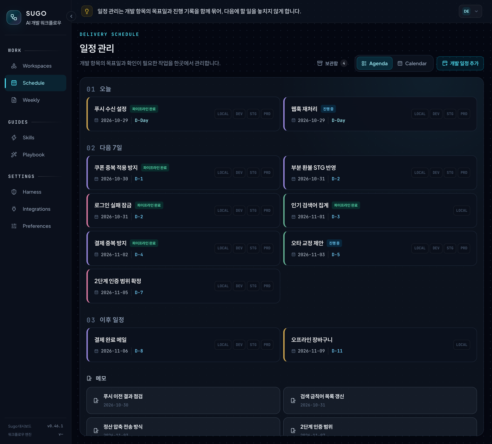 | 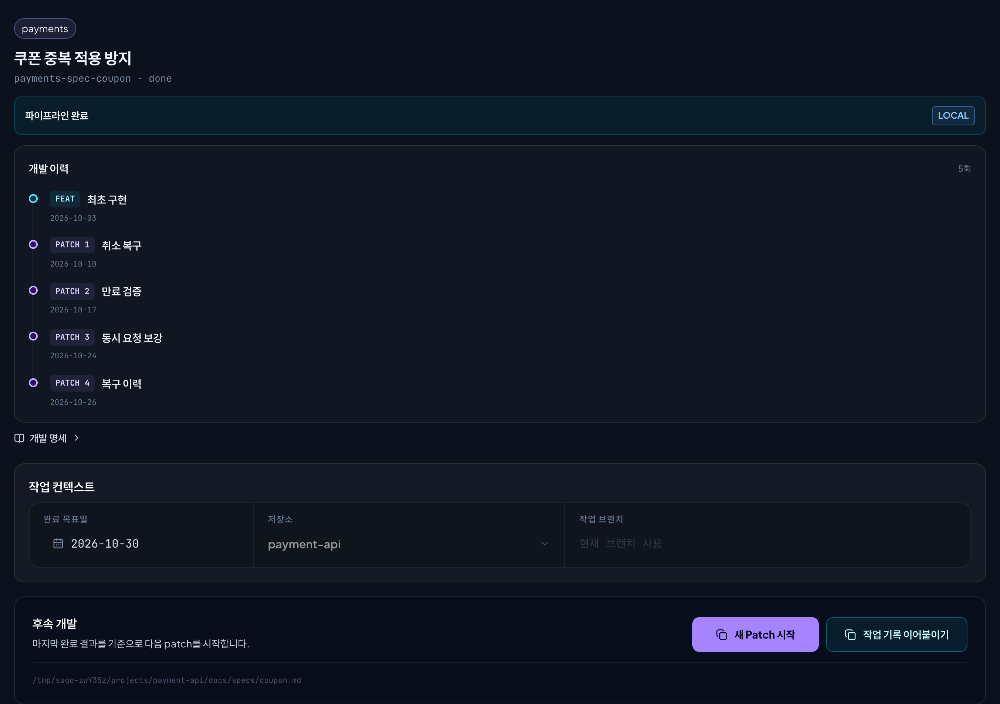 |

The other screens, such as Weekly, Calendar, and diff, are covered in the [Console tour](docs/console.en.md).

## Commands

| Command | Purpose |
| --- | --- |
| `/sugo:feat` | Run one feature from spec to commit |
| `/sugo:patch` | Start a later fix from a finished task's `work-result.md` |
| `/sugo:patch-attach` | Verify changes from a normal chat and connect them to an existing task as a patch |
| `/sugo:add`, `/sugo:ws-add` | Register a project, create a domain |
| `/sugo:status`, `/sugo:ws-list`, `/sugo:ws-status` | Show status and where to resume |
| `/sugo:spec-writer` | Write a spec (`spec.md`) from a Schedule draft |
| `/sugo:checkpoint-sync` | Copy Console domain rules to `.claude/rules/` |
| `/sugo:validate` | Check the project against its rules |
| `/sugo:overview` | Analyze project structure (AST) |
| `/sugo:weekly` | Build the weekly report and learning notes now |
| `/sugo:console` | Local Console `status`, `start`, `restart`, `stop` |
| `/sugo:version` | Show the installed version |
| `/sugo:uninstall`, `/sugo:restore`, `/sugo:purge`, `/sugo:fresh-start` | Remove, restore, delete |

Arguments are defined in [`sugo/commands/`](sugo/commands/).

## What installing Sugo changes

> [!IMPORTANT]
> Hooks run in every Claude Code project, including projects that you did not register with Sugo. Sugo sends no telemetry.

<details>
<summary>Hooks, Console, project files, network</summary>

| When | Hook | Action |
| --- | --- | --- |
| Session start | `dashboard-start` | Starts the local Console in the background |
| Session start | `agent-tools` | Applies `agents.extraTools` to Sugo agents |
| Before Bash | `aws-readonly-guard` | Blocks AWS CLI calls that write, read secrets, or exceed the budget |
| Before Bash | `commit-body` | Makes Claude add a body when it commits without one. Weekly reads the purpose of work from commit bodies. Turn off with `WEEKLY_COMMIT_BODY=off` |
| Before Write/Edit | `scope-guard` | Limits the scope of test-agent and docs-agent |
| After Edit | `lint-hint` | Sends lint failures in registered projects to Claude. Does not block edits |
| After MCP calls | `mcp-presentation` | Applies only to servers in `presentation.mcpServers`. Off by default |

- **Console:** starts at `http://localhost:3001` and accepts connections from `127.0.0.1` only. To turn it off, set `"dashboard": {"enabled": false}` in `~/.claude/sugo/settings.json`.
- **Project files:** Sugo writes `sugo/`, `.claude/rules/`, and a Sugo-managed block in `AGENTS.md` and `CLAUDE.md` to registered projects. Your own text stays.
- **Network:** the Console fetches public engineering-blog RSS feeds for Home and a web font from a CDN, and calls Open-Meteo only if you set a weather region.
- **Weekly:** the Console builds the weekly report on the schedule in Preferences. One build calls `claude -p` twice. Data is in `~/.weekly/`.

</details>

## Reference

<details>
<summary>Configuration and integrations</summary>

Set personal settings as optional keys in `~/.claude/sugo/settings.json`. A missing key turns the feature off.

| Key | Action |
| --- | --- |
| `dashboard` | Console connection (`enabled`, `apiUrl`, `userId`, `apiToken`). Set automatically for the local Console |
| `agents.extraTools` | Extra MCP tools for Sugo agents. Example: `["mcp__team-knowledge__search"]` |
| `aws.environments` | Maps environment names (example: `dev`) to AWS account names registered in the Console |
| `presentation.mcpServers` | MCP servers whose results Claude explains in plain Korean |

Integrations are optional.

- **Git providers** (GitHub, GitLab, Bitbucket Server, CodeCommit): used for PR context.
- **AWS:** uses the local AWS CLI profile and stores resource metadata only. The default direct-read budget is 30 per session, 200 per day, and 10 per minute. If you turn off direct reads in Integrations, all AWS CLI calls from agents are blocked.

</details>

<details>
<summary>Uninstall and data</summary>

Data stays until you ask to delete it.

| Command | Project | Sugo data |
| --- | --- | --- |
| `/sugo:uninstall` | Removes Sugo blocks, rules, hooks. Keeps your text | Archived in `~/.sugo/data`. Not restored on reinstall |
| `/sugo:restore` | Restores archived links | Used again |
| `/sugo:fresh-start` | — | Deletes the archive and registers again |
| `/sugo:purge` | Removes Sugo blocks, rules, hooks | Deletes everything |

If you deleted the plugin cache first, run `node ~/.sugo/bin/sugo-uninstall.mjs uninstall` (or `purge`).

| Location | Content |
| --- | --- |
| `<project>/sugo/` | Applied rules, config, per-feature specs and work result reports |
| `<project>/.claude/rules/` | Harness coding rules, Console domain rules |
| `~/.claude/sugo/` | Registry, sessions, domains, specs, settings, Console data |
| `~/.sugo/` | Archived data, standalone uninstaller |
| `~/.weekly/` | Weekly settings, weekly reports, scheduled-run token. The uninstall commands do not delete it |

</details>

<details>
<summary>Supported stacks</summary>

| Type | Supported |
| --- | --- |
| Languages | Java, JavaScript, TypeScript, Python |
| Frameworks | Spring, Node, Express, React, Next.js |
| Build tools | Gradle, Maven, npm, pnpm, Yarn, pip, Poetry |

Other stacks use the default rules. Rule sources: [`sugo/harness-library/`](sugo/harness-library/).

</details>

<details>
<summary>Troubleshooting</summary>

| Symptom | Fix |
| --- | --- |
| `localhost:3001` does not respond | `/sugo:console status`, then `/sugo:console start` |
| Behavior is old after an update | `/reload-plugins`, then check `/sugo:version` |
| Finished work is not in the Console | Ask the agent to call `sugo_status` with `health: true` and check connection and sync errors |
| Old work is missing after a reinstall | Expected. Run `/sugo:restore`, or `/sugo:fresh-start` to start over |

</details>

## Design philosophy

> An agent is an LLM that calls tools in a loop. Producing code has become fast, and most of the time now goes into verifying it. Sugo started from splitting that loop into Planner, Executor, and Validator, and from leaving verification to the loop rather than to a person's gut feeling.
>
> - **The model does not do it all. The harness does.** Put your stack and team rules in the context, and the model follows your rules instead of whatever was most common in its training data. The same task gives the same result without a long "please do better this time" prompt every session.
> - **Failures become assets.** A mistake you hit once becomes a domain rule, and design decisions stay in the work report, so both become context for the next session. The next task gets better without retraining the model.
>
> Trust is not built in one shot; the loop builds it. Developer work is moving from writing code line by line toward designing loops of exploration and verification, and Sugo saves you from building that loop from scratch every time.

### Four things that keep an agent from falling apart

Agents usually fall apart in the same few ways. They circle the same spot, believe they fixed something they did not, overflow their context, or make a hard-to-undo decision alone. Sugo answers each one.

| Principle | In Sugo |
| --- | --- |
| Stopping is decided from outside | When tests fail, test-agent hands the work back to code-agent at most three times, and the Console shows how many times it did so alongside the reason work stopped. This limit comes from the agent instructions, so the server does not enforce it |
| No one grades their own work | Test results are recorded as the command that ran and its exit code, and a claim that does not match the record is rejected. Review is done by review-agent, which cannot edit files |
| Each role gets its own context | The code, test, review, and docs agents each work in their own context and pass only results to the next agent, so one agent's mistake does not spread to the next step |
| Expensive decisions stay with people | A person approves before the commit, and pushes it themselves |

### Evaluation and safety

The rule for evaluation is to build the evaluation set first and generate later. In Sugo, contract tests are that set. Before code-agent starts, the orchestrator writes tests from the requirements and runs them to record a failure (red), and once the work is done, test-agent runs the same tests to record a pass (green). A test that passed from the start, or has no recorded failure, is not accepted as evidence, because a test written by looking at the implementation simply follows it. For risky changes such as a JDK upgrade, a build system change, or removing a dependency, a baseline showing the existing tests pass is recorded before anything changes. This evidence is required for those risky changes or when the project policy turns it on, and the tests stay in the repository to run as regression tests from the next task on.

code-agent making changes, builds and tests running, and the failure message going back to code-agent is an evaluator-optimizer loop. The evaluator is the build and tests, not the same model, so a failure that comes back is caught again.

Safety asks a different question from quality: whether something can slip into the path that produces the result. When untrusted input, access to sensitive data, and outside communication come together in one tool (the Lethal Trifecta), a single prompt injection can send data out. So the review step does not pass until this check (`sugo_check_lethal_trifecta`) has run, and a tool that has all three needs a written mitigation before work moves on. On the execution side, hooks are the safety box. `aws-readonly-guard` blocks writes, secret reads, and over-limit AWS calls before they run, and `scope-guard` keeps each agent inside its edit scope.

<details>
<summary>PEV self-check</summary>

Questions for checking a workflow. Any "no" marks a weak spot. Each row also shows how Sugo answers it.

| Check | Question | Sugo |
| --- | --- | --- |
| Planner | Are the steps visible outside the model, and does each step have a condition for being done? | Each requirement gets acceptance criteria and contract tests, and the Console shows the steps |
| Executor | Are tool responsibilities separated, and are results more than vague prose? | Each agent has its own tools, and test results are kept as commands and exit codes |
| Validator | Is there an outside signal that decides pass or fail, rather than self-grading? | Real build and test records, a read-only review, and human approval decide |
| Loop | Is there a stop condition, and is a person in front of hard-to-undo decisions? | A person approves before the commit, and handing work back to code-agent is capped at three times by the agent instructions, though the server does not enforce it |
| Memory | Do past mistakes stay as context for the next task? | The next session reads the domain rules and work reports |

</details>

## Links

- [Console tour](docs/console.en.md)
- [Changelog](CHANGELOG.md) (Korean)
- [Contributing](CONTRIBUTING.md) (Korean)
- [MIT License](LICENSE)
