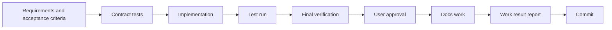
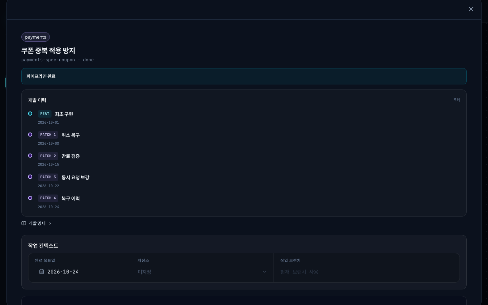
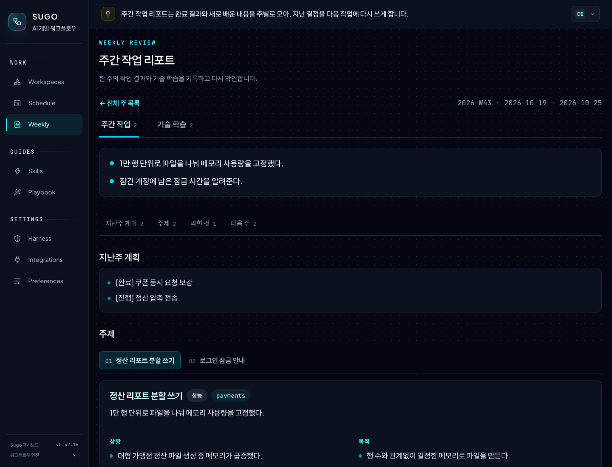

# Sugo

**A Claude Code plugin that verifies AI agent development work with execution evidence**

[한국어](README.md)

Sugo runs each feature in a fixed order. It sets requirements and acceptance criteria, implements, tests, verifies, gets a person's approval, and commits. Each step moves on only after Sugo checks the real test run records and the changed files.

> [!NOTE]
> Sugo makes the commit. You push.


## Contents

- [Problems it solves](#problems-it-solves)
- [How Sugo sees AI development](#how-sugo-sees-ai-development)
- [When to use it](#when-to-use-it)
- [Quick start](#quick-start)
- [Working in the Console](#working-in-the-console)
- [Commands](#commands)
- [Configuration and integrations](#configuration-and-integrations)
- [What installing Sugo changes](#what-installing-sugo-changes)
- [Uninstall and data](#uninstall-and-data)
- [Supported stacks](#supported-stacks)
- [Troubleshooting](#troubleshooting)

## Problems it solves

| Problem | What Sugo does |
| --- | --- |
| The agent reports done without tests | No recorded test run, no next step |
| The agent edits files outside the request | Each step has a limited scope. The test agent edits only tests. The docs agent edits only docs |
| Approval from a summary only | You approve after you see requirement status, test results, open risks, and the diff on one screen |
| The reasoning disappears when the session ends | Specs, design decisions, work results, and later patches stay connected in one history |
| Claude and Codex follow different rules | Both agents read the same rule files |
| The same mistake comes back | Rules that you add as Console domain rules apply to all agents from the next session |

## How Sugo sees AI development

> An AI agent is a fast colleague. It writes code, runs tests, and fixes docs in no time. What it doesn't know on its own is what to build, how this team works, and how far it may reach. Leave that unsaid and the output keeps piling up, but little of it can be trusted as is, and the checking falls back on people.
>
> Sugo fills that gap in three ways.
>
> **The spec comes first.** Specs are written before code (Spec-Driven Development). A planning draft in Schedule becomes a buildable spec through `/sugo:spec-writer`, and `/sugo:feat` attaches acceptance criteria to each requirement. Agents work from that spec, and verification uses the same spec.
>
> **The working environment is designed.** Rather than asking agents to do well every time, Sugo builds an environment where doing well is the natural outcome (harness engineering). Agents read the coding rules for the project stack (the harness) and the domain rules before they start, the order of steps is fixed, and a step cannot move on without execution records. Claude and Codex read the same rule files, so the standard stays the same whichever agent does the work.
>
> **Roles are split.** No single agent does everything. The main session acts as the orchestrator and sets the order. The code agent implements, the test agent touches only test files, and the docs agent touches only docs. The review agent never edits code; it reads and checks rules and security. Reports are matched against execution records instead of being taken at face value, so one agent's mistake doesn't carry into the next step.
>
> That changes what is left for people. Following the diff line by line to see whether tests really ran is already done by Sugo. People decide whether the requirements they set were met and whether the remaining risk is acceptable, then approve. Why each decision was made stays in the work result report and the domain rules, so the next task or the next person doesn't start the same thinking from scratch.

## When to use it

| Goal | Feature |
| --- | --- |
| Feature work with evidence | `/sugo:feat` |
| Team coding rules and prevention rules | Harness (project coding rule set), Console domain rules, `/sugo:checkpoint-sync` |
| Turn a planning draft into an implementable spec and schedule it | Console Schedule, `/sugo:spec-writer` |
| Connect a later fix to the original task | `/sugo:patch` |
| Connect changes from a normal chat to an existing task | `/sugo:patch-attach` |
| Review results and learnings | Console Home learning notes, Console Weekly reports |

> [!TIP]
> Do not use it for one-line fixes or throwaway experiments. Use a normal chat, and connect only the changes you keep with `/sugo:patch-attach`.

## Quick start

### 1. Requirements

- Claude Code or the Codex app
- Git
- Node.js 22.5 or later: the Console uses `node:sqlite`. With an older Node, only the Console does not start.
- Python 3.12 or later: only Weekly report generation needs it.

### 2. Install

```bash
claude plugin marketplace add kim-svadoz/sugo
claude plugin install sugo@sugo-marketplace
```

In Claude Code, run `/reload-plugins`, then `/sugo:version`. No build or `npm install` is necessary.

| Case | How |
| --- | --- |
| Update | `claude plugin update sugo@sugo-marketplace`, then `/reload-plugins`. If the Console is off, run `/sugo:console start` |
| Codex app | Add `https://github.com/kim-svadoz/sugo.git` as a plugin marketplace and turn on `sugo`. Codex provides the `/sugo:...` commands as skills |

### 3. First feature

Create a domain, register a project, and start a feature. Use absolute paths.

```text
/sugo:ws-add payments
/sugo:add /path/to/payment-api payments
/sugo:feat --project /path/to/payment-api Lock the account for 10 minutes after 5 failed logins
```

| Command | Action |
| --- | --- |
| `/sugo:ws-add` | Creates a domain (workspace). A domain is a group of projects in one business area. Example: the `payments` domain holds a payment API, a settlement batch, and an admin UI. Domain rules, schedules, and work history belong to the domain |
| `/sugo:add` | Registers a project in a domain. It detects the language, framework, and build tool and installs the harness |
| `/sugo:feat` | Runs one feature through the steps below |

### How one feature moves



1. **Requirements and acceptance criteria**: Sugo writes the request as a PRD and sets acceptance criteria for each requirement. Out-of-scope work is removed here.
2. **Contract tests**: when needed, Sugo writes the acceptance criteria as contract tests first and confirms that they fail. A baseline locks existing behavior that must not change.
3. **Implementation and test run**: `code-agent` implements. `test-agent` runs the tests and records the results.
4. **Final verification**: `review-agent` (read-only) checks rule violations and security and prepares the verification material.
5. **User approval**: a person reads the verification material and the diff in the Console and approves each requirement.
6. **Docs work**: `docs-agent` updates the project docs for the change.
7. **Work result report**: Sugo saves the change summary, design decisions, open risks, and test evidence to `work-result.md`. The next patch and the Weekly report build on this record.
8. **Commit**: when all steps pass, Sugo makes the commit. The commit message has no AI co-author line.

If a step stops, Sugo returns the missing condition and how to fix it. Answer policy or scope questions in the Console, and the same session continues.

Put one behavior change in each `/sugo:feat`. If a PRD is large, Sugo splits it into subtasks and integrates them.

## Working in the Console

Start with commands. Check and decide in the Console (`http://localhost:3001`). The Console starts with each new Claude Code session.

| Task | In the Console | Command |
| --- | --- | --- |
| Prepare schedule and spec | Create a schedule in Schedule and attach planning links and screen captures | `/sugo:spec-writer` and `/sugo:feat --spec`, copied from the schedule card |
| Check progress | See the current step on the Home work flow and the Workspaces work floor | `/sugo:ws-status` |
| Human decisions | Policy and scope questions and approval requests appear in Home and Schedule | — |
| Approve | Check requirement status, test results, open risks, and the diff, then approve | — |
| Prevent repeats | Add the rule to Workspaces domain rules | `/sugo:checkpoint-sync` |
| Later fix | Check the history of the finished task | `/sugo:patch` |
| Weekly review | Read the weekly report and learning notes in Weekly | `/sugo:weekly` |

### Schedule

Place development schedules on their due dates, and copy the spec command from the schedule card to start.


### Domains and domain rules

Group the projects of one business area into a domain, and keep the same context and conventions with domain rules.


- Each domain card shows progress, blocked tasks, and the number of domain rules.
- A domain rule applies to the whole domain or to one project. Each rule records why it exists and what to check.
- `/sugo:checkpoint-sync` writes the rules to `.claude/rules/<category>/` in each project. Claude Code and Codex read these rules before they work.

### Check progress

The Home work flow shows the steps from spec to commit in one row. Human steps and AI steps have different colors.

On the Workspaces work floor, see the current step of the selected task as a picture. The recent work summary card below shows the task title and its finished result. When a domain has more than one task, switch with the arrows on the card. The Inspector on the right shows the domain projects (Repositories), finished history (History), and the step records of the selected task (Activity).


### Approve

Read the verification result and the changed-file diff, then approve or request changes.

<p>
  
  
</p>

### Work history

A task's first implementation (FEAT) and its later patches stay in one development history. Each round records what changed and when, and the next patch starts from the latest result.



### Weekly review

Weekly collects the finished results and commit bodies of one week into a weekly report and technical learning notes. The report has last week's plan, the situation and goal of each topic, blockers, and next week's plan. Set the generation schedule in Preferences.



### Screens

| Screen | Content |
| --- | --- |
| Home | Work flow, work to continue and approval requests, recent finished work and learning notes, engineering-blog feed |
| Workspaces | Projects, domain rules, and history per domain; step per task; Agent Canvas (task graph, patch history, approval evidence, diff) |
| Schedule | Spec schedule, planning links and memos, deployment state |
| Weekly | Weekly reports and learning notes |
| Skills, Playbook | Agents, commands, and skills; usage scenarios |
| Harness | Coding rules for your projects |
| Integrations | Git providers, AWS, Pinpoint, plugin API tokens |
| Preferences | Display name, weather region, Weekly generation schedule |

Console data is in `~/.claude/sugo/dashboard/` and stays after updates. If the Console is off, the pipeline continues and sends sync data later.

## Commands

| Command | Purpose |
| --- | --- |
| `/sugo:feat` | Run one feature through the pipeline |
| `/sugo:patch` | Start a later fix from a finished task's `work-result.md` |
| `/sugo:patch-attach` | Verify changes from a normal chat and connect them to an existing task as a patch |
| `/sugo:add`, `/sugo:ws-add` | Register a project, create a domain (workspace) |
| `/sugo:status`, `/sugo:ws-list`, `/sugo:ws-status` | Show status and where to resume |
| `/sugo:overview` | Analyze project structure (AST) |
| `/sugo:spec-writer` | Write `spec.md` from a Schedule draft |
| `/sugo:validate` | Check the project against its rules |
| `/sugo:checkpoint-sync` | Copy Console domain rules to `.claude/rules/` |
| `/sugo:console` | Local Console `status`, `start`, `restart`, `stop` |
| `/sugo:weekly` | Build the weekly report and learning notes now |
| `/sugo:version` | Show the installed version |
| `/sugo:uninstall`, `/sugo:restore`, `/sugo:purge`, `/sugo:fresh-start` | Remove, restore, delete |

Arguments are defined in [`sugo/commands/`](sugo/commands/).

## Configuration and integrations

Set personal settings as optional keys in `~/.claude/sugo/settings.json`. A missing key turns the feature off.

| Key | Action |
| --- | --- |
| `dashboard` | Console connection (`enabled`, `apiUrl`, `userId`, `apiToken`). Set automatically for the local Console |
| `agents.extraTools` | Extra MCP tools for Sugo agents. Example: `["mcp__team-knowledge__search"]` |
| `aws.environments` | Maps environment names (example: `dev`) to AWS account names registered in the Console |
| `presentation.mcpServers` | MCP servers whose results Claude explains in plain Korean |

Integrations are optional.

- **Git providers** (GitHub, GitLab, Bitbucket Server, CodeCommit): used for PR context.
- **AWS**: uses the local AWS CLI profile and stores resource metadata only. The default direct-read budget is 30 per session, 200 per day, and 10 per minute. If you turn off direct reads in Integrations, all AWS CLI calls from agents are blocked.

## What installing Sugo changes

> [!IMPORTANT]
> Hooks run in every Claude Code project, including projects that you did not register with Sugo.

| When | Hook | Action |
| --- | --- | --- |
| Session start | `dashboard-start` | Starts the local Console in the background |
| Session start | `agent-tools` | Applies `agents.extraTools` to Sugo agents |
| Before Bash | `aws-readonly-guard` | Blocks AWS CLI calls that write, read secrets, or exceed the budget |
| Before Bash | `commit-body` | Makes Claude add a body when it commits without one. Weekly reads the purpose of work from commit bodies. Turn off with `WEEKLY_COMMIT_BODY=off` |
| Before Write/Edit | `scope-guard` | Limits the scope of test-agent and docs-agent |
| After Edit | `lint-hint` | Sends lint failures in registered projects to Claude. Does not block edits |
| After MCP calls | `mcp-presentation` | Applies only to servers in `presentation.mcpServers`. Off by default |

- **Console**: starts at `http://localhost:3001` and accepts connections from `127.0.0.1` only. To turn it off, set `"dashboard": {"enabled": false}` in `~/.claude/sugo/settings.json`.
- **Project files**: Sugo writes `sugo/`, `.claude/rules/`, and a Sugo-managed block in `AGENTS.md` and `CLAUDE.md` to registered projects. Your own text stays.
- **Network**: Sugo sends no telemetry. The Console fetches public engineering-blog RSS feeds for Home and a web font from a CDN, and calls Open-Meteo only if you set a weather region.
- **Weekly**: the Console builds the weekly report on the schedule in Preferences. One build calls `claude -p` twice. Data is in `~/.weekly/`.

## Uninstall and data

Data stays until you ask to delete it.

| Command | Project | Sugo data |
| --- | --- | --- |
| `/sugo:uninstall` | Removes Sugo blocks, rules, hooks. Keeps your text | Archived in `~/.sugo/data`. Not restored on reinstall |
| `/sugo:restore` | Restores archived links | Used again |
| `/sugo:fresh-start` | — | Deletes the archive and registers again |
| `/sugo:purge` | Removes Sugo blocks, rules, hooks | Deletes everything |

If you deleted the plugin cache first, run `node ~/.sugo/bin/sugo-uninstall.mjs uninstall` (or `purge`).

<details>
<summary>Where data is stored</summary>

| Location | Content |
| --- | --- |
| `<project>/sugo/` | Applied rules, config, per-feature PRDs and work result reports |
| `<project>/.claude/rules/` | Harness coding rules, Console domain rules |
| `~/.claude/sugo/` | Registry, sessions, domains, specs, settings, Console data |
| `~/.sugo/` | Archived data, standalone uninstaller |
| `~/.weekly/` | Weekly settings, weekly reports, scheduled-run token. The uninstall commands do not delete it |

</details>

## Supported stacks

| Type | Supported |
| --- | --- |
| Languages | Java, JavaScript, TypeScript, Python |
| Frameworks | Spring, Node, Express, React, Next.js |
| Build tools | Gradle, Maven, npm, pnpm, Yarn, pip, Poetry |

Other stacks use the default rules. Rule sources: [`sugo/harness-library/`](sugo/harness-library/).

## Troubleshooting

| Symptom | Fix |
| --- | --- |
| `localhost:3001` does not respond | `/sugo:console status`, then `/sugo:console start` |
| Behavior is old after an update | `/reload-plugins`, then check `/sugo:version` |
| Finished work is not in the Console | Ask the agent to call `sugo_status` with `health: true` and check connection and sync errors |
| Old work is missing after a reinstall | Expected. Run `/sugo:restore`, or `/sugo:fresh-start` to start over |

## What we learned building it

> - Using AI agents well depends more on the environment than on the prompt. The same model works far more reliably where the spec, rules, and order are in place.
> - Execution records count more than an agent's word. Instead of a "tests passed" report, the actual run result moves work to the next step.
> - Progress is counted in features. What matters is how many features are fully finished, not how many commits or PRs were added. That's why one `/sugo:feat` holds one behavior change, and later patches stay in the same history.
> - People's time goes to judgment. What a machine can check is left to the machine; people decide what to build and whether to accept the result.
> - Mistakes become rules. A problem you hit once becomes a domain rule that every agent follows from the next session on. The more you use it, the sturdier the environment gets.

## More

- [Changelog](CHANGELOG.md) (Korean)
- [Contributing](CONTRIBUTING.md) (Korean)
- [MIT License](LICENSE)
