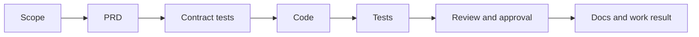

# Sugo

**A development pipeline that turns AI-written code into verified results**

[한국어](README.md)

Sugo is a Claude Code plugin. It makes an AI agent take each feature through spec → code → tests → review → docs, in order. An agent cannot move to the next step by saying "done." Sugo checks real test runs and changed files first. A person gives the final approval after reading the actual diff.

## The problem Sugo solves

AI agents write code fast. Trusting the result is the hard part.

| Common problem with AI coding | What Sugo does |
| --- | --- |
| The agent reports "done" without running tests | No recorded test run, no next step |
| The agent edits files you did not ask about | Each stage agent has a limited scope. The test agent edits only tests; the docs agent edits only docs |
| You approve based on a summary | You approve each requirement after seeing its status, test results, open risks, and the real diff on one screen |
| The reasoning disappears when the session ends | Specs, design decisions, work results, and follow-up patches stay linked as one history |
| Claude and Codex know different project rules | Both agents read the same rule files |
| The same mistake comes back every session | Write the mistake down as a checkpoint, and every agent reads it in the next session |

## When to use Sugo

| Goal | Feature |
| --- | --- |
| Get delegated features back with evidence you can review | `/sugo:feat` |
| Make every agent follow your coding and prevention rules | Harness, checkpoints, `/sugo:checkpoint-sync` |
| Turn a planning draft into an implementable spec and schedule it | Console Schedule, `/sugo:spec-writer` |
| Keep fixes to finished work linked to the original task | `/sugo:patch` |
| Verify and record changes you already made in a normal chat | `/sugo:patch-attach` |
| Look back at what you learned from each day's work | Console Home learning notes, [weekly](https://github.com/kim-svadoz/weekly-ai-report) reports |

**When not to use it:** for a one-line fix or throwaway experiment, the process is too heavy. Use a normal chat, and attach the change later with `/sugo:patch-attach` if you need to keep it.

## Getting started

### Requirements

- Claude Code (or the Codex app)
- Git
- Node.js 22.5 or later. The Console needs `node:sqlite`. With an older Node, the Console does not start, but the pipeline still works.

### Install

```bash
claude plugin marketplace add kim-svadoz/sugo
claude plugin install sugo@sugo-marketplace
```

In Claude Code, run `/reload-plugins`, then `/sugo:version`. No build or `npm install` is needed.

- **Update:** `claude plugin update sugo@sugo-marketplace`, then `/reload-plugins`. If the Console is not running afterward, run `/sugo:console start`.
- **Codex app:** add `https://github.com/kim-svadoz/sugo.git` as a plugin marketplace and turn on `sugo`. Codex provides the `/sugo:...` commands as skills.

### Your first feature

Use absolute paths.

```text
/sugo:ws-add my-workspace
/sugo:add /path/to/my-service my-workspace
/sugo:feat --project /path/to/my-service Lock the account for 10 minutes after 5 failed logins
```

`/sugo:add` detects the language, framework, and build tool and installs matching coding rules. From `/sugo:feat` on, Sugo drives the work.



1. Sugo writes the request as a PRD with separate requirements (REQs).
2. When needed, it records a baseline of current behavior and writes contract tests first. A contract test must fail (red) before implementation starts.
3. `code-agent` implements. `test-agent` runs the tests and records the result.
4. `review-agent` (read-only) checks rule violations and security and prepares the review.
5. You approve each requirement in the Console.
6. `docs-agent` updates documentation and writes `work-result.md`.

If a stage stops, Sugo tells you the missing condition and how to fix it. Questions only a person can answer, such as policy or scope, wait in the Console. Answer there and the same session continues.

**Done does not mean pushed.** Sugo can write the commit message, but you run `git commit` and `git push`.

## Using Sugo well

- **Keep features small.** Put one behavior change in each `/sugo:feat`. If a PRD is large, Sugo splits it into subtasks and integrates them.
- **Write the spec first when you have one.** Put the draft and planning links in Console Schedule, run `/sugo:spec-writer` to make `spec.md`, then start with `/sugo:feat --spec`. The planning intent carries through to requirements and tests.
- **Approve from the diff.** The work summary is a starting point. Check the real code in the Agent Canvas changed-files view.
- **Turn repeated mistakes into rules.** Add them to the workspace domain rules in the Console and run `/sugo:checkpoint-sync`. Claude and Codex both read them from the next session.
- **Use `/sugo:patch` to change finished work.** Starting a new feature breaks the link to the original task.
- **Use `/sugo:ws-status` to find where to resume** after an interruption.

## What installing Sugo changes

Read this before you install.

**Hooks run in every Claude Code project**, including projects you do not register with Sugo.

| When | Hook | Effect |
| --- | --- | --- |
| Session start | `dashboard-start` | Starts the local Console in the background |
| Session start | `agent-tools` | Applies `agents.extraTools` to Sugo agents |
| Before Bash | `aws-readonly-guard` | Blocks AWS CLI calls that are not read-only, that read secrets, or that exceed the call budget |
| Before Write/Edit | `scope-guard` | Limits Sugo's test-agent and docs-agent. No effect on other agents |
| After Edit | `lint-hint` | In registered projects, reports lint failures to Claude. Never blocks |
| After MCP calls | `mcp-presentation` | Only for servers in `presentation.mcpServers`. Off by default |

- **A local Console starts at `http://localhost:3001`.** It accepts connections from `127.0.0.1` only. To turn it off, set `"dashboard": {"enabled": false}` in `~/.claude/sugo/settings.json`.
- **Registered projects get files:** `sugo/` (config, rules, feature records), `.claude/rules/`, and a Sugo-managed block in `AGENTS.md` and `CLAUDE.md`. Your own text is kept.
- **Network:** Sugo sends no telemetry. The Console fetches public engineering-blog RSS feeds for Home, loads a web font from a CDN, and calls Open-Meteo only if you set a weather region.

## Commands

| Command | Purpose |
| --- | --- |
| `/sugo:feat` | Run one feature through the pipeline |
| `/sugo:patch` | Start a follow-up fix from a finished task's `work-result.md` |
| `/sugo:patch-attach` | Attach changes from a normal chat to an existing task as a verified patch |
| `/sugo:add`, `/sugo:ws-add` | Register a project, create a workspace |
| `/sugo:status`, `/sugo:ws-list`, `/sugo:ws-status` | Show progress and where to resume |
| `/sugo:overview` | Scan project structure (AST) |
| `/sugo:spec-writer` | Turn a Schedule draft into an implementable `spec.md` |
| `/sugo:validate` | Check the project against its rules |
| `/sugo:checkpoint-sync` | Pull Console checkpoints into `.claude/rules/` |
| `/sugo:console` | `status`, `start`, `restart`, or `stop` the local Console |
| `/sugo:version` | Show the installed version |
| `/sugo:uninstall`, `/sugo:restore`, `/sugo:purge`, `/sugo:fresh-start` | Remove, restore, delete |

Arguments are defined in [`sugo/commands/`](sugo/commands/).

## Console

Open `http://localhost:3001`. It starts with each new Claude Code session.

| Screen | Use |
| --- | --- |
| Home | Recent work with learning notes, approvals waiting for you, engineering-blog feed |
| Workspaces | Projects, domain rules, task history. The Agent Canvas shows the task graph, patch lineage, approval evidence, and diffs |
| Schedule | Spec schedule, planning links and memos, deployment state |
| Weekly | Reports from the [weekly](https://github.com/kim-svadoz/weekly-ai-report) plugin |
| Skills, Playbook | Sugo's agents, commands, skills, and usage scenarios |
| Harness | Coding rules applied to your projects |
| Integrations | Git providers, AWS, Pinpoint, and plugin API tokens |
| Preferences | Display name, weather region |

The work map on Home is a top-down view of the planning room, main control room, harness library, the code, test, review, and docs rooms, the user confirmation desk, the commit dock, the Weekly store, and one site per domain. The main agent and specialists move with real events. Hover a room to see its state and select it to open the matching page. The work floor on Workspaces splits parallel code tasks in a domain into separate lanes.

Console data is in `~/.claude/sugo/dashboard/` and survives updates. If the Console is down, the pipeline continues and sends sync data later.

## Configuration

All personal settings are optional keys in `~/.claude/sugo/settings.json`. A missing key means the feature is off.

| Key | Effect |
| --- | --- |
| `dashboard` | Console connection (`enabled`, `apiUrl`, `userId`, `apiToken`). Set automatically for the local Console |
| `agents.extraTools` | Extra MCP tools for Sugo agents, for example `["mcp__team-knowledge__search"]` |
| `aws.environments` | Map environment names (for example `dev`) to AWS account names registered in the Console |
| `presentation.mcpServers` | MCP servers whose results Claude explains in short, plain technical Korean |

**Integrations are optional.** Git providers (GitHub, GitLab, Bitbucket Server, CodeCommit) add PR context. AWS uses the AWS CLI profile on your machine and stores resource metadata only. The AWS read guard allows read calls within a budget (default: 30 per session, 200 per day, 10 per minute). If you turn off direct reads in Integrations, all direct AWS CLI calls from agents are blocked.

## Uninstall and data

Uninstalling keeps your data until you ask to delete it.

| Command | Project | Sugo data |
| --- | --- | --- |
| `/sugo:uninstall` | Removes Sugo blocks, rules, hooks. Keeps your text | Archived in `~/.sugo/data`. Not restored on reinstall |
| `/sugo:restore` | Restores archived links | Back in use |
| `/sugo:fresh-start` | — | Deletes the archive and registers from scratch |
| `/sugo:purge` | Removes Sugo blocks, rules, hooks | Deletes everything |

If you deleted the plugin cache first, run `node ~/.sugo/bin/sugo-uninstall.mjs uninstall` (or `purge`).

| Location | Contents |
| --- | --- |
| `<project>/sugo/` | Applied rules, config, per-feature PRDs and work results |
| `<project>/.claude/rules/` | Coding rules and checkpoints |
| `~/.claude/sugo/` | Registry, sessions, workspaces, specs, settings, Console data |
| `~/.sugo/` | Archived data and the standalone uninstaller |

## Supported stacks

Java, JavaScript, TypeScript, Python · Spring, Node, Express, React, Next.js · Gradle, Maven, npm, pnpm, Yarn, pip, Poetry. Other stacks use the default rules. Rule sources are in [`sugo/harness-library/`](sugo/harness-library/).

## Troubleshooting

| Symptom | Fix |
| --- | --- |
| `localhost:3001` does not respond | `/sugo:console status`, then `/sugo:console start` |
| Update installed but behavior is old | `/reload-plugins`, then check `/sugo:version` |
| Finished work does not appear in the Console | Ask the agent to call `sugo_status` with `health: true` to see connection and sync errors |
| Reinstall did not bring back old work | Expected. Run `/sugo:restore`, or `/sugo:fresh-start` to start over |

## More

- [Changelog](CHANGELOG.md) (Korean)
- [Contributing](CONTRIBUTING.md) (Korean)
- [MIT License](LICENSE)
