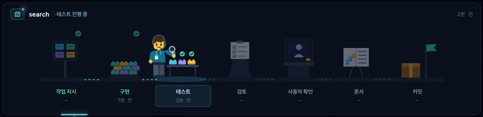
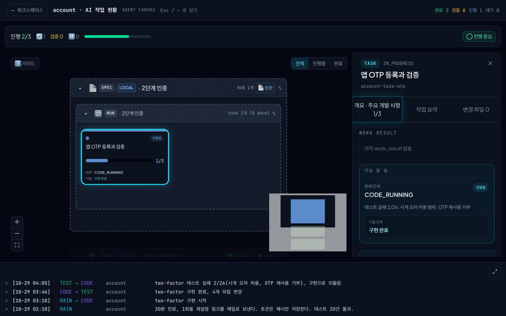
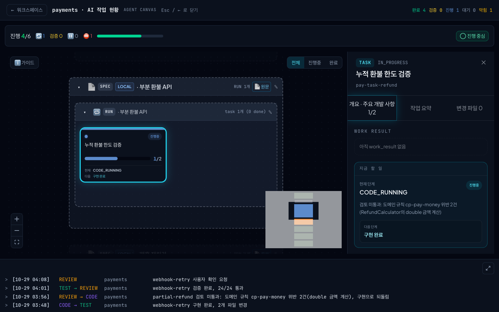
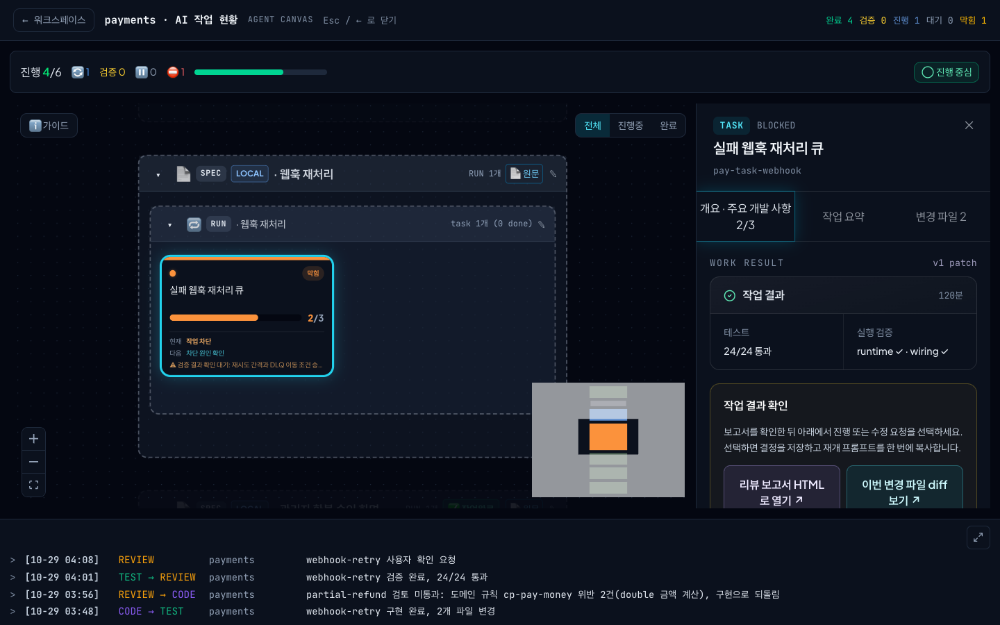
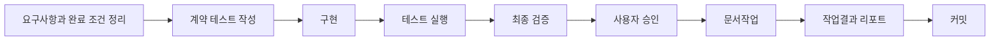
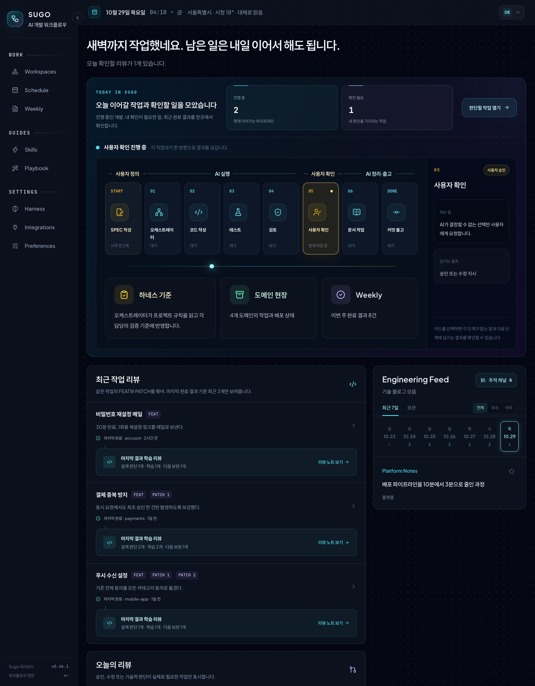
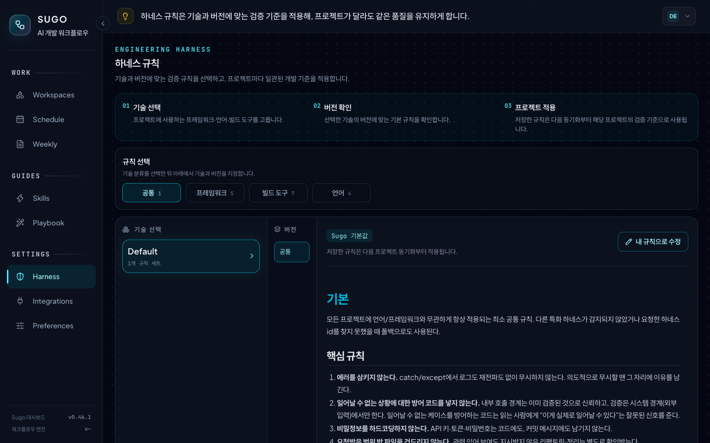
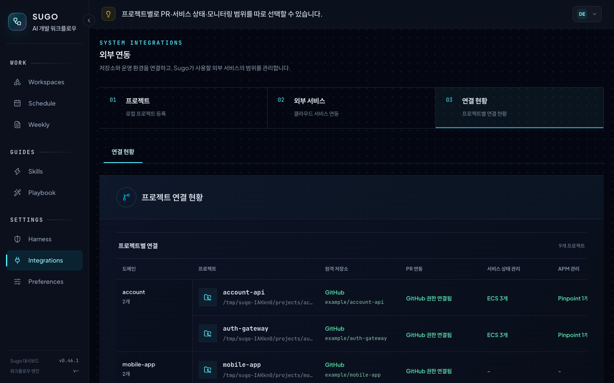
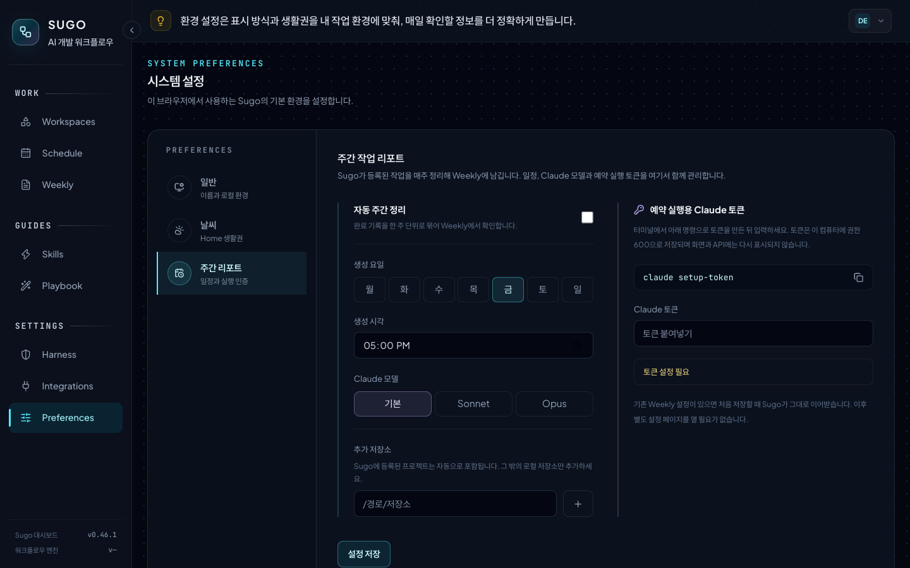

# Sugo

**AI 에이전트의 개발 작업을 실행 근거로 검증하는 Claude Code 플러그인**

[English](README.en.md)

Sugo는 기능 하나를 정해진 순서로 진행합니다. 요구사항과 완료 조건을 정하고, 구현하고, 테스트하고, 검증한 뒤 사람의 승인을 받아 커밋합니다. 각 단계는 실제 테스트 실행 기록과 변경 파일을 확인해야 다음 단계로 넘어갑니다.

> [!NOTE]
> 커밋까지는 Sugo가 만들고, push는 사용자가 직접 합니다.



## Sugo가 막는 장면

AI 에이전트가 "다 됐습니다"라고 말해도, Sugo는 실행 기록과 규칙을 확인하기 전에는 다음 단계로 넘기지 않습니다.

| 테스트가 실패하면 넘어가지 않습니다 | 검토에서 도메인 규칙 위반을 잡습니다 | 빠진 요구사항은 승인 전에 드러납니다 |
| --- | --- | --- |
|  |  |  |
| 26건 중 2건이 실패한 작업은 완료로 보고되지 않고 구현으로 돌아갑니다 | 테스트를 모두 통과해도 금액을 `double`로 계산한 코드는 구현으로 돌아갑니다 | 세 요구사항 중 하나가 빠진 작업은 2/3으로 표시되고 사람이 수정을 요청합니다 |

## 목차

- [Sugo가 막는 장면](#sugo가-막는-장면)
- [Sugo가 해결하는 문제](#sugo가-해결하는-문제)
- [Sugo가 생각하는 AI 개발](#sugo가-생각하는-ai-개발)
- [언제 쓰나요](#언제-쓰나요)
- [빠른 시작](#빠른-시작)
- [Console](#console)
- [명령](#명령)
- [설정과 연동](#설정과-연동)
- [설치하면 바뀌는 것](#설치하면-바뀌는-것)
- [제거와 데이터](#제거와-데이터)
- [지원 스택](#지원-스택)
- [문제 해결](#문제-해결)

## Sugo가 해결하는 문제

| 문제 | Sugo의 처리 |
| --- | --- |
| 테스트 없이 완료를 보고합니다 | 테스트 실행 기록이 없으면 다음 단계로 넘기지 않습니다 |
| 요청 범위 밖의 파일을 고칩니다 | 단계마다 수정 범위를 제한합니다. 테스트 에이전트는 테스트 파일만, 문서 에이전트는 문서만 고칩니다 |
| 요약만 보고 승인합니다 | 요구사항별 충족 상태, 테스트 결과, 남은 위험, diff를 한 화면에서 보고 승인합니다 |
| 세션이 끝나면 판단 근거가 사라집니다 | 스펙, 설계 판단, 작업 결과, 후속 patch를 하나의 이력으로 연결합니다 |
| Claude와 Codex가 다른 규칙으로 작업합니다 | 두 에이전트가 같은 규칙 파일을 읽습니다 |
| 같은 실수를 반복합니다 | Console에 등록한 도메인 규칙을 다음 세션부터 모든 에이전트가 지킵니다 |

## Sugo가 생각하는 AI 개발

> AI 에이전트는 손이 빠른 동료입니다. 코드를 쓰고, 테스트를 돌리고, 문서를 고치는 일을 금방 해냅니다. 다만 무엇을 만들어야 하는지, 이 팀이 어떤 규칙으로 일하는지, 어디까지 손대도 되는지는 스스로 알지 못합니다. 그걸 정해 주지 않으면 결과물은 쌓이는데 믿고 넘길 수 있는 건 많지 않고, 확인하는 몫은 고스란히 사람에게 돌아옵니다.
>
> Sugo는 그 빈자리를 세 가지로 채웁니다.
>
> **스펙이 먼저입니다.** 코드보다 스펙을 먼저 씁니다(Spec-Driven Development). Schedule에 적어 둔 기획 초안은 `/sugo:spec-writer`를 거쳐 구현할 수 있는 스펙이 되고, `/sugo:feat`는 요구사항마다 완료 조건을 붙입니다. 에이전트는 이 스펙을 보고 일하고, 검증도 같은 스펙을 기준으로 합니다.
>
> **일하는 환경을 설계합니다.** 에이전트에게 매번 잘해 달라고 부탁하기보다, 잘할 수밖에 없는 환경을 만듭니다(하네스 엔지니어링). 프로젝트 스택에 맞는 코딩 규칙(하네스)과 도메인 규칙을 작업 전에 읽게 하고, 단계 순서를 정해 두고, 실행 기록이 없으면 다음 단계로 넘어가지 못하게 합니다. Claude와 Codex가 같은 규칙 파일을 읽으니 어느 에이전트가 일해도 기준은 같습니다.
>
> **역할을 나눕니다.** 에이전트 하나가 처음부터 끝까지 다 하지 않습니다. 메인 세션이 오케스트레이터로 순서를 조율하고, 코드 에이전트는 구현을, 테스트 에이전트는 테스트 파일만, 문서 에이전트는 문서만 맡습니다. 검토 에이전트는 코드를 고치지 않고 읽기만 하면서 규칙과 보안을 확인합니다. 서로의 보고를 그대로 믿지 않고 실행 기록과 맞춰 보기 때문에, 한 에이전트의 착각이 다음 단계로 번지지 않습니다.
>
> 그러면 사람에게 남는 일이 달라집니다. diff를 한 줄씩 따라가며 테스트가 정말 돌았는지 확인하던 일은 Sugo가 먼저 끝내 둡니다. 사람은 처음 정한 요구사항이 지켜졌는지, 남은 위험을 감수할 만한지 판단하고 승인하면 됩니다. 왜 그렇게 결정했는지는 작업결과 리포트와 도메인 규칙에 남아서, 다음 작업이나 다음 사람이 같은 고민을 처음부터 다시 하지 않아도 됩니다.

## 언제 쓰나요

| 이런 일을 할 때 | 쓰는 기능 |
| --- | --- |
| 근거가 남는 기능 개발 | `/sugo:feat` |
| 팀 코딩 규칙과 재발 방지 규칙 적용 | 하네스(프로젝트 코딩 규칙 묶음), Console 도메인 규칙, `/sugo:checkpoint-sync` |
| 기획 초안을 구현 가능한 스펙으로 만들고 일정 관리 | Console Schedule, `/sugo:spec-writer` |
| 완료된 기능의 후속 수정을 원래 작업에 연결 | `/sugo:patch` |
| 일반 대화로 고친 내용을 기존 작업에 연결 | `/sugo:patch-attach` |
| 작업 결과와 배운 내용 돌아보기 | Console Home 학습 노트, Console Weekly 주간 보고서 |

> [!TIP]
> 한 줄 수정이나 실험 코드에는 맞지 않습니다. 일반 대화로 처리하고, 남겨 둘 변경만 `/sugo:patch-attach`로 연결하세요.

## 빠른 시작

### 1. 요구 사항

- Claude Code 또는 Codex 앱
- Git
- Node.js 22.5 이상: Console이 `node:sqlite`를 사용합니다. 버전이 낮으면 Console만 시작하지 않습니다.
- Python 3.12 이상: Weekly 주간 보고서를 만들 때만 필요합니다.

### 2. 설치

```bash
claude plugin marketplace add kim-svadoz/sugo
claude plugin install sugo@sugo-marketplace
```

Claude Code에서 `/reload-plugins`를 실행한 뒤 `/sugo:version`으로 설치를 확인합니다. 따로 빌드하거나 `npm install`을 할 필요는 없습니다.

| 상황 | 방법 |
| --- | --- |
| 업데이트 | `claude plugin update sugo@sugo-marketplace` 후 `/reload-plugins`. Console이 꺼져 있으면 `/sugo:console start` |
| Codex 앱 | 플러그인 마켓플레이스에 `https://github.com/kim-svadoz/sugo.git`을 추가하고 `sugo`를 켭니다. `/sugo:...` 명령은 Codex 스킬로 제공됩니다 |

### 3. 첫 기능 만들기

도메인을 만들고, 프로젝트를 등록하고, 기능을 시작합니다. 경로는 절대 경로로 씁니다.

```text
/sugo:ws-add payments
/sugo:add /path/to/payment-api payments
/sugo:feat --project /path/to/payment-api 로그인 실패 5회 시 계정 10분 잠금
```

| 명령 | 하는 일 |
| --- | --- |
| `/sugo:ws-add` | 도메인(Workspace)을 만듭니다. 도메인은 같은 업무 영역의 프로젝트 묶음입니다. 예를 들어 `payments` 도메인에 결제 API, 정산 배치, 관리자 화면을 넣습니다. 도메인 규칙, 일정, 작업 이력은 도메인 단위로 관리합니다 |
| `/sugo:add` | 프로젝트를 도메인에 등록합니다. 언어, 프레임워크, 빌드 도구를 감지해 하네스를 설치합니다 |
| `/sugo:feat` | 기능 하나를 아래 순서로 진행합니다 |

### 기능 하나가 진행되는 순서



1. **요구사항과 완료 조건 정리**: 요청을 PRD로 만들고 요구사항마다 완료 조건을 정합니다. 범위 밖의 일은 여기서 뺍니다.
2. **계약 테스트 작성**: 필요하면 완료 조건을 계약 테스트로 먼저 만들고 실패하는지 확인합니다. 바뀌면 안 되는 기존 동작은 기준선으로 고정합니다.
3. **구현과 테스트 실행**: `code-agent`가 구현하고, `test-agent`가 테스트를 실행해 결과를 기록합니다.
4. **최종 검증**: `review-agent`가 읽기 전용으로 규칙 위반과 보안을 검사하고 검증 자료를 만듭니다.
5. **사용자 승인**: 사람이 Console에서 검증 자료와 diff를 보고 요구사항별로 승인합니다.
6. **문서작업**: `docs-agent`가 변경에 맞춰 프로젝트 문서를 고칩니다.
7. **작업결과 리포트**: 변경 요약, 설계 판단, 남은 위험, 테스트 증거를 `work-result.md`에 남깁니다. 다음 patch와 Weekly 보고서가 이 기록을 이어받습니다.
8. **커밋**: 모든 단계를 통과하면 Sugo가 커밋을 만듭니다. 커밋 메시지에 AI 공동저자 줄은 넣지 않습니다.

단계가 멈추면 Sugo가 부족한 조건과 해결 방법을 알려 줍니다. 정책이나 범위처럼 사람이 정해야 하는 질문은 Console에서 답하면 같은 세션에서 이어집니다.

`/sugo:feat` 하나에는 동작 변경 하나를 담습니다. PRD가 크면 하위 작업으로 나눠 진행한 뒤 통합합니다.

## Console

시작은 명령으로 하고, 확인과 판단은 Console(`http://localhost:3001`)에서 합니다. Console은 새 Claude Code 세션마다 자동으로 시작합니다.



| 할 일 | Console에서 | 명령 |
| --- | --- | --- |
| 일정과 스펙 준비 | Schedule에 개발 일정을 만들고 기획 문서 링크와 화면 캡처를 붙입니다 | 일정 카드에서 복사한 `/sugo:spec-writer`, `/sugo:feat --spec` |
| 진행 확인 | Home 작업 흐름과 Workspaces 작업장에서 지금 단계를 봅니다 | `/sugo:ws-status` |
| 사람의 결정 | 정책과 범위 질문, 승인 요청이 Home과 Schedule에 나타납니다 | — |
| 승인 | 요구사항 충족 상태, 테스트 결과, 남은 위험, diff를 보고 승인합니다 | — |
| 재발 방지 | Workspaces 도메인 규칙에 등록합니다 | `/sugo:checkpoint-sync` |
| 후속 수정 | 완료 작업의 이력을 확인합니다 | `/sugo:patch` |
| 주간 회고 | Weekly에서 주간 보고서와 기술 학습 노트를 봅니다 | `/sugo:weekly` |

Sugo는 이 작업들이 기대는 설정도 함께 관리합니다. 스택별 코딩 규칙(Harness), 클라우드 서비스와 프로젝트별 연결(Integrations), Weekly 일정(Preferences)을 Console에서 정합니다.

| Harness | Integrations | Preferences |
| --- | --- | --- |
|  |  |  |

> [!TIP]
> 모든 화면의 스크린샷과 설명은 [Console 둘러보기](docs/console.md)에 있습니다.

## 명령

| 명령 | 용도 |
| --- | --- |
| `/sugo:feat` | 기능 하나를 파이프라인으로 진행 |
| `/sugo:patch` | 완료 작업의 `work-result.md`에서 후속 수정 시작 |
| `/sugo:patch-attach` | 일반 대화의 변경을 검증해 기존 작업의 patch로 연결 |
| `/sugo:add`, `/sugo:ws-add` | 프로젝트 등록, 도메인(Workspace) 생성 |
| `/sugo:status`, `/sugo:ws-list`, `/sugo:ws-status` | 진행 상태와 이어서 할 위치 확인 |
| `/sugo:overview` | 프로젝트 구조 분석(AST) |
| `/sugo:spec-writer` | Schedule 초안으로 `spec.md` 작성 |
| `/sugo:validate` | 프로젝트 규칙 위반 검사 |
| `/sugo:checkpoint-sync` | Console 도메인 규칙을 `.claude/rules/`로 가져오기 |
| `/sugo:console` | 로컬 Console `status`, `start`, `restart`, `stop` |
| `/sugo:weekly` | 주간 보고서와 기술 학습 노트를 지금 생성 |
| `/sugo:version` | 설치 버전 확인 |
| `/sugo:uninstall`, `/sugo:restore`, `/sugo:purge`, `/sugo:fresh-start` | 제거, 복구, 삭제 |

명령별 인자는 [`sugo/commands/`](sugo/commands/)에서 확인할 수 있습니다.

## 설정과 연동

개인 설정은 `~/.claude/sugo/settings.json`에 필요한 키만 적습니다. 키가 없으면 그 기능은 꺼져 있습니다.

| 키 | 동작 |
| --- | --- |
| `dashboard` | Console 연결(`enabled`, `apiUrl`, `userId`, `apiToken`). 로컬 Console은 자동으로 설정됩니다 |
| `agents.extraTools` | Sugo 에이전트에 추가할 외부 MCP 도구. 예: `["mcp__team-knowledge__search"]` |
| `aws.environments` | 환경 이름(예: `dev`)과 Console에 등록한 AWS 계정 이름의 연결 |
| `presentation.mcpServers` | 결과를 쉬운 한국어 설명으로 바꿔 보여 줄 MCP 서버 |

연동은 모두 선택 사항입니다.

- **Git 서비스**(GitHub, GitLab, Bitbucket Server, CodeCommit): PR 맥락을 가져올 때 씁니다.
- **AWS**: 로컬 AWS CLI profile을 쓰고 리소스 메타데이터만 저장합니다. 직접 조회 한도는 기본으로 세션당 30회, 하루 200회, 분당 10회입니다. Integrations에서 직접 조회를 끄면 에이전트의 AWS CLI 호출을 모두 막습니다.

## 설치하면 바뀌는 것

> [!IMPORTANT]
> 훅은 Sugo에 등록하지 않은 프로젝트를 포함해 Claude Code의 모든 프로젝트에서 동작합니다.

| 시점 | 훅 | 동작 |
| --- | --- | --- |
| 세션 시작 | `dashboard-start` | 로컬 Console을 백그라운드로 시작 |
| 세션 시작 | `agent-tools` | `agents.extraTools` 설정을 Sugo 에이전트에 반영 |
| Bash 실행 전 | `aws-readonly-guard` | 쓰기, 비밀값 조회, 한도를 넘는 AWS CLI 호출 차단 |
| Bash 실행 전 | `commit-body` | 본문 없는 커밋이면 목적을 쓰게 합니다. Weekly가 커밋 본문에서 작업 목적을 읽습니다. `WEEKLY_COMMIT_BODY=off`로 끕니다 |
| Write, Edit 실행 전 | `scope-guard` | test-agent와 docs-agent의 수정 범위 제한 |
| Edit 실행 후 | `lint-hint` | 등록 프로젝트의 lint 실패를 Claude에 전달. 편집은 막지 않습니다 |
| MCP 호출 후 | `mcp-presentation` | `presentation.mcpServers`에 지정한 서버에만 적용. 기본은 꺼짐 |

- **Console**: `http://localhost:3001`에서 시작하고 `127.0.0.1` 접속만 받습니다. 끄려면 `~/.claude/sugo/settings.json`에 `"dashboard": {"enabled": false}`를 넣습니다.
- **프로젝트 파일**: 등록한 프로젝트에 `sugo/`, `.claude/rules/`, 그리고 `AGENTS.md`와 `CLAUDE.md` 안의 Sugo 관리 블록을 씁니다. 사용자가 쓴 내용은 그대로 둡니다.
- **네트워크**: 사용 통계는 보내지 않습니다. Console은 Home 피드용 공개 기술 블로그 RSS와 웹 폰트 CDN을 부르고, 날씨 지역을 설정했을 때만 Open-Meteo를 부릅니다.
- **Weekly**: Preferences에 정한 일정에 맞춰 Console이 주간 보고서를 만듭니다. 한 번 만들 때 `claude -p`를 2번 호출합니다. 데이터는 `~/.weekly/`에 둡니다.

## 제거와 데이터

삭제를 요청하기 전까지 데이터는 남아 있습니다.

| 명령 | 프로젝트 | Sugo 데이터 |
| --- | --- | --- |
| `/sugo:uninstall` | Sugo 블록, 규칙, 훅 제거. 사용자 내용은 유지 | `~/.sugo/data`에 보관. 다시 설치해도 자동으로 복구하지 않음 |
| `/sugo:restore` | 보관한 연결 복구 | 다시 사용 |
| `/sugo:fresh-start` | — | 보관 데이터를 지우고 새로 등록 |
| `/sugo:purge` | Sugo 블록, 규칙, 훅 제거 | 모두 삭제 |

플러그인 캐시를 먼저 지웠다면 `node ~/.sugo/bin/sugo-uninstall.mjs uninstall`(또는 `purge`)을 실행합니다.

<details>
<summary>데이터 저장 위치</summary>

| 위치 | 내용 |
| --- | --- |
| `<project>/sugo/` | 적용 규칙, 설정, 기능별 PRD와 작업결과 리포트 |
| `<project>/.claude/rules/` | 하네스 코딩 규칙, Console 도메인 규칙 |
| `~/.claude/sugo/` | 등록 정보, 세션, 도메인, 스펙, 설정, Console 데이터 |
| `~/.sugo/` | 보관 데이터, 독립 제거기 |
| `~/.weekly/` | Weekly 설정, 주간 보고서, 예약 실행 토큰. 제거 명령으로 지워지지 않습니다 |

</details>

## 지원 스택

| 구분 | 지원 |
| --- | --- |
| 언어 | Java, JavaScript, TypeScript, Python |
| 프레임워크 | Spring, Node, Express, React, Next.js |
| 빌드 도구 | Gradle, Maven, npm, pnpm, Yarn, pip, Poetry |

그 밖의 스택은 기본 규칙을 사용합니다. 규칙 원문은 [`sugo/harness-library/`](sugo/harness-library/)에 있습니다.

## 문제 해결

| 증상 | 조치 |
| --- | --- |
| `localhost:3001`이 응답하지 않습니다 | `/sugo:console status`로 확인한 뒤 `/sugo:console start` |
| 업데이트했는데 동작이 이전과 같습니다 | `/reload-plugins` 후 `/sugo:version`으로 버전 확인 |
| 완료한 작업이 Console에 없습니다 | 에이전트에게 `sugo_status`를 `health: true`로 호출하게 해 연결 오류와 전송 오류 확인 |
| 다시 설치했더니 이전 작업이 없습니다 | 정상입니다. `/sugo:restore`로 복구하거나 `/sugo:fresh-start`로 새로 시작 |

## 만들면서 정리한 생각

> - AI 에이전트를 잘 쓰는 힘은 프롬프트보다 환경에서 나옵니다. 같은 모델도 스펙과 규칙과 순서가 갖춰진 곳에서 훨씬 믿을 만하게 일합니다.
> - 에이전트의 말보다 실행 기록을 믿습니다. "테스트를 통과했습니다"라는 보고 대신 실제로 돌린 결과를 보고 다음 단계로 넘깁니다.
> - 성과는 기능 단위로 셉니다. 커밋이나 PR이 늘어난 것보다 끝까지 완성된 기능이 몇 개인지가 중요합니다. 그래서 `/sugo:feat` 하나에 동작 변경 하나를 담고, 이후의 patch까지 한 이력으로 묶습니다.
> - 사람의 시간은 판단에 씁니다. 기계가 확인할 수 있는 건 기계에 맡기고, 사람은 무엇을 만들지 정하고 결과를 받아들일지 결정합니다.
> - 실수는 규칙으로 남깁니다. 한 번 겪은 문제는 도메인 규칙이 되어 다음 세션의 모든 에이전트가 지킵니다. 쓰면 쓸수록 일하는 환경이 조금씩 단단해집니다.

## 참고

- [변경 기록](CHANGELOG.md)
- [기여 안내](CONTRIBUTING.md)
- [MIT 라이선스](LICENSE)
