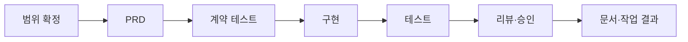

# Sugo

**AI가 만든 코드를 검증된 결과로 받는 개발 파이프라인**

[English](README.en.md)

Sugo는 Claude Code 플러그인입니다. AI 에이전트가 기능 하나를 스펙 → 구현 → 테스트 → 리뷰 → 문서 순서로 진행하게 합니다. 에이전트가 "완료했습니다"라고 말해도 다음 단계로 넘어가지 않습니다. Sugo는 실제 테스트 실행 기록과 변경 파일을 확인한 뒤에만 단계를 넘깁니다. 마지막 승인은 사람이 실제 diff를 보고 합니다.

## Sugo가 해결하는 문제

AI 에이전트는 코드를 빠르게 만듭니다. 그러나 개발자는 결과를 믿기 어렵습니다.

| AI 코딩에서 자주 생기는 문제 | Sugo가 하는 일 |
| --- | --- |
| 테스트를 돌리지 않고 "다 됐다"고 보고한다 | 테스트 실행 기록이 없으면 다음 단계로 넘기지 않습니다 |
| 요청하지 않은 파일까지 고친다 | 단계별 에이전트의 수정 범위를 제한합니다. 테스트 에이전트는 테스트 파일만, 문서 에이전트는 문서만 고칩니다 |
| 결과 요약만 보고 승인하게 된다 | 요구사항별 충족 상태, 테스트 결과, 남은 위험, 실제 diff를 한 화면에서 보고 승인합니다 |
| 세션이 끝나면 왜 그렇게 만들었는지 사라진다 | 스펙, 설계 판단, 작업 결과, 후속 patch를 하나의 계보로 남깁니다 |
| Claude와 Codex가 프로젝트 규칙을 서로 다르게 안다 | 같은 규칙 파일을 두 에이전트가 함께 읽습니다 |
| 같은 실수를 세션마다 반복한다 | 실수를 체크포인트로 적으면 다음 세션의 모든 에이전트가 그 규칙을 읽습니다 |

## Sugo를 쓰면 좋은 경우

| 목표 | 쓰는 기능 |
| --- | --- |
| AI에게 맡긴 기능을 검토 가능한 근거와 함께 받는다 | `/sugo:feat` |
| 팀의 코딩 규칙과 재발 방지 규칙을 모든 에이전트가 지키게 한다 | 하네스, 체크포인트, `/sugo:checkpoint-sync` |
| 기획 초안을 구현 가능한 스펙으로 바꾸고 일정과 함께 관리한다 | Console Schedule, `/sugo:spec-writer` |
| 끝난 기능을 고쳐도 원래 작업과 연결된 이력을 남긴다 | `/sugo:patch` |
| 일반 대화로 이미 고친 내용을 나중에 검증하고 기록한다 | `/sugo:patch-attach` |
| 매일 끝낸 작업에서 무엇을 배웠는지 돌아본다 | Console Home의 학습 리뷰 노트, [weekly](https://github.com/kim-svadoz/weekly-ai-report) 주간 보고 |

**맞지 않는 경우:** 한 줄 수정이나 버릴 실험 코드에는 절차가 무겁습니다. 이런 작업은 일반 대화로 하고, 남겨야 할 변경이면 나중에 `/sugo:patch-attach`로 연결합니다.

## 시작하기

### 요구 사항

- Claude Code(또는 Codex 앱)
- Git
- Node.js 22.5 이상. Console이 `node:sqlite`를 사용합니다. Node 버전이 낮으면 Console은 시작하지 않지만 파이프라인은 동작합니다.

### 설치

```bash
claude plugin marketplace add kim-svadoz/sugo
claude plugin install sugo@sugo-marketplace
```

Claude Code에서 `/reload-plugins`를 실행하고 `/sugo:version`으로 확인합니다. 빌드나 `npm install`은 필요하지 않습니다.

- **업데이트:** `claude plugin update sugo@sugo-marketplace` 후 `/reload-plugins`. 업데이트 뒤 Console이 꺼져 있으면 `/sugo:console start`.
- **Codex 앱:** 플러그인 마켓플레이스에 `https://github.com/kim-svadoz/sugo.git`을 추가하고 `sugo`를 켭니다. Codex는 `/sugo:...` 명령을 스킬로 제공합니다.

### 첫 기능 만들기

경로는 절대 경로로 씁니다.

```text
/sugo:ws-add my-workspace
/sugo:add /path/to/my-service my-workspace
/sugo:feat --project /path/to/my-service 로그인 실패 5회 시 계정 10분 잠금
```

`/sugo:add`는 프로젝트의 언어·프레임워크·빌드 도구를 감지하고 맞는 코딩 규칙을 설치합니다. `/sugo:feat`부터는 Sugo가 진행합니다.



1. 요청을 PRD로 정리하고 요구사항(REQ)을 나눕니다.
2. 필요한 경우 기존 동작의 기준선과 계약 테스트를 먼저 만듭니다. 계약 테스트는 실패(red)를 확인한 뒤 구현합니다.
3. `code-agent`가 구현하고 `test-agent`가 테스트를 실행해 기록합니다.
4. `review-agent`(읽기 전용)가 규칙 위반과 보안을 검사하고 리뷰 자료를 만듭니다.
5. 사람이 Console에서 요구사항별로 승인합니다.
6. `docs-agent`가 문서를 고치고 `work-result.md`를 남깁니다.

단계가 멈추면 Sugo는 부족한 조건과 해결 방법을 알려줍니다. 정책이나 범위처럼 사람만 답할 수 있는 질문은 Console에서 답하면 같은 세션에서 계속 진행합니다.

**완료는 push가 아닙니다.** Sugo는 커밋 메시지를 만들 수 있지만 `git commit`과 `git push`는 사용자가 실행합니다.

## 잘 쓰는 방법

- **기능을 작게 나눕니다.** `/sugo:feat` 하나에 동작 변경 하나를 담습니다. PRD가 크면 Sugo가 하위 작업으로 나눠 진행한 뒤 통합합니다.
- **스펙이 있으면 먼저 씁니다.** Console Schedule에 초안과 기획 링크를 남기고 `/sugo:spec-writer`로 `spec.md`를 만든 뒤 `/sugo:feat --spec`으로 시작합니다. 기획 의도가 요구사항과 테스트까지 이어집니다.
- **승인은 diff를 보고 합니다.** 작업 요약은 출발점입니다. Agent Canvas의 변경 파일에서 실제 코드를 확인합니다.
- **반복되는 실수는 규칙으로 바꿉니다.** Console Workspace의 도메인 규칙에 적고 `/sugo:checkpoint-sync`를 실행하면 다음 세션부터 Claude와 Codex가 함께 읽습니다.
- **끝난 작업을 고칠 때는 `/sugo:patch`를 씁니다.** 새 기능으로 시작하면 원래 작업과의 연결이 끊깁니다.
- **중단된 작업은 `/sugo:ws-status`로 재개 위치를 찾습니다.**

## 설치하면 바뀌는 것

설치 전에 확인하세요.

**훅은 Claude Code를 여는 모든 프로젝트에서 동작합니다.** Sugo에 등록하지 않은 프로젝트도 포함됩니다.

| 시점 | 훅 | 동작 |
| --- | --- | --- |
| 세션 시작 | `dashboard-start` | 로컬 Console을 백그라운드로 시작 |
| 세션 시작 | `agent-tools` | `agents.extraTools` 설정을 Sugo 에이전트에 반영 |
| Bash 실행 전 | `aws-readonly-guard` | 읽기 전용이 아닌 AWS CLI 호출, 비밀값 조회, 호출 예산 초과를 차단 |
| Write·Edit 실행 전 | `scope-guard` | Sugo의 test-agent와 docs-agent 수정 범위 제한. 다른 에이전트에는 영향 없음 |
| Edit 실행 후 | `lint-hint` | 등록한 프로젝트에서 lint 실패를 Claude에게 전달. 편집은 막지 않음 |
| MCP 호출 후 | `mcp-presentation` | `presentation.mcpServers`에 지정한 서버에만 적용. 기본은 꺼짐 |

- **로컬 Console이 `http://localhost:3001`에서 시작됩니다.** `127.0.0.1`에서만 접속을 받습니다. 끄려면 `~/.claude/sugo/settings.json`에 `"dashboard": {"enabled": false}`를 설정합니다.
- **등록한 프로젝트에 파일을 씁니다.** `sugo/`(설정, 규칙, 기능 기록), `.claude/rules/`, `AGENTS.md`와 `CLAUDE.md`의 Sugo 관리 블록입니다. 사용자가 쓴 내용은 유지합니다.
- **네트워크:** Sugo는 사용 통계를 보내지 않습니다. Console은 Home 피드용 공개 기술 블로그 RSS를 받고, 웹 폰트를 CDN에서 읽고, 날씨 지역을 설정한 경우에만 Open-Meteo를 호출합니다.

## 명령

| 명령 | 용도 |
| --- | --- |
| `/sugo:feat` | 기능 하나를 파이프라인으로 진행 |
| `/sugo:patch` | 끝난 작업의 `work-result.md`에서 후속 수정 시작 |
| `/sugo:patch-attach` | 일반 대화에서 만든 변경을 기존 작업의 검증된 patch로 연결 |
| `/sugo:add`, `/sugo:ws-add` | 프로젝트 등록, Workspace 생성 |
| `/sugo:status`, `/sugo:ws-list`, `/sugo:ws-status` | 진행 상태와 재개 위치 확인 |
| `/sugo:overview` | 프로젝트 구조 분석(AST) |
| `/sugo:spec-writer` | Schedule 초안을 구현 가능한 `spec.md`로 작성 |
| `/sugo:validate` | 프로젝트 규칙 위반 검사 |
| `/sugo:checkpoint-sync` | Console 체크포인트를 `.claude/rules/`로 가져오기 |
| `/sugo:console` | 로컬 Console `status`, `start`, `restart`, `stop` |
| `/sugo:version` | 설치된 버전 확인 |
| `/sugo:uninstall`, `/sugo:restore`, `/sugo:purge`, `/sugo:fresh-start` | 제거, 복구, 삭제 |

인자는 [`sugo/commands/`](sugo/commands/)에 정의되어 있습니다.

## Console

`http://localhost:3001`을 엽니다. 새 Claude Code 세션마다 자동으로 시작합니다.

| 화면 | 용도 |
| --- | --- |
| Home | 최근 끝낸 작업과 학습 리뷰 노트, 승인 대기 작업, 기술 블로그 피드 |
| Workspaces | 프로젝트, 도메인 규칙, 작업 이력. Agent Canvas에서 작업 그래프, patch 계보, 승인 근거, diff 확인 |
| Schedule | 스펙 일정, 기획 링크와 메모, 배포 상태 |
| Weekly | [weekly](https://github.com/kim-svadoz/weekly-ai-report) 플러그인이 만든 주간 보고서 |
| Skills, Playbook | Sugo의 에이전트·명령·스킬과 사용 시나리오 |
| Harness | 프로젝트에 적용되는 코딩 규칙 |
| Integrations | Git 서비스, AWS, Pinpoint 연결과 플러그인 API 토큰 |
| Preferences | 표시 이름, 날씨 지역 |

Home의 작업 세계는 메인 에이전트가 SPEC을 보고 구현·테스트·검토·문서 인력에게 작업을 맡기는 모습, Harness 지침 전달, 사용자 확인 창구, 이번 주 완료가 쌓이는 Weekly 창고, 도메인별 현장을 실제 이벤트 기준으로 보여줍니다. 도메인을 누르면 그 도메인 작업들이 거친 단계 순서를 볼 수 있습니다. Workspaces의 작업장은 도메인 안에서 동시에 진행 중인 코드 작업을 작업별 레인으로 나눠 보여줍니다.

Console 데이터는 `~/.claude/sugo/dashboard/`에 있고 업데이트해도 유지됩니다. Console이 꺼져 있어도 파이프라인은 진행하고, 동기화는 나중에 보냅니다.

## 설정

개인 설정은 모두 `~/.claude/sugo/settings.json`의 선택 키입니다. 키가 없으면 그 기능은 꺼져 있습니다.

| 키 | 동작 |
| --- | --- |
| `dashboard` | Console 연결(`enabled`, `apiUrl`, `userId`, `apiToken`). 로컬 Console은 자동 설정 |
| `agents.extraTools` | Sugo 에이전트가 쓸 외부 MCP 도구. 예: `["mcp__team-knowledge__search"]` |
| `aws.environments` | 환경 이름(예: `dev`)을 Console에 등록한 AWS 계정 이름에 연결 |
| `presentation.mcpServers` | 결과를 짧고 명확한 한국어 기술 문장으로 설명할 MCP 서버 |

**연동은 선택 사항입니다.** Git 서비스(GitHub, GitLab, Bitbucket Server, CodeCommit)를 연결하면 PR 맥락을 씁니다. AWS 연동은 이 컴퓨터의 AWS CLI profile을 쓰고 리소스 메타데이터만 저장합니다. AWS 읽기 가드는 예산 안의 읽기 호출만 허용합니다(기본: 세션 30회, 하루 200회, 분당 10회). Integrations에서 직접 읽기를 끄면 에이전트의 AWS CLI 직접 호출을 모두 차단합니다.

## 제거와 데이터

제거해도 삭제를 요청하기 전까지 데이터는 남습니다.

| 명령 | 프로젝트 | Sugo 데이터 |
| --- | --- | --- |
| `/sugo:uninstall` | Sugo 블록·규칙·훅 제거. 사용자 내용 유지 | `~/.sugo/data`에 보관. 재설치해도 자동 복구하지 않음 |
| `/sugo:restore` | 보관된 연결 복구 | 다시 사용 |
| `/sugo:fresh-start` | — | 보관 데이터를 지우고 새로 등록 |
| `/sugo:purge` | Sugo 블록·규칙·훅 제거 | 모두 삭제 |

플러그인 캐시를 먼저 지웠다면 `node ~/.sugo/bin/sugo-uninstall.mjs uninstall`(또는 `purge`)을 실행합니다.

| 위치 | 내용 |
| --- | --- |
| `<project>/sugo/` | 적용 규칙, 설정, 기능별 PRD와 작업 결과 |
| `<project>/.claude/rules/` | 코딩 규칙과 체크포인트 |
| `~/.claude/sugo/` | 등록 정보, 세션, Workspace, 스펙, 설정, Console 데이터 |
| `~/.sugo/` | 보관 데이터와 독립 제거기 |

## 지원 스택

Java, JavaScript, TypeScript, Python · Spring, Node, Express, React, Next.js · Gradle, Maven, npm, pnpm, Yarn, pip, Poetry. 그 밖의 스택은 기본 규칙을 씁니다. 규칙 원문은 [`sugo/harness-library/`](sugo/harness-library/)에 있습니다.

## 문제 해결

| 증상 | 조치 |
| --- | --- |
| `localhost:3001`이 응답하지 않음 | `/sugo:console status` 후 `/sugo:console start` |
| 업데이트했는데 동작이 이전과 같음 | `/reload-plugins` 후 `/sugo:version` 확인 |
| 끝난 작업이 Console에 보이지 않음 | 에이전트에게 `sugo_status`를 `health: true`로 호출하게 해 연결·전송 오류 확인 |
| 재설치했는데 이전 작업이 돌아오지 않음 | 정상입니다. `/sugo:restore`로 복구하거나 `/sugo:fresh-start`로 새로 시작 |

## 더 보기

- [변경 기록](CHANGELOG.md)
- [기여 안내](CONTRIBUTING.md)
- [MIT 라이선스](LICENSE)
