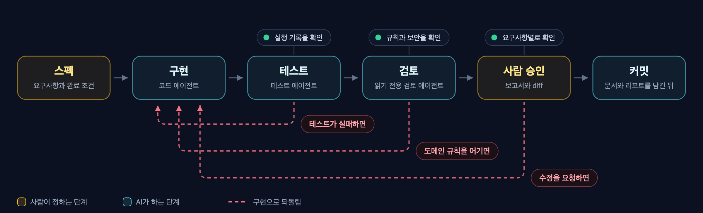
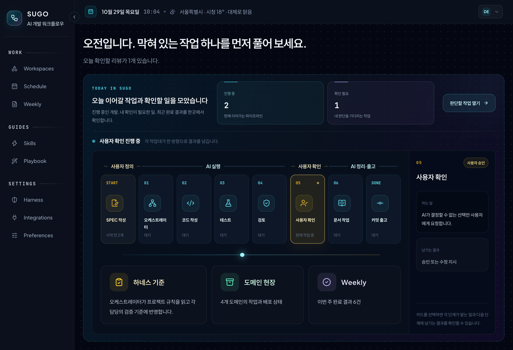

# Sugo

[](LICENSE)  

[English](README.en.md)

Sugo는 AI 에이전트가 스펙(요구사항과 완료 조건)대로 만들고 테스트로 확인한 뒤에만 다음 단계로 넘어가게 하는 Claude Code 플러그인입니다. 함께 뜨는 Sugo Console에서 여러 작업의 진행을 한눈에 보고, 필요한 판단만 내리면 됩니다.

이름은 "수고"에서 따왔습니다. 개발의 수고는 AI가 맡고, 사람은 확인하고 결정하는 데 시간을 쓰자는 뜻입니다.


> [!NOTE]
> Sugo는 커밋까지 만들고, push는 사용자가 직접 합니다.

## 목차

- [왜 Sugo인가](#왜-sugo인가)
- [동작 방식](#동작-방식)
- [빠른 시작](#빠른-시작)
- [Console 둘러보기](#console-둘러보기)
- [명령](#명령)
- [설치하면 바뀌는 것](#설치하면-바뀌는-것)
- [참고 자료](#참고-자료)
- [설계 철학](#설계-철학)

## 왜 Sugo인가

| 자주 겪는 문제 | Sugo의 처리 |
| --- | --- |
| 테스트 없이 완료를 보고합니다 | 테스트 실행 기록이 없으면 다음 단계로 넘기지 않습니다 |
| 요청 범위 밖의 파일을 고칩니다 | 단계마다 수정 범위를 제한합니다. 테스트 에이전트는 테스트 파일만, 문서 에이전트는 문서만 고칩니다 |
| 요약만 보고 승인합니다 | 요구사항별 충족 상태, 테스트 결과, 남은 위험, diff를 한 화면에서 보고 승인합니다 |
| 세션이 끝나면 판단 근거가 사라집니다 | 스펙, 설계 판단, 작업 결과, 후속 patch를 하나의 이력으로 잇습니다 |
| Claude와 Codex가 다른 규칙으로 작업합니다 | 두 에이전트가 같은 규칙 파일을 읽습니다 |
| 같은 실수를 반복합니다 | 한 번 겪은 실수를 규칙으로 남기면 다음 세션부터 모든 에이전트가 지킵니다 |

> [!TIP]
> 한 줄 수정이나 실험 코드에는 맞지 않습니다. 일반 대화로 처리하고, 남겨 둘 변경만 `/sugo:patch-attach`로 기존 작업에 연결하세요.

## 동작 방식



사람이 스펙을 정하면 AI 에이전트들이 구현, 테스트, 검토를 맡고, 사람이 결과를 승인한 뒤 커밋합니다. 테스트가 실패하거나, 검토에서 규칙 위반이 나오거나, 사람이 수정을 요청하면 구현으로 되돌아갑니다.

되돌아간 이유는 Console(Sugo가 띄우는 로컬 화면)의 **스펙 카드**, 즉 스펙 하나의 진행 상태와 이력을 모은 카드 맨 위에 문장으로 남습니다.

**테스트가 실패하면 구현으로 돌아갑니다.** 26건 중 2건이 실패한 작업은 완료로 보고되지 않습니다.


**검토에서 규칙 위반을 잡습니다.** 테스트를 모두 통과해도, "금액은 정수(long)로만 계산한다"는 규칙을 어기고 `double`을 쓴 코드는 구현으로 돌아갑니다.


**마지막은 사람이 승인합니다.** 리뷰 보고서와 변경 파일 diff를 열어 본 뒤 승인하거나, 고칠 내용을 적어 수정을 요청합니다.


<details>
<summary>단계별로 자세히</summary>

1. **스펙:** 요청을 스펙으로 만들고 요구사항마다 완료 조건을 정합니다. 범위 밖의 일은 여기서 뺍니다. 필요하면 완료 조건을 계약 테스트로 먼저 만들고 실패하는지 확인합니다.
2. **구현:** `code-agent`가 스펙 범위 안에서 구현합니다.
3. **테스트:** `test-agent`가 테스트를 실행하고 결과를 기록합니다. 테스트 파일 말고는 고치지 않습니다.
4. **검토:** `review-agent`가 읽기 전용으로 규칙 위반과 보안을 검사하고 검증 자료를 만듭니다.
5. **사람 승인:** Console에서 검증 자료와 diff를 보고 요구사항별로 승인합니다. 정책이나 범위처럼 사람이 정할 질문도 여기서 답하면 같은 세션에서 이어집니다.
6. **문서와 리포트:** `docs-agent`가 프로젝트 문서를 고치고, 변경 요약, 설계 판단, 남은 위험, 테스트 증거를 `work-result.md`에 남깁니다.
7. **커밋:** 모든 단계를 통과하면 Sugo가 커밋을 만듭니다. 커밋 메시지에 AI 공동저자 줄은 넣지 않습니다.

`/sugo:feat` 하나에는 동작 변경 하나를 담습니다. 스펙이 크면 하위 작업으로 나눠 진행한 뒤 통합합니다.

</details>

## 빠른 시작

### 1. 요구 사항

- Claude Code 또는 Codex 앱
- Git
- Node.js 22.5 이상: Console이 `node:sqlite`를 사용합니다. 버전이 낮으면 Console만 시작하지 않습니다.
- Python 3.12 이상: Weekly 주간 보고서를 만들 때만 필요합니다.

### 2. 설치

```bash
claude plugin marketplace add kim-svadoz/sugo
claude plugin install sugo@sugo-marketplace
```

Claude Code에서 `/reload-plugins`를 실행한 뒤 `/sugo:version`으로 설치를 확인합니다. 따로 빌드하거나 `npm install`을 할 필요는 없습니다.

- **업데이트:** `claude plugin update sugo@sugo-marketplace` 후 `/reload-plugins`
- **Codex 앱:** 플러그인 마켓플레이스에 `https://github.com/kim-svadoz/sugo.git`을 추가하고 `sugo`를 켭니다. `/sugo:...` 명령은 Codex 스킬로 제공됩니다.

### 3. 첫 기능 만들기

```text
/sugo:ws-add payments
/sugo:add /path/to/payment-api payments
/sugo:feat --project /path/to/payment-api 로그인 실패 5회 시 계정 10분 잠금
```

| 명령 | 하는 일 |
| --- | --- |
| `/sugo:ws-add` | 도메인을 만듭니다. 도메인은 같은 업무 영역의 프로젝트 묶음입니다. 예를 들어 `payments` 도메인에 결제 API, 정산 배치, 관리자 화면을 넣습니다 |
| `/sugo:add` | 프로젝트를 도메인에 등록합니다. 언어, 프레임워크, 빌드 도구를 감지해 그 스택의 코딩 규칙(하네스)을 설치합니다 |
| `/sugo:feat` | 기능 하나를 스펙부터 커밋까지 진행합니다 |

경로는 절대 경로로 씁니다. 진행 상황은 Console(`http://localhost:3001`)에서 봅니다. Console은 새 Claude Code 세션마다 자동으로 시작합니다.

## Console 둘러보기

시작은 명령으로 하고, 확인과 판단은 Console에서 합니다.

### Home

오늘 이어 갈 일과 내 판단을 기다리는 일이 먼저 보입니다. 작업 흐름은 사람이 맡는 단계와 AI가 맡는 단계를 나눠 보여 주고, 지금 어느 단계에서 무엇을 기다리는지 알려 줍니다.



### Workspaces

도메인마다 무엇이 어디까지 진행됐는지 한 화면에서 봅니다.


- **도메인 카드:** 도메인별 진행률, 막힌 작업, 규칙 수를 봅니다.
- **작업장:** 작업자가 지금 어느 단계에 있는지 보여 줍니다. 사람의 확인이 필요하면 그 자리에서 물음표를 띄우고 기다립니다.
- **최근 작업 요약:** 선택한 작업의 제목과 완료 결과가 나옵니다.
- **Inspector:** 도메인의 저장소와 연동 상태, 완료 이력(History), 작업의 단계별 기록(Activity)을 봅니다.

### 일정과 스펙 카드

Schedule의 Agenda에서 오늘, 다음 7일, 이후 일정을 봅니다. 스펙 카드를 열면 최초 구현(FEAT)부터 이어진 patch까지 개발 이력이 한 줄로 이어지고, 마지막 결과를 기준으로 **새 Patch**를 바로 시작합니다.

| Agenda | 스펙 카드 |
| --- | --- |
|  |  |

### 도메인 규칙

한 번 겪은 실수는 도메인 규칙으로 남깁니다. 규칙마다 생긴 이유와 확인 항목을 적고, `/sugo:checkpoint-sync`가 각 프로젝트의 `.claude/rules/`에 씁니다. Claude Code와 Codex는 작업 전에 이 규칙을 읽습니다.


### 설정

| Harness | Integrations | Preferences |
| --- | --- | --- |
|  |  |  |
| 스택과 버전별 코딩 규칙. 필요하면 내 규칙으로 고쳐 씁니다 | 클라우드 서비스, 프로젝트별 원격 저장소, PR, 서비스 상태, APM 연결 | 표시 이름, 날씨 지역, Weekly 생성 일정 |

> [!TIP]
> Home, Weekly, Calendar, diff까지 모든 화면 설명은 [Console 둘러보기](docs/console.md)에 있습니다.

## 명령

| 명령 | 용도 |
| --- | --- |
| `/sugo:feat` | 기능 하나를 스펙부터 커밋까지 진행 |
| `/sugo:patch` | 완료 작업의 `work-result.md`에서 후속 수정 시작 |
| `/sugo:patch-attach` | 일반 대화의 변경을 검증해 기존 작업의 patch로 연결 |
| `/sugo:add`, `/sugo:ws-add` | 프로젝트 등록, 도메인 생성 |
| `/sugo:status`, `/sugo:ws-list`, `/sugo:ws-status` | 진행 상태와 이어서 할 위치 확인 |
| `/sugo:spec-writer` | Schedule 초안으로 스펙(`spec.md`) 작성 |
| `/sugo:checkpoint-sync` | Console 도메인 규칙을 `.claude/rules/`로 가져오기 |
| `/sugo:validate` | 프로젝트 규칙 위반 검사 |
| `/sugo:overview` | 프로젝트 구조 분석(AST) |
| `/sugo:weekly` | 주간 보고서와 기술 학습 노트를 지금 생성 |
| `/sugo:console` | 로컬 Console `status`, `start`, `restart`, `stop` |
| `/sugo:version` | 설치 버전 확인 |
| `/sugo:uninstall`, `/sugo:restore`, `/sugo:purge`, `/sugo:fresh-start` | 제거, 복구, 삭제 |

명령별 인자는 [`sugo/commands/`](sugo/commands/)에 있습니다.

## 설치하면 바뀌는 것

> [!IMPORTANT]
> 훅은 Sugo에 등록하지 않은 프로젝트를 포함해 Claude Code의 모든 프로젝트에서 동작합니다. 사용 통계는 보내지 않습니다.

<details>
<summary>훅, Console, 프로젝트 파일, 네트워크</summary>

| 시점 | 훅 | 동작 |
| --- | --- | --- |
| 세션 시작 | `dashboard-start` | 로컬 Console을 백그라운드로 시작 |
| 세션 시작 | `agent-tools` | `agents.extraTools` 설정을 Sugo 에이전트에 반영 |
| Bash 실행 전 | `aws-readonly-guard` | 쓰기, 비밀값 조회, 한도를 넘는 AWS CLI 호출 차단 |
| Bash 실행 전 | `commit-body` | 본문 없는 커밋이면 목적을 쓰게 합니다. Weekly가 커밋 본문에서 작업 목적을 읽습니다. `WEEKLY_COMMIT_BODY=off`로 끕니다 |
| Write, Edit 실행 전 | `scope-guard` | test-agent와 docs-agent의 수정 범위 제한 |
| Edit 실행 후 | `lint-hint` | 등록 프로젝트의 lint 실패를 Claude에 전달. 편집은 막지 않습니다 |
| MCP 호출 후 | `mcp-presentation` | `presentation.mcpServers`에 지정한 서버에만 적용. 기본은 꺼짐 |

- **Console:** `http://localhost:3001`에서 시작하고 `127.0.0.1` 접속만 받습니다. 끄려면 `~/.claude/sugo/settings.json`에 `"dashboard": {"enabled": false}`를 넣습니다.
- **프로젝트 파일:** 등록한 프로젝트에 `sugo/`, `.claude/rules/`, 그리고 `AGENTS.md`와 `CLAUDE.md` 안의 Sugo 관리 블록을 씁니다. 사용자가 쓴 내용은 그대로 둡니다.
- **네트워크:** Console은 Home 피드용 공개 기술 블로그 RSS와 웹 폰트 CDN을 부르고, 날씨 지역을 설정했을 때만 Open-Meteo를 부릅니다.
- **Weekly:** Preferences에 정한 일정에 맞춰 Console이 주간 보고서를 만듭니다. 한 번 만들 때 `claude -p`를 2번 호출합니다. 데이터는 `~/.weekly/`에 둡니다.

</details>

## 참고 자료

<details>
<summary>설정과 연동</summary>

개인 설정은 `~/.claude/sugo/settings.json`에 필요한 키만 적습니다. 키가 없으면 그 기능은 꺼져 있습니다.

| 키 | 동작 |
| --- | --- |
| `dashboard` | Console 연결(`enabled`, `apiUrl`, `userId`, `apiToken`). 로컬 Console은 자동으로 설정됩니다 |
| `agents.extraTools` | Sugo 에이전트에 추가할 외부 MCP 도구. 예: `["mcp__team-knowledge__search"]` |
| `aws.environments` | 환경 이름(예: `dev`)과 Console에 등록한 AWS 계정 이름의 연결 |
| `presentation.mcpServers` | 결과를 쉬운 한국어 설명으로 바꿔 보여 줄 MCP 서버 |

연동은 모두 선택 사항입니다.

- **Git 서비스**(GitHub, GitLab, Bitbucket Server, CodeCommit): PR 맥락을 가져올 때 씁니다.
- **AWS:** 로컬 AWS CLI profile을 쓰고 리소스 메타데이터만 저장합니다. 직접 조회 한도는 기본으로 세션당 30회, 하루 200회, 분당 10회입니다. Integrations에서 직접 조회를 끄면 에이전트의 AWS CLI 호출을 모두 막습니다.

</details>

<details>
<summary>제거와 데이터</summary>

삭제를 요청하기 전까지 데이터는 남아 있습니다.

| 명령 | 프로젝트 | Sugo 데이터 |
| --- | --- | --- |
| `/sugo:uninstall` | Sugo 블록, 규칙, 훅 제거. 사용자 내용은 유지 | `~/.sugo/data`에 보관. 다시 설치해도 자동으로 복구하지 않음 |
| `/sugo:restore` | 보관한 연결 복구 | 다시 사용 |
| `/sugo:fresh-start` | — | 보관 데이터를 지우고 새로 등록 |
| `/sugo:purge` | Sugo 블록, 규칙, 훅 제거 | 모두 삭제 |

플러그인 캐시를 먼저 지웠다면 `node ~/.sugo/bin/sugo-uninstall.mjs uninstall`(또는 `purge`)을 실행합니다.

| 위치 | 내용 |
| --- | --- |
| `<project>/sugo/` | 적용 규칙, 설정, 기능별 스펙과 작업결과 리포트 |
| `<project>/.claude/rules/` | 하네스 코딩 규칙, Console 도메인 규칙 |
| `~/.claude/sugo/` | 등록 정보, 세션, 도메인, 스펙, 설정, Console 데이터 |
| `~/.sugo/` | 보관 데이터, 독립 제거기 |
| `~/.weekly/` | Weekly 설정, 주간 보고서, 예약 실행 토큰. 제거 명령으로 지워지지 않습니다 |

</details>

<details>
<summary>지원 스택</summary>

| 구분 | 지원 |
| --- | --- |
| 언어 | Java, JavaScript, TypeScript, Python |
| 프레임워크 | Spring, Node, Express, React, Next.js |
| 빌드 도구 | Gradle, Maven, npm, pnpm, Yarn, pip, Poetry |

그 밖의 스택은 기본 규칙을 사용합니다. 규칙 원문은 [`sugo/harness-library/`](sugo/harness-library/)에 있습니다.

</details>

<details>
<summary>문제 해결</summary>

| 증상 | 조치 |
| --- | --- |
| `localhost:3001`이 응답하지 않습니다 | `/sugo:console status`로 확인한 뒤 `/sugo:console start` |
| 업데이트했는데 동작이 이전과 같습니다 | `/reload-plugins` 후 `/sugo:version`으로 버전 확인 |
| 완료한 작업이 Console에 없습니다 | 에이전트에게 `sugo_status`를 `health: true`로 호출하게 해 연결 오류와 전송 오류 확인 |
| 다시 설치했더니 이전 작업이 없습니다 | 정상입니다. `/sugo:restore`로 복구하거나 `/sugo:fresh-start`로 새로 시작 |

</details>

## 설계 철학

> AI 에이전트는 손이 빠른 동료입니다. 다만 무엇을 만들어야 하는지, 이 팀이 어떤 규칙으로 일하는지, 어디까지 손대도 되는지는 스스로 알지 못합니다. 그걸 정해 주지 않으면 결과물은 쌓이는데 믿고 넘길 수 있는 건 많지 않고, 확인하는 몫은 고스란히 사람에게 돌아옵니다. Sugo는 그 빈자리를 세 가지로 채웁니다.
>
> - **스펙이 먼저입니다(Spec-Driven Development).** 에이전트는 스펙을 보고 일하고, 검증도 같은 스펙을 기준으로 합니다.
> - **일하는 환경을 설계합니다(하네스 엔지니어링).** 매번 잘해 달라고 부탁하기보다, 스택별 코딩 규칙과 도메인 규칙을 읽게 하고 실행 기록 없이는 넘어가지 못하게 해서 잘할 수밖에 없는 환경을 만듭니다.
> - **역할을 나눕니다.** 오케스트레이터, 코드, 테스트, 검토, 문서 에이전트가 각자 맡은 범위만 다루고, 서로의 보고를 실행 기록과 맞춰 봅니다.
>
> 그러면 사람의 시간은 판단에 쓰입니다. 테스트가 정말 돌았는지 확인하던 일은 Sugo가 끝내 두고, 사람은 요구사항이 지켜졌는지와 남은 위험을 보고 승인합니다. 한 번 겪은 실수는 규칙이 되어 다음 작업으로 이어지니, 쓸수록 일하는 환경이 조금씩 단단해집니다.

## 링크

- [Console 둘러보기](docs/console.md)
- [변경 기록](CHANGELOG.md)
- [기여 안내](CONTRIBUTING.md)
- [MIT 라이선스](LICENSE)
