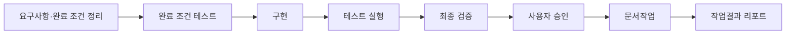
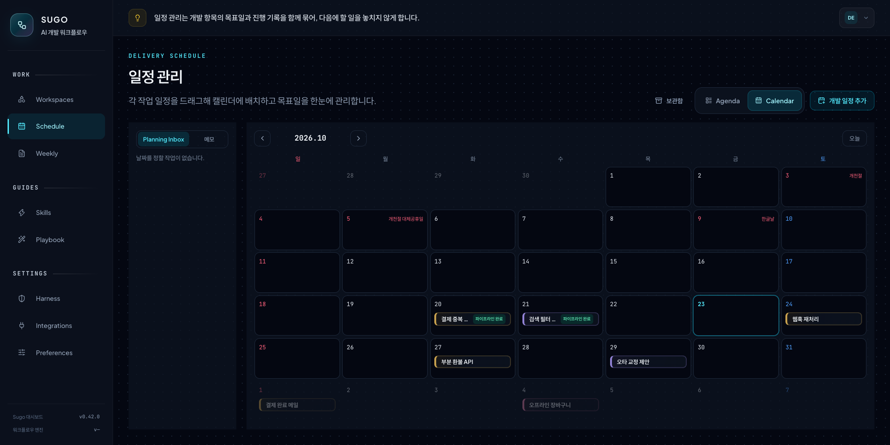
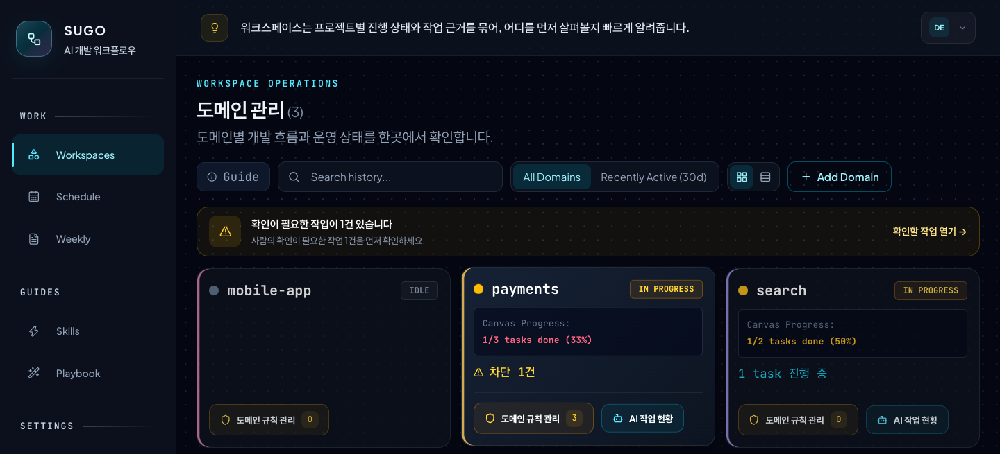
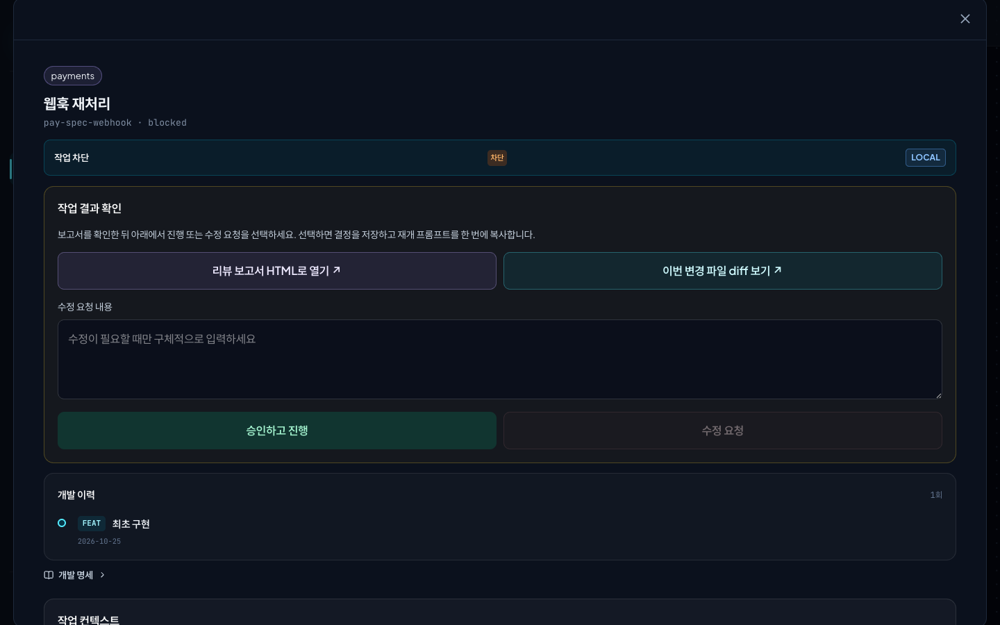
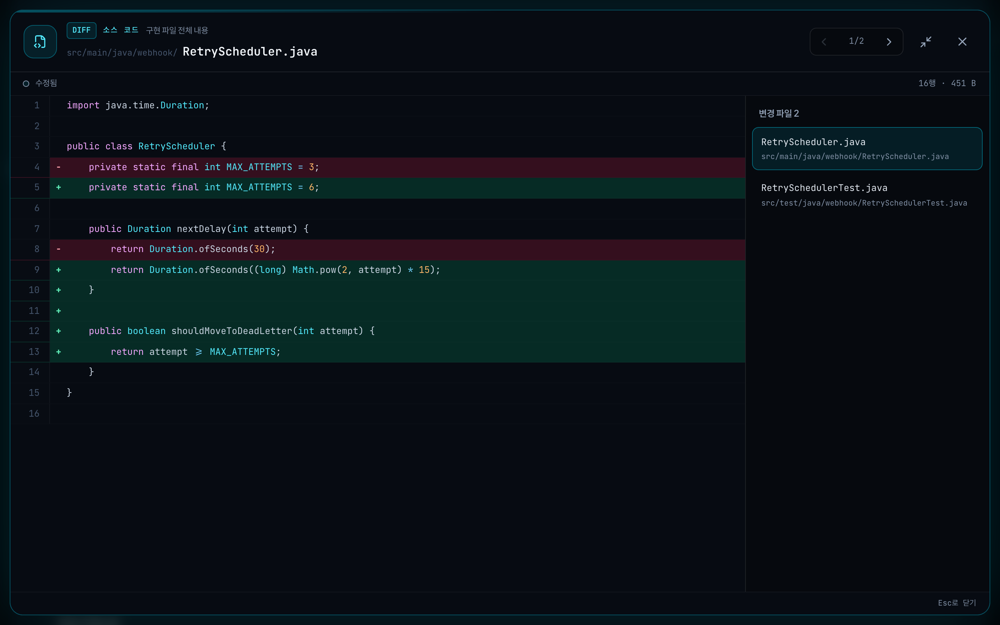

# Sugo

**AI 에이전트의 개발 작업을 실행 근거로 검증하는 Claude Code 플러그인**

[English](README.en.md)

Sugo는 기능 하나를 요구사항·완료 조건 정리 → 구현 → 테스트 → 최종 검증 → 사용자 승인 → 문서작업 → 작업결과 리포트 순서로 진행한다. 각 단계는 실제 테스트 실행 기록과 변경 파일을 확인한 뒤에 다음 단계로 넘어간다. 최종 승인은 사람이 diff를 보고 한다.


## 해결하는 문제

| 문제 | Sugo의 처리 |
| --- | --- |
| 테스트 없이 완료를 보고한다 | 테스트 실행 기록이 없으면 다음 단계로 넘기지 않는다 |
| 요청 범위 밖의 파일을 고친다 | 단계별 수정 범위를 제한한다. 테스트 에이전트는 테스트 파일만, 문서작업 에이전트는 문서만 고친다 |
| 요약만 보고 승인한다 | 요구사항별 충족 상태, 테스트 결과, 남은 위험, diff를 한 화면에서 보고 승인한다 |
| 세션이 끝나면 판단 근거가 사라진다 | 스펙, 설계 판단, 작업 결과, 후속 patch를 하나의 이력으로 연결한다 |
| Claude와 Codex가 다른 규칙으로 작업한다 | 두 에이전트가 같은 규칙 파일을 읽는다 |
| 같은 실수를 반복한다 | Console의 도메인 규칙에 등록한 내용을 다음 세션부터 모든 에이전트가 지킨다 |

## 적합한 사용

| 목적 | 기능 |
| --- | --- |
| 근거가 있는 기능 개발 | `/sugo:feat` |
| 팀 코딩 규칙과 재발 방지 규칙 적용 | 하네스(프로젝트 코딩 규칙 묶음), Console 도메인 규칙, `/sugo:checkpoint-sync` |
| 기획 초안을 구현 가능한 스펙으로 작성하고 일정 관리 | Console Schedule, `/sugo:spec-writer` |
| 완료된 기능의 후속 수정을 원래 작업에 연결 | `/sugo:patch` |
| 일반 대화로 수정한 내용을 기존 작업에 연결 | `/sugo:patch-attach` |
| 작업 결과와 학습 내용 회고 | Console Home 학습 노트, Console Weekly 주간 보고서 |

한 줄 수정과 실험 코드에는 맞지 않는다. 일반 대화로 처리하고, 남길 변경만 `/sugo:patch-attach`로 연결한다.

## 시작

### 요구 사항

- Claude Code 또는 Codex 앱
- Git
- Node.js 22.5 이상. Console이 `node:sqlite`를 사용한다. 버전이 낮으면 Console만 시작하지 않는다.
- Python 3.12 이상. Weekly 주간 보고서를 만들 때만 필요하다.

### 설치

```bash
claude plugin marketplace add kim-svadoz/sugo
claude plugin install sugo@sugo-marketplace
```

Claude Code에서 `/reload-plugins` 실행 후 `/sugo:version`으로 확인한다. 빌드와 `npm install`은 필요 없다.

- 업데이트: `claude plugin update sugo@sugo-marketplace` 후 `/reload-plugins`. Console이 꺼져 있으면 `/sugo:console start`.
- Codex 앱: 플러그인 마켓플레이스에 `https://github.com/kim-svadoz/sugo.git`을 추가하고 `sugo`를 켠다. `/sugo:...` 명령은 Codex 스킬로 제공된다.

### 첫 기능 만들기

경로는 절대 경로로 쓴다.

```text
/sugo:ws-add payments
/sugo:add /path/to/payment-api payments
/sugo:feat --project /path/to/payment-api 로그인 실패 5회 시 계정 10분 잠금
```

| 명령 | 동작 |
| --- | --- |
| `/sugo:ws-add` | Workspace(도메인)를 만든다. 도메인은 같은 업무 영역의 프로젝트 묶음이다. 예: `payments` 도메인에 결제 API, 정산 배치, 관리자 화면. 도메인 규칙, 일정, 작업 이력은 도메인 단위로 관리한다. |
| `/sugo:add` | 프로젝트를 도메인에 등록한다. 언어·프레임워크·빌드 도구를 감지해 하네스를 설치한다. |
| `/sugo:feat` | 기능 하나를 아래 흐름으로 진행한다. |



1. 요구사항·완료 조건 정리: 요청을 PRD로 만들고 요구사항마다 완료 조건을 정한다. 범위 밖 작업은 여기서 제외한다.
2. 완료 조건 테스트: 필요하면 완료 조건을 계약 테스트로 먼저 만들고 실패를 확인한다. 바뀌면 안 되는 기존 동작은 기준선으로 고정한다.
3. 구현·테스트 실행: `code-agent`가 구현하고 `test-agent`가 테스트를 실행해 결과를 기록한다.
4. 최종 검증: `review-agent`(읽기 전용)가 규칙 위반과 보안을 검사하고 검증 자료를 만든다.
5. 사용자 승인: 사람이 Console에서 검증 자료와 diff를 보고 요구사항별로 승인한다.
6. 문서작업: `docs-agent`가 변경에 맞춰 프로젝트 문서를 고친다.
7. 작업결과 리포트: 변경 요약, 설계 판단, 남은 위험, 테스트 증거를 `work-result.md`로 남긴다. 다음 patch와 Weekly 보고서가 이 이력을 쓴다. `feature/*` 브랜치에서는 TODO-SPEC에 완료·남은 일을 갱신하고, 커밋 전에 이를 확인한다.

단계가 멈추면 부족한 조건과 해결 방법을 반환한다. 정책·범위처럼 사람이 정할 질문은 Console에서 답하면 같은 세션에서 이어진다.

완료는 push가 아니다. `git commit`과 `git push`는 사용자가 실행한다.

## 사용 방법

기능마다 PRD, 테스트 기록, 검증 자료, 작업결과 리포트가 생긴다. 시작은 명령으로 하고, 확인과 판단은 Console(`http://localhost:3001`)에서 한다.

| 작업 | Console | 명령 |
| --- | --- | --- |
| 일정·스펙 준비 | Schedule에 개발 일정을 만들고 기획 문서 링크와 화면 캡처를 붙인다 | 일정 카드에서 복사한 `/sugo:spec-writer`, `/sugo:feat --spec` |
| 진행 확인 | Home 작업 흐름: 지금 진행 중인 단계. Workspaces 작업장: 작업별 진행 단계와 완료 기록 | `/sugo:ws-status` |
| 사람의 결정 | 정책·범위 질문과 승인 요청이 Home과 Schedule에 표시된다 | — |
| 승인 | Agent Canvas에서 요구사항 충족 상태, 테스트 결과, 남은 위험, diff를 확인한다 | — |
| 재발 방지 | Workspaces 도메인 규칙에 등록한다 | `/sugo:checkpoint-sync`로 `.claude/rules/`에 반영 |
| 후속 수정 | 완료 작업의 이력을 확인한다 | `/sugo:patch` |
| 주간 회고 | Weekly에서 주간 보고서와 기술 학습 노트를 본다. 생성 일정은 Preferences에서 정한다 | `/sugo:weekly`로 바로 생성 |

`/sugo:feat` 하나에 동작 변경 하나를 담는다. PRD가 크면 하위 작업으로 나눠 진행한 뒤 통합한다.

**일정·스펙 준비** · 개발 일정을 마감일에 배치한다



**도메인과 도메인 규칙** · 같은 업무 영역의 프로젝트를 한 도메인으로 묶고, 도메인 규칙으로 같은 맥락과 규약을 유지한다




- 도메인 카드에 진행 상태, 차단 건수, 도메인 규칙 수가 나온다.
- 도메인 규칙은 도메인 전체 또는 특정 프로젝트에 적용한다. 규칙마다 생긴 이유와 확인 항목을 적는다.
- `/sugo:checkpoint-sync`가 규칙을 각 프로젝트의 `.claude/rules/<분류>/`에 쓴다. Claude Code와 Codex는 작업 전에 이 규칙을 읽는다. 같은 도메인의 다음 작업은 같은 규약에서 시작한다.

**진행 확인** · 도메인의 작업장에서 선택한 작업의 진행 단계와 완료 기록을 본다. 아래 Inspector에 도메인에 등록한 프로젝트가 나온다


**사용자 승인** · 검증 결과와 변경 파일 diff를 보고 승인하거나 수정을 요청한다

<p>
  
  
</p>

## 설치 시 변경 사항

훅은 Sugo에 등록하지 않은 프로젝트를 포함해 Claude Code의 모든 프로젝트에서 동작한다.

| 시점 | 훅 | 동작 |
| --- | --- | --- |
| 세션 시작 | `dashboard-start` | 로컬 Console을 백그라운드로 시작 |
| 세션 시작 | `agent-tools` | `agents.extraTools` 설정을 Sugo 에이전트에 반영 |
| Bash 실행 전 | `aws-readonly-guard` | 쓰기·비밀값 조회·예산 초과 AWS CLI 호출 차단 |
| Bash 실행 전 | `commit-body` | Claude가 본문 없이 커밋하면 목적을 쓰게 한다. Weekly가 커밋 본문에서 작업 목적을 읽는다. `WEEKLY_COMMIT_BODY=off`로 끈다 |
| Write·Edit 실행 전 | `scope-guard` | test-agent와 docs-agent의 수정 범위 제한 |
| Edit 실행 후 | `lint-hint` | 등록 프로젝트의 lint 실패를 Claude에 전달. 편집은 막지 않음 |
| MCP 호출 후 | `mcp-presentation` | `presentation.mcpServers`에 지정한 서버에만 적용. 기본 꺼짐 |

- 로컬 Console이 `http://localhost:3001`에서 시작한다. `127.0.0.1` 접속만 받는다. 끄려면 `~/.claude/sugo/settings.json`에 `"dashboard": {"enabled": false}`.
- 등록 프로젝트에 `sugo/`, `.claude/rules/`, `AGENTS.md`·`CLAUDE.md`의 Sugo 관리 블록을 쓴다. 사용자 작성 내용은 유지한다.
- 네트워크: 사용 통계를 보내지 않는다. Console은 Home 피드용 공개 기술 블로그 RSS, 웹 폰트 CDN, 날씨 지역 설정 시 Open-Meteo를 호출한다.
- Weekly: Console이 Preferences의 일정에 맞춰 주간 보고서를 만든다. 한 번 생성할 때 `claude -p`를 2회 호출한다. 데이터는 `~/.weekly/`에 둔다.

## 명령

| 명령 | 용도 |
| --- | --- |
| `/sugo:feat` | 기능 하나를 파이프라인으로 진행 |
| `/sugo:patch` | 완료 작업의 `work-result.md`에서 후속 수정 시작 |
| `/sugo:patch-attach` | 일반 대화의 변경을 기존 작업의 patch로 검증·연결 |
| `/sugo:add`, `/sugo:ws-add` | 프로젝트 등록, Workspace(도메인) 생성 |
| `/sugo:status`, `/sugo:ws-list`, `/sugo:ws-status` | 진행 상태와 재개 위치 확인 |
| `/sugo:overview` | 프로젝트 구조 분석(AST) |
| `/sugo:spec-writer` | Schedule 초안으로 `spec.md` 작성 |
| `/sugo:validate` | 프로젝트 규칙 위반 검사 |
| `/sugo:checkpoint-sync` | Console 도메인 규칙을 `.claude/rules/`로 가져오기 |
| `/sugo:console` | 로컬 Console `status`, `start`, `restart`, `stop` |
| `/sugo:weekly` | 주간 보고서와 기술 학습 노트를 지금 생성 |
| `/sugo:version` | 설치 버전 확인 |
| `/sugo:uninstall`, `/sugo:restore`, `/sugo:purge`, `/sugo:fresh-start` | 제거, 복구, 삭제 |

인자는 [`sugo/commands/`](sugo/commands/)에 정의되어 있다.

## Console

`http://localhost:3001`. 새 Claude Code 세션마다 자동으로 시작한다.

| 화면 | 내용 |
| --- | --- |
| Home | 작업 흐름, 오늘 이어갈 작업과 승인 요청, 최근 완료 작업과 학습 노트, 기술 블로그 피드 |
| Workspaces | 도메인별 프로젝트·도메인 규칙·작업 이력, 작업별 진행 단계, Agent Canvas(작업 그래프, patch 이력, 승인 근거, diff) |
| Schedule | 스펙 일정, 기획 링크와 메모, 배포 상태 |
| Weekly | 주간 보고서와 기술 학습 노트 |
| Skills, Playbook | 에이전트·명령·스킬 목록, 사용 시나리오 |
| Harness | 프로젝트에 적용되는 코딩 규칙 |
| Integrations | Git 서비스, AWS, Pinpoint 연결, 플러그인 API 토큰 |
| Preferences | 표시 이름, 날씨 지역, Weekly 생성 일정(요일·시각, Claude 모델, 추가 저장소, 예약 실행 토큰) |

Home 작업 흐름은 SPEC 작성부터 커밋 출고까지의 단계를 한 줄로 표시한다. 활동 이벤트가 들어오면 현재 단계가 선택되고, 오른쪽에 그 단계가 하는 일과 남기는 결과가 나온다. 아래 카드는 하네스, 도메인, Weekly 화면으로 이동한다.

Workspaces 작업장은 도메인에서 진행 중인 작업을 작업별 레인으로 나눠 표시한다. 레인을 고르면 아래 최근 작업 요약이 그 작업의 완료 기록으로 바뀐다.

Console 데이터는 `~/.claude/sugo/dashboard/`에 저장되고 업데이트 후에도 유지된다. Console이 꺼져 있어도 파이프라인은 진행하고 동기화는 나중에 전송한다.

## 설정

개인 설정은 `~/.claude/sugo/settings.json`의 선택 키로 지정한다. 키가 없으면 해당 기능은 꺼진다.

| 키 | 동작 |
| --- | --- |
| `dashboard` | Console 연결(`enabled`, `apiUrl`, `userId`, `apiToken`). 로컬 Console은 자동 설정 |
| `agents.extraTools` | Sugo 에이전트에 추가할 외부 MCP 도구. 예: `["mcp__team-knowledge__search"]` |
| `aws.environments` | 환경 이름(예: `dev`)과 Console에 등록한 AWS 계정 이름의 연결 |
| `presentation.mcpServers` | 결과를 STE 원칙 기반 한국어로 설명할 MCP 서버 |

연동은 선택 사항이다.

- Git 서비스(GitHub, GitLab, Bitbucket Server, CodeCommit): PR 맥락에 사용.
- AWS: 로컬 AWS CLI profile을 사용하고 리소스 메타데이터만 저장. 직접 조회 예산 기본값은 세션 30회, 하루 200회, 분당 10회. Integrations에서 직접 조회를 끄면 에이전트의 AWS CLI 호출을 모두 차단.

## 제거와 데이터

삭제를 요청하기 전까지 데이터는 남는다.

| 명령 | 프로젝트 | Sugo 데이터 |
| --- | --- | --- |
| `/sugo:uninstall` | Sugo 블록·규칙·훅 제거. 사용자 내용 유지 | `~/.sugo/data`에 보관. 재설치 시 자동 복구 안 함 |
| `/sugo:restore` | 보관된 연결 복구 | 재사용 |
| `/sugo:fresh-start` | — | 보관 데이터 삭제 후 새로 등록 |
| `/sugo:purge` | Sugo 블록·규칙·훅 제거 | 전부 삭제 |

플러그인 캐시를 먼저 지운 경우 `node ~/.sugo/bin/sugo-uninstall.mjs uninstall`(또는 `purge`)을 실행한다.

| 위치 | 내용 |
| --- | --- |
| `<project>/sugo/` | 적용 규칙, 설정, 기능별 PRD와 작업결과 리포트 |
| `<project>/.claude/rules/` | 하네스 코딩 규칙, Console 도메인 규칙 |
| `~/.claude/sugo/` | 등록 정보, 세션, Workspace, 스펙, 설정, Console 데이터 |
| `~/.sugo/` | 보관 데이터, 독립 제거기 |
| `~/.weekly/` | Weekly 설정, 주간 보고서, 예약 실행 토큰. 제거 명령은 지우지 않는다 |

## 지원 스택

Java, JavaScript, TypeScript, Python · Spring, Node, Express, React, Next.js · Gradle, Maven, npm, pnpm, Yarn, pip, Poetry. 그 외 스택은 기본 규칙을 사용한다. 규칙 원문: [`sugo/harness-library/`](sugo/harness-library/).

## 문제 해결

| 증상 | 조치 |
| --- | --- |
| `localhost:3001` 응답 없음 | `/sugo:console status` 후 `/sugo:console start` |
| 업데이트 후 동작이 이전과 같음 | `/reload-plugins` 후 `/sugo:version` 확인 |
| 완료 작업이 Console에 없음 | 에이전트에게 `sugo_status`를 `health: true`로 호출하게 해 연결·전송 오류 확인 |
| 재설치 후 이전 작업이 없음 | 정상 동작. `/sugo:restore`로 복구하거나 `/sugo:fresh-start`로 새로 시작 |

## 참고

- [변경 기록](CHANGELOG.md)
- [기여 안내](CONTRIBUTING.md)
- [MIT 라이선스](LICENSE)
