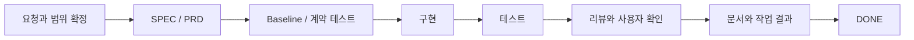
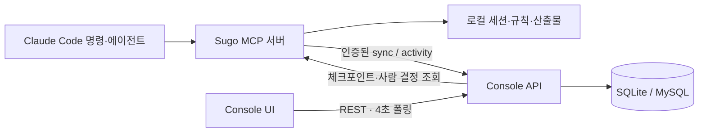

# Sugo

**AI 개발을 반복 가능한 제품 흐름으로 만드는 증거 기반 개발 파이프라인과 운영 콘솔.**

Sugo는 Claude Code와 Codex가 같은 프로젝트 규칙을 읽게 하고, SPEC부터 구현·테스트·리뷰·문서화까지의 순서를 게이트로 관리합니다. “완료했다”는 응답 대신 저장된 실행 증거를 확인하며, 사람이 승인하기 전 작업 요약·REQ·검증 결과·실제 diff를 먼저 제공합니다. 설치와 제거의 경계도 관리해 다른 사용자의 빈 환경에서 시작해도 같은 구조와 동작을 재현합니다.

이 저장소에는 독립적으로 버전을 관리하는 두 제품이 있습니다.

| 제품 | 역할 | 구현·버전 |
| --- | --- | --- |
| **Sugo Plugin** | Claude Code 명령·에이전트·훅과 MCP 서버. 프로젝트 등록, 개발 파이프라인, 실행 증거·작업 관리 | [sugo/](sugo/) · [package.json](sugo/package.json) |
| **Sugo Console** | Workspace, Schedule, Agent Canvas와 연동 설정을 제공하는 웹 대시보드 | [dashboard/](dashboard/) · [frontend](dashboard/frontend/package.json) / [backend](dashboard/backend/package.json) |

**플러그인의 로컬 개발 파이프라인은 Console이나 DB 없이 사용할 수 있습니다.** Console을 연결하면 작업 상태와 이력을 동기화하고, 일정·스펙·사람의 결정을 같은 화면에서 관리합니다.

## 목차

- [무엇을 할 수 있나요?](#무엇을-할-수-있나요)
- [설치와 첫 작업](#설치와-첫-작업)
- [제품 수명주기](#제품-수명주기)
- [작업이 진행되는 방식](#작업이-진행되는-방식)
- [Console 실행](#console-실행)
- [플러그인과 Console 연결](#플러그인과-console-연결)
- [외부 서비스 연동](#외부-서비스-연동)
- [데이터와 동기화](#데이터와-동기화)
- [MCP 도구](#mcp-도구)
- [개발과 검증](#개발과-검증)
- [문제 해결](#문제-해결)
- [현재 범위와 참고 문서](#현재-범위와-참고-문서)

## 무엇을 할 수 있나요?

- **Claude와 Codex에 같은 규칙 적용** — 언어·프레임워크·빌드 도구를 감지해 하네스를 합성합니다. `AGENTS.md`를 공통 정책 연결점으로 사용하고, Claude는 `CLAUDE.md`의 import를 통해 같은 `.claude/rules/**`를 읽습니다.
- **단계를 지키는 개발** — PRD, baseline, 계약 테스트, 구현, 테스트, 리뷰, 문서화의 전제조건을 검사합니다. 테스트를 통과했다는 응답은 저장된 실행 증거와 대조합니다.
- **스펙에서 후속 수정까지 추적** — Schedule의 SPEC 초안과 기획 화면을 `spec.md`로 정리하고, feat와 patch의 PRD·work-result·요구사항·계보를 연결합니다.
- **승인 전에 근거 검토** — `review_done` 전에 작업 요약, 요구사항 충족 상태, 테스트·런타임 증거, 설계 결정, 남은 위험과 실제 코드 diff를 Console에서 확인합니다.
- **막힌 이유와 다음 행동 확인** — 온톨로지 모델에서 허용 액션을 파생합니다. 세션 조회로 현재 상태, 부족한 증거, 사람의 결정 필요 여부와 다음 행동을 확인합니다.
- **팀의 작업 기억 유지** — Workspace별 Task, 체크포인트, 스펙·ADR, 완료 이력과 로드맵을 관리합니다. **도메인 규칙 관리**의 체크포인트는 프로젝트 규칙으로 내려받아 다음 Claude/Codex 세션에도 적용합니다.
- **깨끗한 설치·제거** — 일반 제거는 Sugo의 영향을 끊고 데이터를 비활성 보관합니다. 명시 복구와 완전 삭제를 분리해 재설치만으로 과거 설정이 되살아나거나 사용자 설정이 오염되지 않게 합니다.
- **구현과 운영 맥락 함께 보기** — AST 기반 코드 탐색, Git 제공자 연동, AWS 리소스·배포 snapshot, Pinpoint 연동을 제공합니다.

하네스에는 Java·JavaScript·TypeScript·Python, Spring·Node·Express·React·Next.js, Gradle·Maven·npm·pnpm·Yarn·pip·Poetry 규칙이 포함되어 있습니다. 실제 적용 항목은 감지 결과에 따라 달라지며, 없는 버전은 기본 하네스로 폴백합니다. 전체 목록은 [harness-library](sugo/harness-library/)에서 확인하세요.

## 설치와 첫 작업

### 준비

- Claude Code와 `node` 실행 환경
- Git
- 소스 개발이나 Console 실행에는 npm과 **Node.js 22.5 이상** 필요 — SQLite 실행에 Node 내장 `node:sqlite`를 사용합니다.

설치·업데이트 명령은 터미널에서, `/sugo:...` 명령은 Claude Code 대화 안에서 실행합니다.

### 플러그인 설치

```bash
claude plugin marketplace add kim-svadoz/sugo
claude plugin install sugo@sugo-marketplace
```

이미 복제한 저장소를 사용하려면 첫 명령의 `kim-svadoz/sugo` 대신 **저장소 루트의 절대 경로**를 지정합니다. 마켓플레이스 정의는 루트의 [`.claude-plugin/marketplace.json`](.claude-plugin/marketplace.json)에 있습니다.

배포 번들 `sugo/dist/index.bundle.mjs`가 저장소에 포함되어 있으므로, 플러그인을 사용하기 위해 별도로 `npm install`하거나 빌드할 필요는 없습니다. 플러그인 등록이 끝나면 Claude Code에서 `/reload-plugins`를 실행하고 `/sugo:version`으로 버전을 확인합니다.

#### 설치하면 모든 프로젝트에 적용되는 훅

플러그인 훅은 Sugo에 등록한 프로젝트만이 아니라 **Claude Code를 여는 모든 프로젝트**에서 동작합니다. 훅은 [`sugo/hooks/hooks.json`](sugo/hooks/hooks.json)에 정의되어 있습니다.

| 시점 | 훅 | 동작 |
| --- | --- | --- |
| 세션 시작 | `dashboard-start` | 번들 Console을 백그라운드로 시작합니다. |
| 세션 시작 | `agent-tools` | `agents.extraTools` 설정을 Sugo 에이전트 정의에 반영합니다. |
| Bash 실행 전 | `aws-readonly-guard` | AWS CLI 직접 호출 중 읽기 정책에 없는 명령, 변경 명령, 비밀값 조회, 호출량 초과를 차단합니다. |
| Write·Edit 실행 전 | `scope-guard` | Sugo의 `test-agent`는 테스트 파일만, `docs-agent`는 문서 파일만 수정하게 제한합니다. 다른 에이전트와 메인 대화에는 영향이 없습니다. |
| Edit 실행 후 | `lint-hint` | Sugo에 등록한 프로젝트에서 lint가 실패하면 실패 요약을 Claude에게 전달합니다. 편집은 막지 않습니다. |
| MCP 도구 실행 후 | `mcp-presentation` | `presentation.mcpServers`에 지정한 서버에만 적용되며, 설정이 없으면 아무 일도 하지 않습니다. |

AWS CLI 직접 호출 제한을 원하지 않으면 Console의 Settings에서 직접 읽기를 끕니다. 훅 전체를 쓰지 않으려면 `/sugo:uninstall`로 플러그인을 제거합니다.

### 프로젝트 등록 → 기능 개발

아래 경로는 작업할 프로젝트의 절대 경로로 바꾸세요. Windows에서는 `C:/dev/my-service`처럼 사용할 수 있습니다.

```text
/sugo:ws-add my-workspace
/sugo:add /absolute/path/to/my-service my-workspace
/sugo:overview /absolute/path/to/my-service
/sugo:feat --project /absolute/path/to/my-service 로그인 실패 횟수 제한 추가
```

등록하면 대상 프로젝트에 `sugo/config.json`, `sugo/CLAUDE.md`, `sugo/harness/`와 `.claude/rules/`가 생성됩니다. 루트 `AGENTS.md`와 `CLAUDE.md`에는 Sugo가 소유한 연결 블록만 멱등 갱신하며, 사용자가 작성한 기존 본문과 규칙은 보존합니다. Codex는 `AGENTS.md`, Claude는 `CLAUDE.md`의 `@AGENTS.md` import를 통해 같은 프로젝트 규칙을 읽습니다.

완료한 작업을 이어 고칠 때는 결과 파일로 진입합니다.

```text
/sugo:patch /absolute/path/to/work-result.md 제한 횟수를 설정으로 변경
```

일반 대화에서 이미 수정한 내용을 뒤늦게 기존 작업에 연결할 때는 `patch-attach`를 사용합니다. 경로를
생략하면 현재 프로젝트의 완료 결과 후보를 보여줍니다. Sugo는 Git 변경 파일을 먼저 보여주고 사용자가
확정한 파일만 연결합니다. 다른 프로젝트의 결과, 기존 Dashboard 계보가 없는 결과, 이미 연결한 동일
변경은 거부합니다.

```text
/sugo:patch-attach
/sugo:patch-attach /absolute/path/to/work-result.md
```

| 자주 쓰는 명령 | 용도 |
| --- | --- |
| `/sugo:status` | 프로젝트 상태 확인. 세부 진단은 MCP `sugo_status`의 `health`·`judgment` 옵션 사용 |
| `/sugo:ws-list`, `/sugo:ws-status` | Workspace 목록·진행상황 확인 |
| `/sugo:spec-writer` | Schedule에서 선택한 SPEC 초안을 문서화하고 같은 카드에 연결 |
| `/sugo:patch-attach` | 일반 대화에서 이미 만든 변경을 선택한 기존 작업의 다음 patch로 검증·연결 |
| `/sugo:validate` | 프로젝트 하네스의 검증 규칙 대조 |
| `/sugo:checkpoint-sync` | Console의 체크포인트를 프로젝트 규칙으로 가져오기 |
| `/sugo:version` | 설치된 플러그인 버전 확인 |
| `/sugo:uninstall` | 프로젝트 영향을 제거하고 로컬 데이터를 비활성 보관한 뒤 플러그인 제거 |
| `/sugo:restore` | 보관된 Sugo 데이터와 프로젝트 연결을 명시적으로 복구 |
| `/sugo:purge` | 프로젝트 영향과 Sugo 보관 데이터를 완전히 삭제 |

각 명령의 인자는 [commands](sugo/commands/)에 정의되어 있습니다. Schedule에서 복사한 spec-writer·feat 명령에는 선택한 Workspace·프로젝트·SPEC 식별자가 들어 있으므로 그대로 사용하면 됩니다.

### 업데이트

```bash
claude plugin update sugo@sugo-marketplace
```

이후 Claude Code에서 `/reload-plugins`를 실행합니다. 플러그인 버전 문자열이 업데이트 신호이므로, 소스만 바뀌고 버전이 그대로인 변경은 설치본에 반영되지 않을 수 있습니다.

## 제품 수명주기

Sugo는 설치 여부와 데이터 보존 여부를 분리합니다. 플러그인 캐시가 지워졌는데 프로젝트 훅만 남거나, 재설치만으로 과거 규칙이 다시 활성화되는 상태를 정상 흐름으로 보지 않습니다.

| 동작 | 프로젝트 영향 | Sugo 데이터 | 다음 설치 |
| --- | --- | --- | --- |
| 설치·등록 | 관리 블록과 규칙을 활성화 | 활성 원장 사용 | 같은 입력은 같은 구조로 합성 |
| `/sugo:uninstall` | Sugo 관리 블록·규칙·훅 제거, 사용자 본문 보존 | `~/.sugo/data`에 비활성 보관 | 자동 복구하지 않음 |
| `/sugo:restore` | 보관 당시 연결을 명시적으로 복구 | 활성 위치로 복원 | 기존 작업을 이어서 사용 |
| `/sugo:purge` | Sugo 영향 제거 | 활성·보관 데이터와 독립 제거기 삭제 | 완전히 새로운 환경으로 시작 |

플러그인 캐시를 먼저 삭제해 명령을 사용할 수 없어도 `~/.sugo/bin/sugo-uninstall.mjs` 독립 제거기가 같은 정리를 수행합니다. 일반 제거는 복구 가능성을 남기고, 완전 삭제는 별도 확인 문자열을 요구합니다. 두 동작 모두 기존 `CLAUDE.md`, `AGENTS.md`, 사용자 `.claude/rules/**`의 Sugo 비소유 영역을 보존합니다.

## 작업이 진행되는 방식



위 그림은 일반적인 작업 흐름입니다. 실제 상태 전이에는 스펙 대조, 큰 작업의 분해·통합, 재검증·취소 등이 있으며, [온톨로지 모델](sugo/src/ontology/model.ts)과 [`sugo_plan`](sugo/src/tools/sugoPlan.ts)이 허용 순서와 조건을 결정합니다.

- **code-agent → test-agent → review-agent → docs-agent**가 역할을 나눕니다. 리뷰 에이전트는 읽기 전용입니다.
- baseline이 필요한 변경, 계약 테스트의 red→green 기록, 실제 분석·검증 호출, 테스트 증거와 변경 파일 지문 등을 단계별로 확인합니다. 적용 조건이 다른 게이트도 있으므로 모든 작업에 같은 검증을 무조건 실행하는 구조는 아닙니다.
- 검증 환경 부재나 우회는 사유를 기록하며 완료등급에 반영됩니다. 게이트가 막히면 반환된 코드와 부족한 조건을 확인합니다.
- 정책·범위처럼 사람만 결정할 수 있는 문제는 질문·선택지·복귀 액션과 함께 Console에 기록합니다. 결정 후에는 같은 세션에서 재개합니다.
- `feature/*` 브랜치에서는 최종 목표를 담는 `TODO-SPEC` 확인·갱신 게이트가 적용됩니다.

review-agent는 최종 완료 전에 `reviewPacket`을 게시합니다. 이 패킷에는 작업 요약, 변경 내용, 테스트, 설계 결정, 남은 위험과 변경 파일이 들어갑니다. Console의 **작업 요약**은 이 근거를 독립 HTML 보고서로 열고, **변경 파일**은 실제 코드와 diff를 파일별로 불러옵니다. 사용자가 REQ의 최종 확인을 완료해야 `review_done`이 통과하며, 그 뒤 최종 `work-result.md`가 확정됩니다. 최신 patch를 취소하면 해당 시도는 계보에 보존하되 원래 Task의 표시는 직전 유효 완료 상태로 돌아갑니다.

**파이프라인의 DONE은 Git push 완료를 뜻하지 않습니다.** `sugo_plan(action:"commit")`은 파이프라인을 완료 상태로 전이하고, `sugo_commit`은 DONE 세션의 커밋 메시지만 생성합니다. 실제 Git 커밋·push는 별도 실행입니다.

Console의 계층은 **Workspace → Spec → Run → Task → REQ**입니다. Run은 실행 묶음, Task는 실제 작업, REQ는 검증할 요구사항입니다. Patch는 기존 Run을 이어 차수별 결과를 남깁니다.

Schedule에서 작성한 최초 SPEC은 특정 개발자 경로가 아니라 실행 사용자 홈 아래의 관리 영역에 저장됩니다.

```text
<HOME>/.claude/sugo/specs/YYYYMMDD/<slug>/vN/spec.md
```

날짜는 사용자의 로컬 시간대를 따릅니다. 같은 SPEC을 다시 작성하면 기존 파일을 덮지 않고 다음 `vN`을 만들며, feat를 시작한 뒤의 구현 산출물은 프로젝트 아래 `<project>/sugo/features/YYYYMMDD/<slug>/`에 기록합니다.

## Console 실행

### 플러그인만 설치한 경우(기본)

플러그인을 설치하면 Console도 함께 설치됩니다. 저장소를 복제하거나 별도 명령을 실행할 필요가 없습니다.

- **세션 시작 때 자동 실행**: 새 세션을 열면 로컬 Console이 백그라운드로 뜨고, 사용자와 플러그인 API 토큰을 만든 뒤 `~/.claude/sugo/settings.json`의 `dashboard` 연결을 켭니다. 첫 실행 때만 주소(`http://localhost:3001`)를 알립니다.
- **한 프로세스, 한 포트**: 빌드된 서버가 UI와 API를 함께 제공합니다. 개발 서버나 `npm ci`가 필요하지 않습니다.
- **데이터 위치**: DB, 세션 비밀, 로그는 `~/.claude/sugo/dashboard/`에 있습니다. 플러그인을 업데이트해도 유지됩니다.
- **이미 떠 있으면 다시 띄우지 않습니다.** 플러그인을 업데이트하면 다음 세션 시작 때 새 버전 서버로 바뀝니다. 같은 포트에 다른 Console(개발용 등)이 응답 중이면 건드리지 않고 그대로 씁니다.
- **끄려면** `settings.json`의 `dashboard.enabled`를 `false`로 둡니다. 그러면 자동 실행하지 않습니다.
- **Node 22.5 이상**이 필요합니다(`node:sqlite`). 낮으면 세션 시작 때 설치를 안내하고, Console 없이 sugo의 나머지 기능은 그대로 동작합니다.
- Console이 꺼져 있거나 오류가 나도 sugo 파이프라인은 멈추지 않습니다.
- `/sugo:uninstall`과 `/sugo:purge`는 서버를 먼저 멈춘 뒤 데이터를 보관하거나 삭제하고, `/sugo:restore`는 데이터를 되살린 뒤 서버를 다시 띄웁니다.

Weekly 탭은 [weekly](https://github.com/kim-svadoz/weekly-ai-report) 플러그인이 만든 주간 보고서를 보여줍니다. weekly가 보고서를 만들 때 플러그인 토큰으로 Console에 올리며(방향은 weekly → Console 한쪽), 보고서는 올린 사용자 본인에게만 보입니다. weekly가 없으면 탭은 비어 있습니다. 이미 만든 주는 `sh ~/.weekly/app/scripts/weekly.sh push --all`로 올립니다.

이 저장소의 개발용 `dashboard/sd.sh`도 같은 API 포트(3001)를 씁니다. `sd`는 플러그인이 띄운 서버를 먼저 멈추고 개발 서버를 띄웁니다. 개발 서버는 `dashboard/backend/local.db`를, 플러그인이 띄운 서버는 `~/.claude/sugo/dashboard/dashboard.db`를 쓰므로 두 데이터는 따로입니다. 기존 `local.db` 데이터를 플러그인 서버로 옮기려면 서버를 멈춘 상태에서 한 번 실행합니다.

```bash
node sugo/scripts/import-legacy-dashboard-db.mjs dashboard/backend/local.db
```

대상 DB가 이미 있으면 덮어쓰지 않고, 원본은 읽기만 합니다.

### 저장소를 복제해 개발용으로 실행

먼저 저장소를 복제합니다. 이미 복제했다면 기존 디렉터리를 사용하세요.

```bash
git clone https://github.com/kim-svadoz/sugo.git
cd sugo
```

### macOS / Linux: 개인용 SQLite 모드

저장소 루트에서 실행합니다.

```bash
# 백그라운드 시작·재시작
bash dashboard/sd.sh

# 포트 확인
bash dashboard/sd.sh ports
```

`sd`라는 전역 명령은 자동 설치되지 않습니다. 별도로 등록하지 않았다면 위처럼 스크립트 경로로 실행하세요. 포그라운드에서 로그를 보려면 `bash dashboard/dev-local.sh`를 사용합니다.

실행기가 의존성 설치, SQLite 초기화, 로컬 로그인과 플러그인용 API 토큰 설정을 처리합니다. 기존 로컬 Workspace 데이터도 동기화합니다.

- UI: **http://localhost:5175**
- 로컬 로그인: **http://localhost:3001/api/auth/local**
- DB: `dashboard/backend/local.db`
- 플러그인 연결 설정: `~/.claude/sugo/settings.json`

이 모드는 `LOCAL_DEV_MODE=1`로 OAuth를 우회하는 개인용 실행입니다. 기본적으로 `tmp-sugo-showcase` 데모 데이터도 준비하며, 데모 없이 포그라운드에서 실행하려면 `SUGO_LOCAL_DEMO=0 bash dashboard/dev-local.sh`를 사용합니다. API와 UI는 loopback에 바인딩됩니다.

### Windows: SQLite + GitHub 로그인

저장소의 PowerShell 실행기 [`dashboard/dev.ps1`](dashboard/dev.ps1)은 GitHub OAuth를 사용하는 개발 모드입니다. 위 Bash 실행기와 달리 개인용 토큰 자동 설정까지 수행하지 않습니다.

`dashboard/backend/.env`를 만들고 **본인의 OAuth App 값과 새 세션 서명키**를 입력합니다.

```dotenv
HOST=127.0.0.1
DB_DRIVER=sqlite
SQLITE_FILE=./local.db
SESSION_SECRET=<새로 생성한 랜덤값>
GITHUB_CLIENT_ID=<본인의 OAuth App Client ID>
GITHUB_CLIENT_SECRET=<본인의 OAuth App Client Secret>
GITHUB_REDIRECT_URI=http://localhost:3001/api/auth/github/callback
```

OAuth App의 callback URL도 위 `GITHUB_REDIRECT_URI`와 맞춥니다. 랜덤값은 `node -e "console.log(require('crypto').randomBytes(32).toString('hex'))"`로 생성할 수 있습니다. `.env`는 커밋하지 않습니다.

저장소 루트의 PowerShell에서 실행합니다.

```powershell
powershell.exe -NoProfile -ExecutionPolicy Bypass -File .\dashboard\dev.ps1
```

API·UI 로그 창이 열리면 **http://localhost:5175**에서 로그인합니다. 플러그인 연결은 아래 [연결 설정](#플러그인과-console-연결)을 따릅니다. `npm run dev`로 백엔드를 직접 실행할 때는 `.env`가 자동 로드되지 않으므로, 실행기나 명시적인 환경변수 주입이 필요합니다.

### MySQL 검증 모드

[`dev-mysql.ps1`](dashboard/dev-mysql.ps1) / [`dev-mysql.sh`](dashboard/dev-mysql.sh)는 실제 MySQL, 데모 시드, 로그인 페이지를 사용하는 로컬 검증용 실행기입니다. 먼저 DB·계정·데이터 디렉터리와 패키지 의존성을 준비해야 합니다.

| 모드 | API | UI |
| --- | --- | --- |
| 일반 로컬 개발 | `3001` | `5175` |
| MySQL / E2E | `4000` | `4173` |

포트 정본은 [`dashboard/ports.env`](dashboard/ports.env)입니다. 포트가 이미 사용 중이면 다른 번호로 자동 이동하지 않습니다.

macOS/Linux는 `MYSQLD_BIN`·`MYSQL_DATADIR`로 설치 위치를 지정할 수 있습니다. **Windows MySQL 실행기의 데이터 디렉터리와 DB 설정은 자기 환경에 맞게 확인·수정한 뒤 실행하세요.** 준비가 끝나면 `dashboard/`에서 해당 스크립트를 실행하고 `http://localhost:4173/dev-login.html`로 접속합니다.

프론트 빌드는 `dist/`를 비웁니다. 개발용 로그인 페이지를 쓰는 이 모드는 반드시 **빌드 → 시드** 순서를 지켜야 합니다.

### 화면 구성

| 화면 | 할 수 있는 일 |
| --- | --- |
| **Workspaces** | 프로젝트 묶음, **도메인 규칙 관리**, AI 작업 현황, Repository·ADR·이력 확인 |
| **Schedule** | SPEC 일정, 기획 이미지·문서 링크, 작업 준비, 배포 상태와 보관함 관리 |
| **Agent Canvas** | Spec/Run/Task/REQ, patch 계보, 승인 근거, 실제 변경 코드와 차단 원인 확인 |
| **Skills / Harness** | 실제 플러그인의 Agent·Command·Skill과 적용 코딩 규칙 열람 |
| **Playbook** | SPEC 설계, 팀 맥락, 작업 통제, 근거 검토, patch 계보와 실배포 추적을 배우는 사용 시나리오 |
| **Weekly** | weekly 플러그인이 올린 주간 보고서(요약·주제·다음 주·막힌 일) |
| **Settings** | Git 제공자, AWS·Pinpoint, 프로젝트 연동, API 토큰과 조회 정책 관리 |

Agent Canvas는 자동 배치되는 읽기 전용 뷰어입니다. Schedule에서 열면 선택한 작업을 확대해 시작하고, Task 선택 시 캔버스와 오른쪽 검사 패널을 70:30으로 배치합니다. 검사 패널은 **개요 · 작업 요약 · 변경 파일**로 나뉩니다. 작업 요약은 승인용 HTML 보고서로 열리며, 변경 파일은 하단 뷰어나 전체 화면에서 파일 목록, 구문 강조, 이전·다음 변경 영역 이동을 제공합니다. 변경 영역 이동은 파일 안의 실제 diff 구간에서 멈추며 처음이나 끝으로 순환하지 않습니다.

노드 드래그나 연결선 생성은 제공하지 않습니다. 지원하는 상태·소속·의존성 변경은 패널·메뉴에서 수행합니다.

## 플러그인과 Console 연결

플러그인의 세션 시작 훅과 Bash 개인용 실행기는 연결을 자동 설정합니다. 별도로 실행한 Console이나 원격 Console에는 로그인 후 **Settings → Plugin API Tokens**에서 플러그인용 토큰을 발급하고, `~/.claude/sugo/settings.json`의 기존 설정에 다음 항목을 병합합니다.

```json
{
  "dashboard": {
    "enabled": true,
    "apiUrl": "http://localhost:3001",
    "userId": "<Console 사용자 ID>",
    "apiToken": "<발급한 Plugin API Token>"
  }
}
```

Windows의 `~`는 사용자 홈 디렉터리입니다. `apiUrl`은 **UI 주소가 아니라 백엔드 API의 base URL**이며, `/api`는 덧붙이지 않습니다. 서버는 데이터 요청의 사용자를 Bearer 토큰으로 확인합니다.

환경변수로도 설정할 수 있습니다. `SUGO_DASHBOARD_API_URL`이 있으면 파일 설정보다 우선하며, 이때 토큰도 환경변수로 함께 전달해야 합니다.

| 변수 | 의미 |
| --- | --- |
| `SUGO_DASHBOARD_API_URL` | Console 백엔드 base URL |
| `SUGO_DASHBOARD_USER_ID` | 클라이언트 사용자 식별자 |
| `SUGO_DASHBOARD_API_TOKEN` | 플러그인 API 토큰 |

연결 진단은 에이전트에 **`sugo_status`를 `health:true`로 호출**하도록 요청하세요. 진단은 재시도 가능한 큐도 한 번 처리하고 영구 실패·폐기 수와 사유를 보여줍니다. 개인용 로컬 모드에서는 자동 발급하므로 API 토큰 카드가 숨겨집니다.

## 외부 서비스 연동

연동은 선택 사항입니다. 설정·리소스 snapshot이 필요한 기능은 Console과 해당 서비스의 접근 권한이 있어야 동작합니다.

| 연동 | 현재 구현 |
| --- | --- |
| **GitHub / GitLab / Bitbucket Server / AWS CodeCommit** | Settings의 연결 설정, 프로젝트와 제공자 연결, PR 생성·조회 및 Repository 맥락 |
| **AWS Context** | 로컬 AWS CLI profile을 통한 계정 확인, 배포 판정과 CodeCommit·Athena·S3·CodeBuild·CodePipeline·DynamoDB·ElastiCache·OpenSearch·CloudWatch·Lambda·Kinesis·SageMaker·ECS 리소스 snapshot |
| **Pinpoint** | 서버 연결과 application/agent snapshot, 프로젝트 운영 맥락 연결 |

AWS 연결 프로젝트의 SPEC에는 개발 상태와 별도로 **LOCAL / DEV / STG / PRD** 배포 태그가 표시됩니다. 실제 실행 이미지와 작업 커밋을 비교하며 부분 반영과 확인 불가도 구분합니다. 태그를 누르면 환경별 근거를 볼 수 있습니다. [판정 규칙과 업데이트 안내](docs/spec-deployment.md)를 참고하세요.

AWS는 access key를 Console에 복사하는 방식 대신 **Console 백엔드를 실행하는 환경의 AWS CLI profile**을 사용합니다. Settings → AWS Context에서 표시 이름·profile·region을 등록하고 새로고침합니다.

Lambda snapshot은 함수 이름·runtime·handler·상태·수정 시각·메모리·timeout, **환경변수 이름만**, event source mapping 메타데이터를 저장합니다. 환경변수 값은 수집하지 않습니다. Kinesis snapshot은 stream 이름·ARN·상태·mode·생성 시각·open shard 수를 저장합니다.

`sugo_aws_context`의 `environment`는 Settings에 등록한 계정 표시 이름이며, 생략하면 `default`를 읽습니다. 표시 이름과 다른 환경 이름을 쓰려면 `~/.claude/sugo/settings.json`에 `{"aws": {"environments": {"dev": "<표시 이름>"}}}`처럼 별칭을 등록합니다. 화면의 계정 드롭다운을 바꾸는 것과 에이전트의 환경 선택은 별개입니다. 도구는 기본적으로 서비스별 개수만 반환해 토큰 사용을 제한합니다. 식별자가 필요할 때만 `includeResources:true`를 사용하며, 응답은 서비스별 최대 100개 리소스로 제한됩니다.

AWS snapshot 조회와 에이전트의 직접 CLI 조회는 구분됩니다. 직접 조회는 [읽기 정책](sugo/harness-library/aws-readonly-policy.md)의 허용 목록·호출량·시간 범위를 적용하며, 기본 예산은 세션 30회 / 사용자 로컬 날짜 기준 하루 200회 / 분당 10회입니다. Settings에서 직접 읽기를 끄거나 예산을 조절할 수 있습니다.

백엔드의 세션 서명키·Git 토큰 암호화 키·CORS·DB·연동 경로는 [`config.ts`](dashboard/backend/src/config.ts)가 정본입니다. 원격 배포에서는 로컬 인증 우회나 개발용 고정 키를 사용하지 않습니다.

## 데이터와 동기화



| 위치 | 저장 내용 |
| --- | --- |
| `<project>/sugo/` | 적용 하네스·설정, `features/<날짜>/<기능>/prd.md`와 `work-result.md`, patch 산출물 |
| `<project>/.claude/rules/` | 자동 로드할 하네스와 내려받은 체크포인트 규칙 |
| `~/.claude/sugo/registry.json`, `sessions/` | 등록 프로젝트와 파이프라인 세션 |
| `~/.claude/sugo/specs/YYYYMMDD/<slug>/vN/` | Schedule에서 확정한 최초 SPEC의 버전별 원본 |
| `~/.claude/sugo/work/<workspace>/` | Workspace·Task·로드맵·스펙·체크포인트·이력 |
| `~/.claude/sugo/work/sync-retry-queue.json` | 동기화 재시도와 실패 진단 |
| `~/.sugo/data/` | uninstall 뒤 자동 재활성화되지 않는 비활성 보관 데이터 |
| `~/.sugo/bin/sugo-uninstall.mjs` | 플러그인 캐시가 먼저 사라져도 사용할 수 있는 독립 제거기 |
| Console DB | 동기화된 데이터, 수동 상태·순서, 사용자·연동 설정 |

플러그인의 내용 변경과 Console의 수동 편집에는 소유권 경계가 있습니다. 동기화가 사용자의 수동 상태나 배치를 무조건 덮어쓰지 않도록 서버에서 구분합니다. Console 장애 시 로컬 파이프라인은 계속 진행하고 실패한 전송은 큐에 남깁니다.

로드맵은 전체 스냅샷으로 전송합니다. 서버가 누락 노드를 삭제하는 계약이므로, 같은 API에 변경 노드만 보내면 안 됩니다. 이 스냅샷에는 파일 경로·변경 종류 같은 메타데이터만 넣고 큰 코드 본문은 섞지 않습니다. lineage와 Run에는 요약을 남깁니다.

리뷰용 코드 아티팩트는 로드맵과 분리해 파일별 endpoint로 전송합니다. Console은 사용자가 변경 파일을 선택할 때 해당 아티팩트를 지연 조회하므로, 일반 캔버스 조회나 에이전트 프롬프트에 모든 소스가 실리지 않습니다. 텍스트 파일만 대상으로 본문은 파일당 **200KB**, diff는 **400KB**까지 snapshot합니다. `.env`, `.git`, `.aws`, `.ssh`, credential·secret 파일, 개인키·인증서와 `node_modules`는 목록만 남기고 내용은 전송하지 않습니다. 완료된 기존 Task도 다음 Workspace 동기화에서 아티팩트를 보강합니다.

일반 송신 상한은 **1MiB**, Console JSON 수신 상한은 **10MiB**입니다. 크기 초과와 재시도로 해결되지 않는 오류는 영구 실패로 표시하며, 로컬 산출물은 유지됩니다. 상세한 큐 처리·복구·업데이트 계약은 [로드맵 동기화 문서](docs/roadmap-sync-contract.md)를 참고하세요.

## MCP 도구

명령은 사용자 진입점이고, MCP 도구는 에이전트가 호출하는 실행 인터페이스입니다. 정확한 인자·반환값은 [도구 핸들러](sugo/src/tools/)와 [등록 코드](sugo/src/index.ts)에 있습니다.

| 영역 | 도구 |
| --- | --- |
| 프로젝트·하네스 | `sugo_add`, `sugo_update`, `sugo_enable`, `sugo_disable`, `sugo_reset`, `sugo_delete`, `sugo_get_project_context` |
| 코드 탐색·라우팅 | `sugo_overview`, `sugo_explore`, `sugo_route` |
| 파이프라인·검증 | `sugo_plan`, `sugo_chain`, `sugo_analyze`, `sugo_validate`, `sugo_record_test_evidence`, `sugo_record_contract_evidence`, `sugo_check_lethal_trifecta` |
| 작업 관리 | `sugo_workspace`, `sugo_task`, `sugo_roadmap`, `sugo_checkpoint`, `sugo_spec`, `sugo_spec_writer`, `sugo_history` |
| 상태·운영 질의 | `sugo_status`, `sugo_ontology`, `sugo_aws_context`, `sugo_version` |
| 보조·호환 | `sugo_commit` — 메시지 생성, `sugo_setup` — 설정 위치 안내, `sugo_prd` — 폐기 안내 |

`sugo_ontology`는 `explain_state`, `explain_block`, `next_actions`, `trace_artifact`로 실행과 산출물의 관계를 설명합니다. 운영 질의에 `presentation:"ste-inspired-ko"` 또는 `"asd-ste100-en"`을 지정하면 사실 응답은 유지한 채 명확한 기술 설명 규칙을 함께 받습니다. 대화에서 “ASD-STE100으로 설명해줘”라고 요청하면 `technical-explanation` 스킬이 같은 계약을 사용합니다. 한국어는 STE 원칙 기반이며 정식 준수로 표시하지 않고, 영어도 공식 사전·규칙 검사와 전문 검토 전에는 준수 미검증으로 표시합니다. `sugo_prd`는 독립 PRD 생성을 거부하므로 `sugo_plan(action:"prd")`를 사용합니다. 판단품질 리포트는 별도 `sugo_judgment_report`가 아니라 `sugo_status(judgment:true)`에서 제공합니다.

새 Work Result의 한국어 요약·설계 결정·남은 위험은 기본적으로 `ste-inspired-ko`로 작성됩니다. Dashboard는 기존 로컬 History와 Work Result도 원문을 변경하지 않고 같은 문장 단위로 표시합니다. 코드, 경로, 명령, 로그 원문은 변환하지 않습니다.

`~/.claude/sugo/settings.json`의 `presentation.mcpServers`에 MCP 서버 이름을 등록하면(예:
`{"presentation": {"mcpServers": ["team-knowledge"]}}`), 그 서버의 도구를 호출할 때 플러그인 훅이 사용자 출력용
`ste-inspired-ko` 계약을 자동으로 전달합니다. 등록하지 않으면 어떤 MCP에도 적용하지 않습니다.
내부 분석과 MCP 원문은 바꾸지 않습니다. Claude가 그 결과를 사용자에게 설명하거나 요약할 때만 짧은
능동문과 일관된 용어를 사용하며, 식별자·수치·근거·불확실성은 그대로 유지합니다.

### 사용자별 연동 설정 (opt-in)

개인 환경 값은 소스에 넣지 않고 `~/.claude/sugo/settings.json`에서만 받습니다. 키가 없으면 해당 기능은 아무것도 하지 않습니다.

| 키 | 예 | 하는 일 |
| --- | --- | --- |
| `aws.environments` | `{"dev": "my-dev-account"}` | `sugo_aws_context`의 환경 이름을 Dashboard 계정 표시 이름으로 연결 |
| `presentation.mcpServers` | `["team-knowledge"]` | 지정한 MCP 결과를 사용자에게 설명할 때 `ste-inspired-ko` 계약 전달 |
| `agents.extraTools` | `["mcp__team-knowledge__search"]` 또는 `["mcp__team-knowledge__*"]` | code·test·review·docs 에이전트가 쓸 수 있는 외부 MCP 도구 추가 |

`agents.extraTools`는 세션 시작 훅이 설치된 플러그인의 에이전트 정의에 반영합니다. 에이전트 정의는 세션 시작 때 읽히므로 `/reload-plugins` 또는 다음 세션부터 적용됩니다. 상태를 바꾸는 도구까지 열지 않으려면 서버 와일드카드 대신 읽기 도구 이름을 하나씩 적습니다.

## 개발과 검증

### 저장소 구조

```text
.
├── .claude-plugin/marketplace.json   # 마켓플레이스 정의
├── AGENTS.md                        # 공통 개발·검증·릴리스 규칙
├── CLAUDE.md                        # AGENTS.md 참조
├── docs/                            # 설계 불변식, 동기화 계약, 판정 규칙
├── sugo/
│   ├── .claude-plugin/plugin.json   # 플러그인·MCP 등록
│   ├── commands/ · agents/ · skills/
│   ├── hooks/                      # 범위 검사, AWS 읽기 정책, lint · MCP 출력 힌트
│   ├── harness-library/            # 코딩 표준과 validation.yaml
│   ├── src/                        # 도구, 온톨로지, 게이트, 저장·동기화
│   ├── test/                       # 단위·통합·계약 테스트
│   └── dist/index.bundle.mjs        # 배포 번들 — 버전 관리 대상
└── dashboard/
    ├── backend/                    # Express · TypeScript · MySQL/SQLite
    ├── frontend/                   # React 19 · Vite · Tailwind v4 · React Flow
    ├── e2e/                        # HTTP·브라우저 통합 검증
    └── ports.env                   # 로컬/E2E 포트 계약
```

루트 npm workspace는 없습니다. 아래 명령은 각 패키지 디렉터리에서 실행합니다.

| 디렉터리 | 설치 | 검증 |
| --- | --- | --- |
| `sugo/` | `npm ci` | `npm run typecheck`, `npm run build`, `npm test`, `npm run cold-smoke`; 릴리스 정책 검증은 `npm run release-verify` |
| `dashboard/backend/` | `npm ci` | `npm run typecheck`, `npm run build`, `npm test` |
| `dashboard/frontend/` | `npm ci` | `npm run typecheck`, `npm run build`, 아래 Vitest 실행 |
| `dashboard/e2e/` | `npm ci` | [E2E 안내](dashboard/e2e/README.md)의 환경과 시나리오 확인 |

프론트엔드는 현재 `test` 스크립트와 Vitest 직접 의존성이 없습니다. 기존 테스트를 실행하려면 `dashboard/frontend/`에서 테스트 러너를 임시 설치합니다.

```bash
npm install --no-save --package-lock=false vitest@2.1.9
npx vitest run
```

콜드 스모크는 별도 `node_modules`가 없는 배포 형태와 격리된 홈 디렉터리에서 실제 MCP 호출을 검증합니다. `release-verify`는 일반 patch 릴리스에서 core 검증을 실행하고 patch 버전이 10의 배수일 때 full cold smoke까지 실행합니다. 핵심 계약을 바꾼 릴리스는 주기와 무관하게 full 검증으로 설치·등록·온톨로지·제거 대칭성까지 확인합니다. 게이트는 조건을 만족하지 못했을 때 차단되는지부터 테스트하며, SQLite 테스트 통과와 실제 MySQL 검증은 구분합니다.

공통 코드 품질 정책은 [code-quality-policy.md](sugo/harness-library/code-quality-policy.md)에 있습니다. JUnit에서 실제로 실행되는 테스트에는 상황·행위·기대 결과가 드러나는 한글 `@DisplayName`을 사용합니다. 테스트 helper·fixture·setup에는 붙이지 않습니다. Lombok·Jackson 같은 어노테이션도 기존 관례를 복사해 일괄 추가하지 않고, 생성자·직렬화·역직렬화 등 실제 사용 계약으로 필요성이 확인된 것만 유지합니다.

### 변경과 릴리스

작업 전에 [AGENTS.md](AGENTS.md)를 읽으세요. 게이트를 약화시키지 않습니다.

- **Plugin:** `sugo/package.json` 버전이 정본입니다. `npm run build`가 매니페스트·lockfile 버전을 동기화하고 번들을 만듭니다. 번들도 함께 커밋합니다.
- **Console:** frontend/backend 버전을 함께 올리고 각각의 lockfile을 갱신합니다. Console 버전 배지는 프론트 빌드 시 주입됩니다.
- **문서만 변경:** 런타임 동작이 같으면 버전을 올리지 않습니다.
- `git add`와 `git commit`은 별도 단계로 실행합니다. 배포 동작을 바꾼 릴리스는 저장소 규칙에 따라 검증·커밋·push까지 마칩니다.

## 문제 해결

| 증상 | 확인할 것 |
| --- | --- |
| 설치·업데이트 실패 | GitHub 접속과 Git 설정 확인 |
| `sd` 명령을 찾을 수 없음 | 저장소 루트에서 `bash dashboard/sd.sh` 사용. 전역 명령은 별도 등록 필요 |
| UI가 열리지 않거나 포트 점유 오류 | 일반 로컬 UI는 `5175`, E2E UI는 `4173`. `ports.env`와 실행 중인 프로세스 확인 |
| GitHub 로그인 503 | `GITHUB_CLIENT_ID`·`GITHUB_CLIENT_SECRET`, callback URL과 환경변수 로드 방식 확인 |
| 로컬 작업은 DONE인데 Canvas가 갱신되지 않음 | `sugo_status(health:true)`의 연결·큐·영구 실패 사유 확인. API 주소와 토큰 점검 |
| HTTP 413 또는 `ROADMAP_PAYLOAD_TOO_LARGE` | 서버·프록시 제한과 스냅샷 크기 확인. 수정 후 백엔드 재시작 및 현재 Workspace 재동기화 |
| `코드 아티팩트를 불러오지 못했습니다` | Plugin과 Console을 최신 버전으로 맞춘 뒤 `/reload-plugins` 실행. `sugo_status(health:true)`에서 API 연결·재시도 큐를 확인하고 Workspace를 다시 동기화 |
| 특정 파일에 본문·diff가 없음 | 바이너리·크기 제한·민감 경로 차단 여부와 변경 파일 카드의 `unavailableReason` 확인. 원본은 로컬 저장소에서 검토 |
| MySQL 모드에서 빌드 후 로그인이 풀림 | 빌드가 `dev-login.html`을 삭제했는지 확인하고 시드를 다시 실행 |
| 플러그인 캐시를 먼저 삭제해 `/sugo:uninstall`을 쓸 수 없음 | `node ~/.sugo/bin/sugo-uninstall.mjs uninstall` 실행. 완전 삭제는 마지막 인자를 `purge`로 변경 |
| 재설치했는데 보관된 작업이 자동 복구되지 않음 | 정상 동작. 명시적으로 `/sugo:restore`를 실행하거나 `/sugo:purge` 후 새로 시작 |

## 현재 범위와 참고 문서

MCP 서버, Claude Code 플러그인과 로컬 Console 실행 경로가 구현되어 있습니다. AST 탐색도 포함됩니다. 프로젝트 규칙은 Codex와 Claude가 같은 정본을 읽도록 연결하지만, slash command와 Claude Code 훅 자체는 Claude Code 런타임 기능입니다. Codex에서는 같은 MCP 도구·스킬·프로젝트 컨텍스트를 통해 동작합니다. `sugo_setup`은 연동 설정을 저장하지 않으며, 원격 Git 하네스 fetch는 현재 배포 범위에 포함되지 않습니다.

| 문서 | 읽는 목적 |
| --- | --- |
| [설계 불변식](docs/invariants.md) | 문서로 지키는 설계 원칙 |
| [동기화 계약](docs/roadmap-sync-contract.md) | 크기 제한, 실패 처리, 복구와 업데이트 절차 |
| [사람 승인 완료등급](docs/human-completion.md) | 라벨별 승인·취소, 구현 사이클, 로그인 조건과 마이그레이션 |
| [SPEC 배포 판정](docs/spec-deployment.md) | 환경별 배포 태그의 판정 규칙 |

## 라이선스

[MIT License](LICENSE) · Copyright © 2026 김성현
