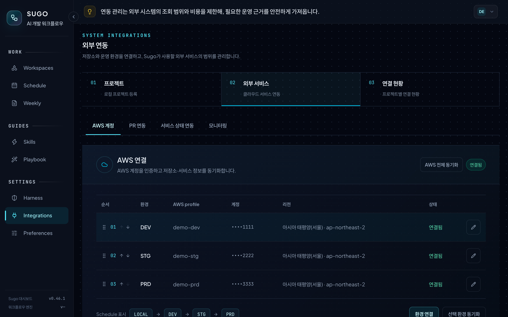

# Console 둘러보기

[English](console.en.md) | [README로 돌아가기](../README.md)

Console은 Sugo가 진행하는 작업을 확인하고 판단하는 로컬 화면입니다. `/sugo:console open`을 실행하거나 작업이 사람의 판단을 기다릴 때 `http://sugo.localhost:3001`에서 뜨고, 3001 포트가 쓰이고 있으면 다음 빈 포트로 뜹니다. 꺼져 있을 때 즐겨찾기로 열면 다시 띄우는 방법을 안내합니다.

## 목차

- [Home](#home)
- [Workspaces](#workspaces)
- [Schedule](#schedule)
- [스펙 카드](#스펙-카드)
- [Weekly](#weekly)
- [Harness](#harness)
- [Integrations](#integrations)
- [Preferences](#preferences)
- [화면 구성 한눈에 보기](#화면-구성-한눈에-보기)

## Home

오늘 이어갈 작업과 확인할 일을 한 화면에 모읍니다.

- **작업 흐름:** SPEC 작성부터 커밋까지의 단계를 한 줄로 보여 줍니다. 사람이 맡는 단계와 AI가 맡는 단계는 색으로 구분합니다. 단계를 고르면 오른쪽에 그 단계가 하는 일과 남기는 결과가 나옵니다.
- **최근 작업 리뷰:** 같은 작업의 FEAT와 PATCH를 묶어, 마지막 완료 결과 기준으로 최근 작업을 보여 줍니다. 결과마다 설계 판단과 배운 점을 정리한 리뷰 노트가 붙습니다.
- **Engineering Feed:** 공개 기술 블로그의 새 글을 모읍니다. 마음에 드는 글은 보관해 둘 수 있습니다.

## Workspaces

도메인마다 무엇이 어디까지 진행됐는지 한 화면에서 봅니다.

- **도메인 카드:** 같은 업무 영역의 프로젝트 묶음입니다. 진행률, 차단된 작업, 도메인 규칙 수를 보여 줍니다.
- **작업장:** 선택한 작업이 작업 지시, 구현, 테스트, 검토, 사용자 확인, 문서, 커밋 중 어디에 있는지 그림으로 보여 줍니다. 사람의 확인이 필요하면 작업자가 물음표를 띄우고 기다립니다. 4일 넘게 기록이 없으면 작업대가 꺼지고 작업자는 휴게 공간에서 쉽니다.
- **최근 작업 요약:** 작업 제목과 완료 결과가 나옵니다. 도메인에 작업이 여러 개면 카드의 화살표로 바꿉니다.
- **Inspector:** 도메인의 프로젝트(Repositories), 완료 이력(History), 선택한 작업의 단계별 기록(Activity)을 봅니다. 프로젝트마다 원격 저장소와 서비스 상태 연동 여부도 표시합니다.

### 도메인 규칙

도메인 규칙은 한 번 겪은 실수를 다음 작업에서 반복하지 않도록 남기는 규칙입니다. 도메인 전체나 특정 프로젝트에 적용하고, 규칙마다 생긴 이유와 확인 항목을 적습니다.

`/sugo:checkpoint-sync`가 규칙을 각 프로젝트의 `.claude/rules/<분류>/`에 씁니다. Claude Code와 Codex는 작업 전에 이 규칙을 읽습니다.

## Schedule

개발 일정을 마감일에 배치합니다. 일정 카드에서 스펙 작성 명령(`/sugo:spec-writer`)과 기능 시작 명령(`/sugo:feat --spec`)을 복사해 바로 시작합니다.

**Agenda**는 지난 일정, 오늘, 다음 7일, 이후 일정, 날짜 미정으로 나눠 보여 주고, 아래에 메모를 둡니다. 끝난 스펙은 작업 종료로 보관함에 넣습니다.

**Calendar**는 같은 일정을 달력에 놓고, 끌어서 날짜를 옮깁니다.

## 스펙 카드

일정 카드를 열면 그 스펙의 지금 상태, 개발 이력, 작업 맥락, 후속 개발이 한 화면에 나옵니다.

### 개발 이력과 후속 개발

최초 구현(FEAT)과 이후의 patch가 하나의 개발 이력으로 이어집니다. 차수마다 무엇을 바꿨는지와 날짜가 남고, 마지막 결과를 기준으로 **새 Patch 시작**이나 **작업 기록 이어붙이기** 명령을 복사합니다.

### 멈춘 이유

작업이 다음 단계로 넘어가지 못하면, 카드 맨 위에 지금 단계와 멈춘 이유, 다음에 할 일이 문장으로 나옵니다.

**테스트가 실패하면 구현으로 돌아갑니다.**

**검토에서 도메인 규칙 위반을 잡습니다.**

### 승인

검토까지 통과한 작업은 사람의 승인을 기다립니다. 리뷰 보고서와 변경 파일 diff를 열어 본 뒤 승인하거나 수정을 요청합니다. 수정 요청을 고르면 결정을 저장하고, 같은 세션에서 이어 갈 재개 프롬프트를 복사합니다.

## Weekly

한 주의 완료 결과와 커밋 본문을 모아 주간 보고서와 기술 학습 노트를 만듭니다. 보고서는 지난주 계획, 주제별 상황과 목적, 막힌 것, 다음 주 계획으로 나뉩니다.

## Harness

프로젝트에 적용되는 코딩 규칙(하네스)을 기술과 버전별로 봅니다. 공통, 프레임워크, 빌드 도구, 언어로 나뉘고, 필요하면 **내 규칙으로 수정**해 씁니다. 저장한 규칙은 다음 동기화부터 그 프로젝트의 검증 기준이 됩니다.

## Integrations

Sugo가 쓸 외부 서비스를 연결하고, 연결 범위를 프로젝트별로 정합니다. 연결은 모두 선택 사항입니다.

**클라우드 서비스 연동:** AWS 계정, PR 연동(Git 서비스), 서비스 상태 연동, 모니터링을 연결합니다. AWS는 로컬 AWS CLI profile을 쓰고 조회만 합니다. 환경 이름과 순서는 Schedule의 배포 상태 표시에도 그대로 쓰입니다.

**프로젝트별 연결 현황:** 도메인별로 프로젝트마다 원격 저장소, PR 연동, 서비스 상태 관리, APM 연결 상태를 봅니다.

## Preferences

표시 이름, 날씨 지역, Weekly 생성 일정을 정합니다. Weekly는 생성 요일과 시각, Claude 모델, 추가로 포함할 저장소, 예약 실행에 쓸 Claude 토큰을 설정합니다.

## 화면 구성 한눈에 보기

| 화면 | 내용 |
| --- | --- |
| Home | 작업 흐름, 오늘 이어갈 작업과 승인 요청, 최근 완료 작업과 학습 노트, 기술 블로그 피드 |
| Workspaces | 도메인 카드, 작업장, 최근 작업 요약, Inspector(Repositories, History, Activity), 도메인 규칙 |
| Schedule | Agenda와 Calendar, 기획 링크와 메모, 배포 상태, 스펙 카드(개발 이력, 멈춘 이유, 승인, 후속 개발) |
| Weekly | 주간 보고서와 기술 학습 노트 |
| Skills, Playbook | 에이전트, 명령, 스킬 목록과 사용 시나리오 |
| Harness | 프로젝트에 적용되는 코딩 규칙 |
| Integrations | 프로젝트 등록, 클라우드 서비스 연동, 프로젝트별 연결 현황 |
| Preferences | 표시 이름, 날씨 지역, Weekly 생성 일정 |

Console 데이터는 `~/.claude/sugo/dashboard/`에 저장되고 업데이트 후에도 남습니다. Console이 꺼져 있어도 파이프라인은 그대로 진행되고, 동기화는 나중에 전송됩니다.
